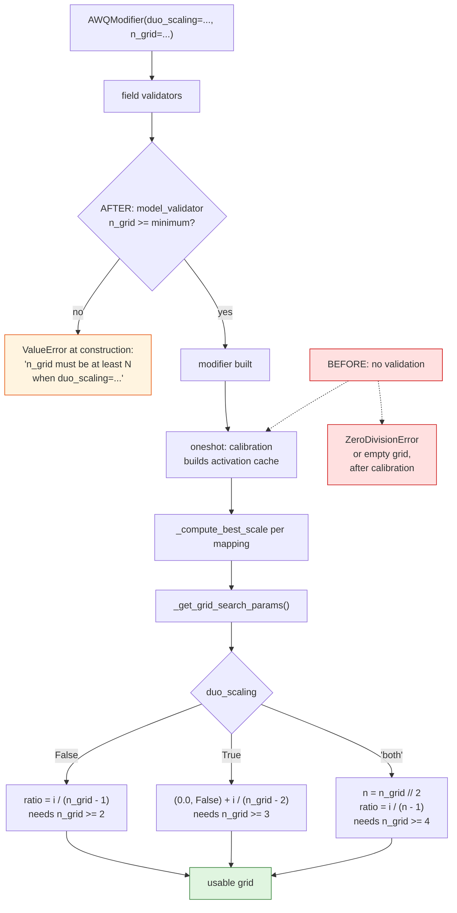
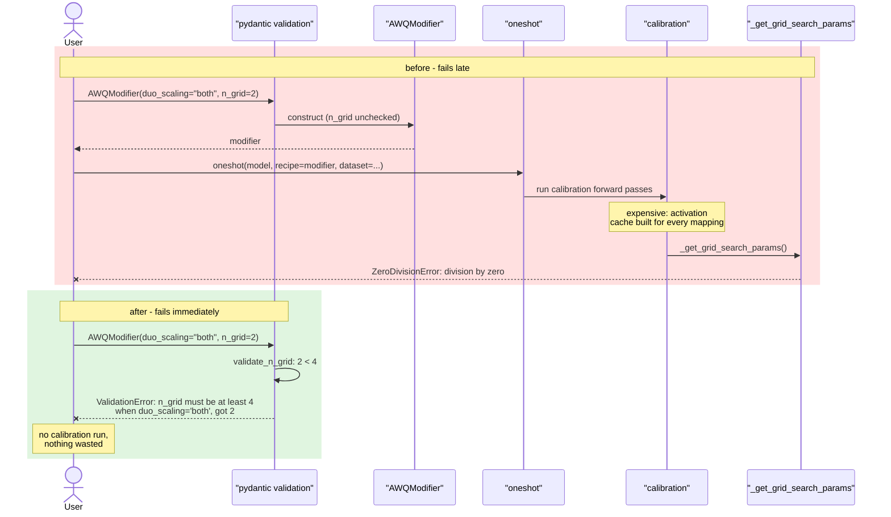

# AWQ: validating `n_grid` against `duo_scaling`

Upstream issue: [vllm-project/llm-compressor#3311](https://github.com/vllm-project/llm-compressor/issues/3311)

## Summary

`AWQModifier.n_grid` was never validated, and the grid spacing divides by a term
that depends on `duo_scaling`. Six combinations were broken — five raised
`ZeroDivisionError` from inside calibration, and one silently produced an empty
grid. Too small an `n_grid` is now rejected when the modifier is built, naming
the minimum for the chosen `duo_scaling`.

## Background

### What the grid search sweeps

AWQ chooses a per-channel scale for each mapping by trying candidate scales and
keeping the one with the lowest output error. Candidates are generated from a
`ratio` in `[0.0, 1.0]`, which acts as an exponent on the mean absolute
activation `x_mean`:

| `duo_scaling` | Candidate scale |
|---|---|
| `False` | `x_mean ** ratio` |
| `True` | `x_mean ** ratio / w_mean ** (1 - ratio)` |

`n_grid` is how many candidates are evaluated per mapping, so it is directly
proportional to AWQ's runtime. The docstring invites lowering it: *"To decrease
the runtime, at the possible cost of slightly worse scales, this can be
decreased."*

### Why the minimum differs per setting

`_get_grid_search_params` spaces the ratios across the interval, and the
denominator is different in each branch:

```python
case "both":                              # half the budget per setting
    n_grid = int(self.n_grid / 2)
    return [(grid_idx / (n_grid - 1), duo_scaling) ...]
case False:
    return [(grid_idx / (self.n_grid - 1), False) ...]
case True:                                # identity point is prepended
    return [(0.0, False)] + [(grid_idx / (self.n_grid - 2), True) ...]
```

- `False` divides by `n_grid - 1`, so it needs `n_grid >= 2`.
- `True` divides by `n_grid - 2`, because the identity point `(0.0, False)` is
  prepended explicitly and the remaining `n_grid - 1` points use the duo
  formula. It needs `n_grid >= 3`.
- `"both"` halves the budget *first* and then divides by `n_grid // 2 - 1`, so
  it needs `n_grid >= 4`.

The identity point exists because with `duo_scaling=True`, `ratio = 0.0` gives
`1 / w_mean` rather than the identity, so a no-op baseline would otherwise be
missing from the search.

## Symptom

```python
for duo in (True, False, "both"):
    for n in (1, 2, 3, 4):
        AWQModifier(duo_scaling=duo, n_grid=n)._get_grid_search_params()
```

```
duo=True  n_grid=1: 1 points                  <- searched identity only
duo=True  n_grid=2: ZeroDivisionError
duo=False n_grid=1: ZeroDivisionError
duo=both  n_grid=1: 0 points                  <- empty grid, no search at all
duo=both  n_grid=2: ZeroDivisionError
duo=both  n_grid=3: ZeroDivisionError
```

The failure surfaced from `_compute_best_scale`, which runs *after* calibration
has built the activation cache. A one-character typo in a recipe therefore
wasted the entire expensive part of the run before failing.

The two non-raising rows are arguably worse than the crashes: `duo_scaling=True,
n_grid=1` searched only identity scaling, and `duo_scaling="both", n_grid=1`
searched nothing at all. Both complete "successfully" having done no search.

## Decision: validate rather than clamp

The issue offered two options — validate `n_grid` up front, or handle the small
cases explicitly (for instance with a single-point grid at ratio `0.0`).
Validation was chosen because:

- It fails at recipe-validation time, which is the specific complaint in the
  issue: the error arrived after the costly work.
- A one- or two-point grid is not a meaningful search. Silently accepting it
  would turn a misconfiguration into a quiet quality regression, which is the
  failure mode of the two non-raising rows above.

The cost is that `duo_scaling=True, n_grid=1` changes from "works" to "rejected".
That value only ever evaluated the identity, so nothing that was doing useful
work stops working.

## Control flow



## Call sequence



## The change

A module-level table records the minimum per setting:

```python
# Smallest `n_grid` that gives `_get_grid_search_params` at least two distinct
# ratios, per `duo_scaling` setting. `duo_scaling="both"` needs twice as many
# because it splits the grid across the two settings.
_MIN_N_GRID: dict[bool | str, int] = {False: 2, True: 3, "both": 4}
```

and a `model_validator(mode="after")` enforces it, since the check depends on
two fields:

```python
@model_validator(mode="after")
def validate_n_grid(self):
    minimum = _MIN_N_GRID.get(self.duo_scaling)
    if minimum is not None and self.n_grid < minimum:
        raise ValueError(
            f"n_grid must be at least {minimum} when "
            f"duo_scaling={self.duo_scaling!r}, got {self.n_grid}. ..."
        )
    return self
```

`mode="after"` means it runs only once field validation has succeeded, so an
invalid `duo_scaling` is still reported by its own field validator rather than
producing a confusing `n_grid` message. `.get` returning `None` is tolerated for
the same reason.

The docstring now states the minimums alongside the existing advice to lower
`n_grid` for speed.

## Behaviour

| `duo_scaling` | `n_grid` | Before | After |
|---|---|---|---|
| `False` | 1 | `ZeroDivisionError` | Rejected: minimum 2 |
| `False` | ≥2 | Works | Unchanged |
| `True` | 1 | 1 point (identity only) | Rejected: minimum 3 |
| `True` | 2 | `ZeroDivisionError` | Rejected: minimum 3 |
| `True` | ≥3 | Works | Unchanged |
| `"both"` | 1 | Empty grid (0 points) | Rejected: minimum 4 |
| `"both"` | 2, 3 | `ZeroDivisionError` | Rejected: minimum 4 |
| `"both"` | ≥4 | Works | Unchanged |

## Testing

`tests/llmcompressor/modifiers/transform/awq/test_base.py`:

- `test_n_grid_too_small_is_rejected` — parametrized over all six broken
  combinations; asserts a `ValidationError` matching `n_grid must be at least`.
- `test_smallest_accepted_n_grid_gives_a_usable_grid` — for the minimum of each
  setting, asserts the grid has at least two *distinct* ratios, all within
  `[0.0, 1.0]`. This is what makes the table above a guarantee rather than three
  hard-coded numbers.

The existing `test_get_grid_search_params` continues to cover the normal values,
and `AWQModifier(n_grid=3)` elsewhere in the suite still passes, since the
default `duo_scaling=True` has a minimum of 3.
