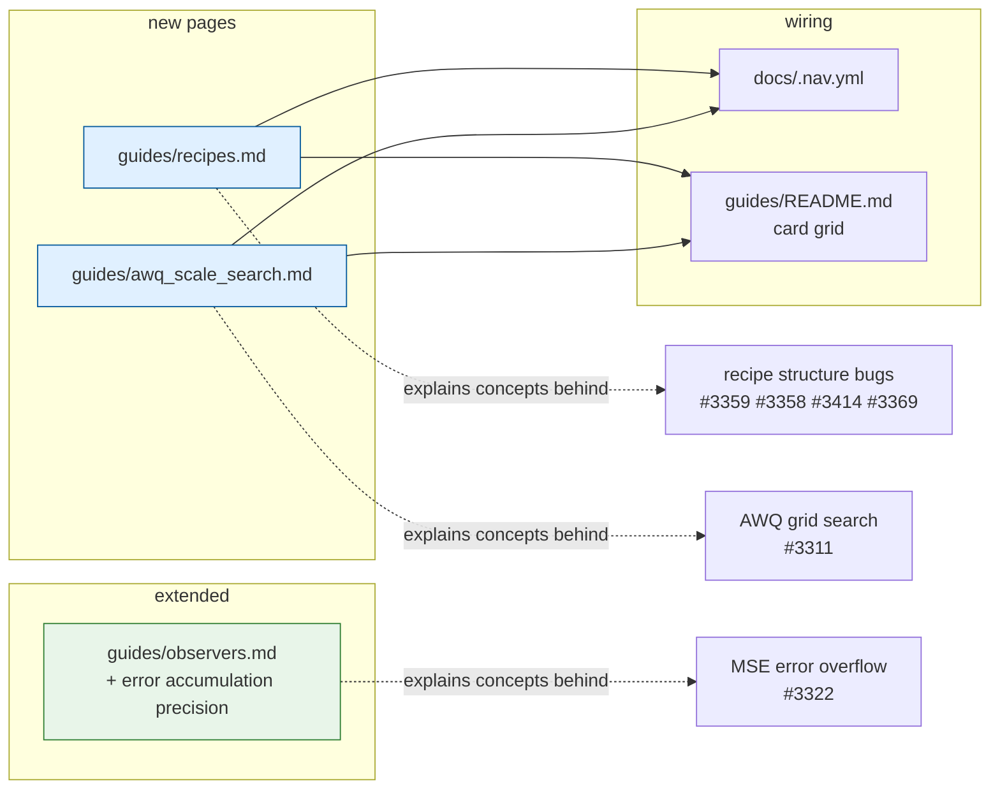
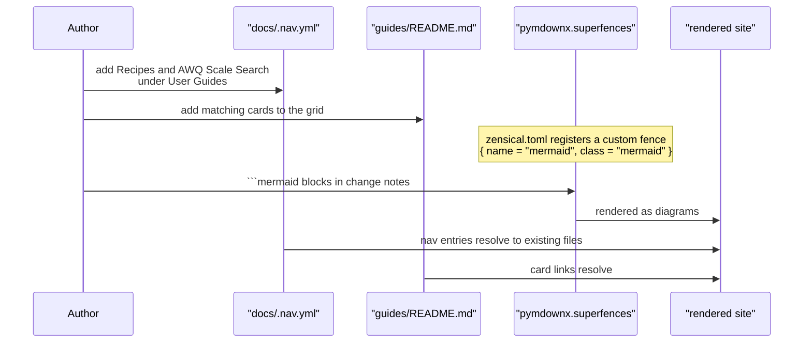

# Concept guides: Recipes and AWQ Scale Search

## Summary

Adds the two concept guides the documentation was missing, and a section on
grid-search error precision. These cover the concepts behind a group of open bug
fixes, so that the reasoning survives in the docs rather than only in commit
messages.

## Background

The user guides covered *schemes* (which format to quantize to), *observers*
(how calibration statistics are gathered) and *entrypoints* (how to invoke a
run). Two conceptual gaps remained.

**The recipe itself was undocumented.** Every entrypoint consumes a recipe, and
every compressed model ships a `recipe.yaml` beside its weights, but nothing
explained the structure. There was no reference for what a stage is, how a
modifier's group is determined, what forms `Recipe.create_instance` accepts, or
what survives a save and reload. Several open bugs were reported against
behaviour that had never been written down — a modifier with no arguments, an
explicit `group`, Python object tags in a saved recipe, and `actorder` not
surviving a round trip.

**`duo_scaling` was used but never explained.** It appears in three key-model
examples with no explanation anywhere in the docs of what it sweeps or why
`"both"` would be preferred.

## What was added



### `guides/recipes.md`

Covers the three-level nesting (stage → modifier group → modifier and its
arguments), how a stage key is recognized and how a group name is derived from
its key, when to set `group` explicitly, modifiers written without arguments,
the five input forms `create_instance` accepts, multi-stage numbering, and a
common-errors table.

The serialization section is the substantive part. It states the four rules that
let a saved recipe be read back:

1. **Only plain YAML** — recipes are read with `yaml.safe_load`, so they are
   written with `yaml.safe_dump` from a JSON-mode dump.
2. **The group is dropped** — it is recovered from the group key.
3. **An unset `None` is dropped; an explicit `None` is kept** — for `actorder`,
   `None` is how activation ordering is switched off.
4. **Unresolved `Sentinel` defaults are omitted** — so they resolve again on
   load instead of looking like a user's choice.

It also explains *why* round-trip fidelity is a correctness property rather than
a nicety: `update_and_save_recipe` reloads an existing `recipe.yaml` to append a
new stage, so an unparseable recipe fails a second pass after calibration has
already run.

### `guides/awq_scale_search.md`

Covers the candidate scale formulas for each `duo_scaling` setting, what `ratio`
interpolates, why `duo_scaling=True` prepends an explicit identity point (at
`ratio = 0.0` the duo formula gives `1 / w_mean`, not the identity), the minimum
`n_grid` each setting needs and where each denominator comes from, and guidance
on choosing values.

### `guides/observers.md`

A new *Error accumulation precision* subsection under the MSE parameters: the
FP32 reduction above one 512-value tile, why the split exists (eager mirrors
Triton's packed kernel below one tile and its FP32 split reductions above), and
why a half-precision sum over a large group is lossy in a silent way — it
saturates to `inf`, nothing is strictly lower than `inf`, so no candidate is
accepted and the observer falls back to plain min/max.

## Documentation build



Mermaid is already configured in `zensical.toml` as a `pymdownx.superfences`
custom fence, so ```` ```mermaid ```` blocks render without further setup.

## Ordering

These guides describe behaviour as it stands **with the companion fixes
merged**:

| Statement | Depends on |
|---|---|
| A modifier written with no arguments is built from its defaults | #3359 |
| An explicit `group` overrides the inferred one | #3358 |
| Minimum `n_grid` is rejected at construction | #3311 |
| MSE error accumulates in FP32 above one tile | #3322 |
| Recipes are written as plain YAML only | #3414 |
| Unset `None` dropped, explicit `None` kept, `Sentinel` defaults omitted | #3369 |

Merging this ahead of those would document intended behaviour before it exists,
so it should land last.

## Verification

- Every internal link in the new and edited pages resolves, and every
  `docs/.nav.yml` guide entry points at a file that exists.
- Every runnable YAML example in `recipes.md` was executed through
  `Recipe.create_instance` with all fixes merged together, and produces the
  modifiers and groups the guide claims: `quant` inferred from the key,
  `custom_group` overriding it, and `smoothquant` inferred when no `group` is
  given.
- Every Mermaid diagram in the change notes on this and the fix branches was
  parsed with Mermaid's own parser rather than eyeballed.
