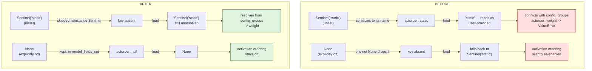
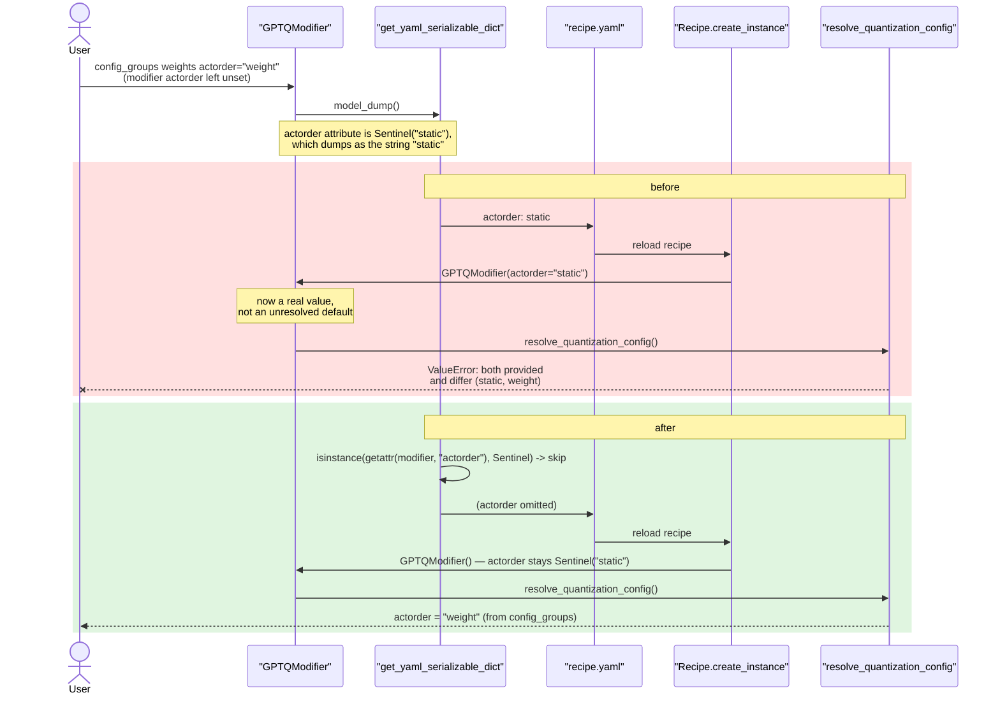

# GPTQ `actorder` through a recipe round trip

Upstream issue: [vllm-project/llm-compressor#3369](https://github.com/vllm-project/llm-compressor/issues/3369)

## Summary

A GPTQ recipe saved to `recipe.yaml` did not reproduce the `actorder` it was
saved with. An explicit `actorder=None` came back as `static`, quietly switching
activation ordering back on; and the `Sentinel("static")` default was written out
as a plain string, which then collided with a differing `actorder` in
`config_groups` and raised on reload. The serializer now keeps an explicitly set
`None` and omits arguments still holding a `Sentinel`.

## Background

### `actorder` can be set in two places

GPTQ activation ordering can be specified on the modifier, or on the weight
`QuantizationArgs` inside `config_groups`. `resolve_quantization_config`
reconciles the two, and raises if both are set and differ:

```
ValueError: Cannot resolve activation ordering when both `GPTQModifier.actorder`
and `QuantizationScheme.actorder` are provided and differ (static, weight).
```

That rule is only sound if "provided" can be distinguished from "defaulted".

### How "not provided" is represented

`GPTQModifier.actorder` is declared as:

```python
actorder: ActivationOrdering | Sentinel | None = Sentinel("static")
```

Three states have to survive serialization, and they mean different things:

| Value | Meaning |
|---|---|
| `Sentinel("static")` | Nobody set it. Resolve from `config_groups`, else default to static. |
| `None` | The user switched activation ordering **off**. This is documented in the observers guide as the way to disable it. |
| `"weight"` / `"static"` | The user chose a mode explicitly. |

A `Sentinel` serializes to its bare name, so `Sentinel("static")` dumps as the
string `"static"` — indistinguishable from a user who deliberately wrote
`static`.

### What the old serializer did

```python
args = {
    k: v
    for k, v in modifier.model_dump().items()
    if v is not None and not k.endswith("_") and k != "group"
}
```

Two behaviours fall out of that single filter, and both are wrong for
`actorder`:

- `if v is not None` drops **every** `None`, conflating "the user set this to
  `None`" with "this happens to be unset".
- Nothing special-cases a `Sentinel`, so an unresolved default is written out as
  though it were a choice.

## Symptom

```python
def reload(modifier):
    return Recipe.create_instance(Recipe.from_modifiers(modifier).yaml()).modifiers[0]

def resolved(modifier):
    return modifier.resolve_quantization_config().config_groups["group_0"].weights.actorder
```

**Case 1 — an explicit `None` becomes `static`.**

```python
mod = GPTQModifier(targets="Linear", scheme="W4A16", ignore=["lm_head"], actorder=None)
resolved(mod)           # None
resolved(reload(mod))   # ActivationOrdering.STATIC
```

Activation ordering was deliberately disabled, and the saved recipe turns it
back on. Nothing warns.

**Case 2 — `actorder` in `config_groups` no longer resolves.**

```python
weights = {"num_bits": 4, "type": "int", "symmetric": True,
           "strategy": "group", "group_size": 128, "actorder": "weight"}
mod = GPTQModifier(ignore=["lm_head"],
                   config_groups={"group_0": {"targets": ["Linear"], "weights": weights}})
resolved(mod)                  # "weight"
reload(mod).actorder           # 'static'  <- the default, now a plain string
resolved(reload(mod))          # ValueError: ...provided and differ (static, weight)
```

The user never set `actorder` on the modifier at all. Saving invented a value
for it, and reloading then reported a conflict with the user's own
`config_groups`.

## State transitions



## Call sequence



## The change

The single-expression filter becomes an explicit loop with two named rules:

```python
dumped = modifier.model_dump()
args = {}
for key, value in dumped.items():
    if key.endswith("_") or key == "group":
        continue

    # An argument still holding a `Sentinel` is an unresolved default.
    # A `Sentinel` serializes to its name, so writing it out (e.g.
    # `actorder: static`) makes a later load read it as a value the
    # user set on the modifier, which then conflicts with an
    # `actorder` coming from `config_groups`. Skip it so the default
    # resolves again on load.
    if isinstance(getattr(modifier, key, None), Sentinel):
        continue

    # An unset argument that happens to be `None` carries no
    # information, but a `None` the user set explicitly does -- for
    # `actorder` it is how activation ordering is turned off -- so it
    # must survive the round trip.
    if value is None and key not in modifier.model_fields_set:
        continue

    args[key] = value
```

Two details matter:

- The `Sentinel` check reads **`getattr(modifier, key)`**, not the dumped
  value. By the time `model_dump()` has run, the `Sentinel` has already been
  serialized to the string `"static"` — the information is only still available
  on the instance.
- `model_fields_set` is pydantic's record of which fields were passed to the
  constructor, which is exactly the "provided versus defaulted" distinction the
  resolver depends on.

`model_dump()` itself is unchanged; only what the recipe serializer chooses to
write changes.

## Scope

This covers points 1 and 2 of the issue. Point 3 is a separate change in
compressed-tensors: `QuantizationArgs` omits `actorder: None` when serialized,
so an explicitly set `None` *inside `config_groups`* still reads as "not set"
after a reload. Its serializer would need to consult `model_fields_set`, as it
already does for `observer` and `zp_dtype`.

## Behaviour

| Modifier state | Written as | Reloads as |
|---|---|---|
| unset (`Sentinel("static")`) | omitted | `Sentinel("static")`, resolves from `config_groups` |
| `actorder=None` | `actorder: null` | `None` — ordering stays off |
| `actorder="weight"` | `actorder: weight` | `"weight"` |

Beyond `actorder`, this also stops every other `Sentinel`-defaulted argument
from being written as a resolved value — for instance AWQ's `offload_device`,
whose `Sentinel("not_provided")` default is now omitted rather than serialized.

## Testing

`tests/llmcompressor/recipe/test_recipe.py`:

- `test_gptq_explicit_actorder_none_survives_round_trip` — asserts the resolved
  `actorder` is `None` both before and after a round trip (case 1).
- `test_gptq_unset_actorder_is_not_serialized` — asserts `actorder` is absent
  from the serialized recipe and that the reloaded modifier still holds a
  `Sentinel`. This pins the mechanism, not just the outcome.
- `test_gptq_config_groups_actorder_survives_round_trip` — asserts a
  `config_groups` `actorder` of `"weight"` still resolves after a reload
  (case 2).

All three fail on `main`.

## Related

- [vllm-project/llm-compressor#3414](https://github.com/vllm-project/llm-compressor/issues/3414)
  — a different round-trip defect in the same function, Python object tags in
  the saved recipe. Both fixes touch `get_yaml_serializable_dict`, so whichever
  lands second needs a one-hunk resolution: the combined version iterates a
  JSON-mode dump *and* applies the two rules above.
