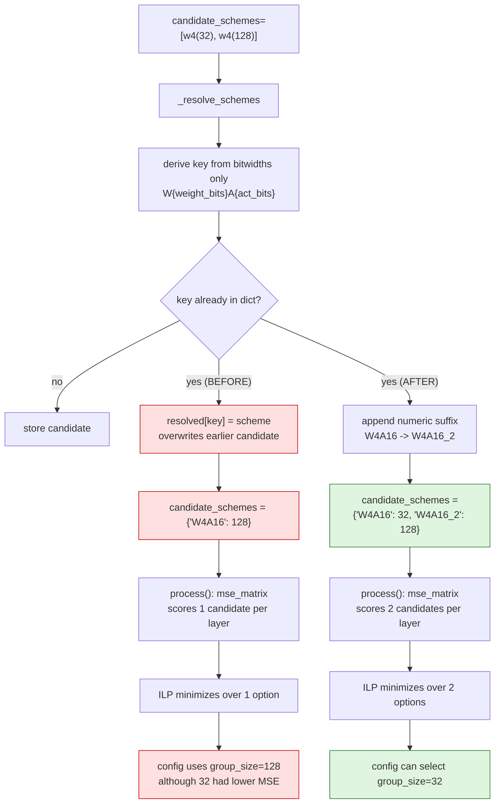
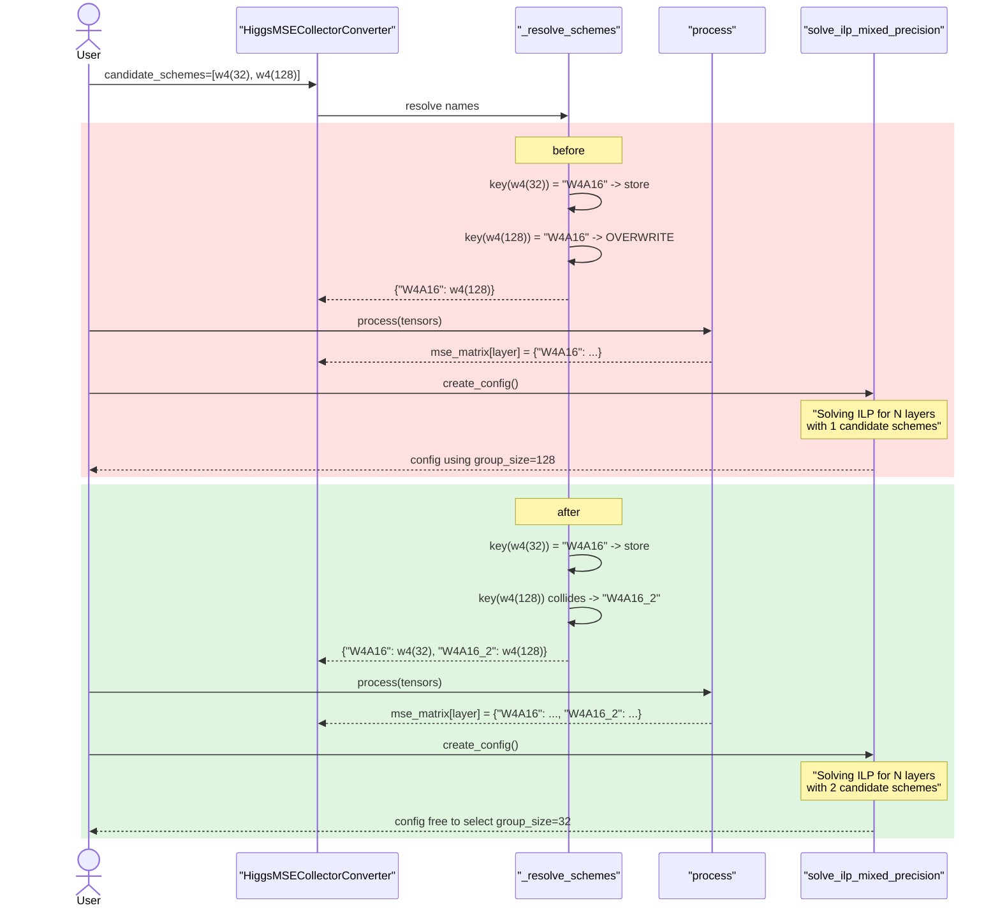

# HIGGS: keeping every candidate scheme

Upstream issue: [vllm-project/llm-compressor#3329](https://github.com/vllm-project/llm-compressor/issues/3329)

## Summary

`HiggsMSECollectorConverter` keyed its candidate schemes by bitwidth alone, so
two candidates that differed only in strategy, group size, type or symmetry
collided and the later one silently replaced the earlier. The ILP then minimized
over a smaller set than the caller offered, and could return a worse scheme than
one that was passed in. Colliding names are now disambiguated instead of
overwritten.

## Background

### What HIGGS does

HIGGS picks a *per-layer* quantization scheme. The caller supplies a list of
candidates, and the converter:

1. computes an MSE for every (layer, candidate) pair — the `mse_matrix`,
2. hands that matrix to an integer linear program,
3. the ILP assigns each layer the candidate that minimizes total error subject
   to an average-bitwidth budget.

The ILP can only ever choose from what reaches the matrix. Anything dropped
before step 1 is invisible to the optimizer — and because the result is still a
valid config, there is no error to notice.

### Why the candidates are a dict

Candidates are stored by name, because the name is the handle used throughout:
as the inner key of `mse_matrix[layer][scheme_name]`, as the ILP's candidate
list, as part of each PuLP decision variable name
(`x_{layer}_{scheme}`), and to map the ILP's solution back to a scheme object.

### Where the names came from

`_resolve_schemes` derived a key per candidate:

```python
if isinstance(scheme, str):
    resolved[scheme] = preset_name_to_scheme(scheme, targets=self.targets)
elif isinstance(scheme, QuantizationScheme):
    if scheme.weights:
        key = f"W{scheme.weights.num_bits}"
        key += f"A{scheme.input_activations.num_bits}" if scheme.input_activations else "A16"
    else:
        key = f"scheme_{len(resolved)}"
    resolved[key] = scheme
```

For a scheme object the key encodes **only bitwidths** — `W4A16`. It does not
encode strategy, group size, quantization type, or symmetry. Those are precisely
the axes along which a user would offer several same-bitwidth candidates and
expect HIGGS to pick between them.

`resolved[key] = scheme` then assigns over any existing entry.

## Symptom

```python
def w4(group_size):
    return QuantizationScheme(targets=["Linear"], weights=QuantizationArgs(
        num_bits=4, type="int", symmetric=True,
        strategy="group", group_size=group_size))

collector = HiggsMSECollectorConverter(candidate_schemes=[w4(32), w4(128)], ignore=[])
{k: v.weights.group_size for k, v in collector.candidate_schemes.items()}
# {'W4A16': 128}        <- the group_size=32 candidate is gone
```

Two shapes of collision, both reasonable things to write:

| Input | Collapses to |
|---|---|
| Two custom W4A16 schemes differing in `group_size` (or sym/asym, int/float) | One candidate |
| The preset `"W4A16"` plus a custom W4A16 scheme | One candidate |

The second is close to the custom-scheme example in the HIGGS README.

The consequence is a quality regression, not a crash. With both candidates
present, the per-layer MSE shows the dropped one was strictly better:

```
model.layers.0.mlp.down_proj  {'W4A16': 0.00890675, 'W4A16_2': 0.01227016}
model.layers.1.mlp.down_proj  {'W4A16': 0.00913742, 'W4A16_2': 0.01244764}
```

`W4A16` here is `group_size=32`, with the lower error on every layer — the
candidate that used to be discarded.

## Where the candidate was lost



## Call sequence



## The change

The key derivation is unchanged; only the insertion is. A colliding name gets a
numeric suffix instead of replacing the existing entry:

```python
# The key only encodes bitwidths, so candidates that differ in
# strategy, group size, type or symmetry map to the same name --
# as do a preset and a custom scheme of the same bitwidths.
# Assigning over the key dropped the earlier candidate, so the ILP
# chose from a smaller set than the caller offered and could return
# a worse scheme than one that was passed in.
unique_key = key
suffix = 2
while unique_key in resolved:
    unique_key = f"{key}_{suffix}"
    suffix += 1
if unique_key != key:
    logger.debug(
        f"Candidate scheme name {key} is already taken; "
        f"tracking this candidate as {unique_key}"
    )

resolved[unique_key] = candidate
```

The string and object branches were also restructured to compute `key` and
`candidate` and share one insertion point, rather than each assigning into the
dict, so the uniqueness rule cannot be bypassed by one branch.

### Why a suffix rather than a descriptive key

Encoding strategy, group size, type and symmetry into the name — `W4A16_group128_sym_int` —
would be more informative, but it would rename **every** candidate, including
the common single-candidate case. Those names appear in the ILP solution, in log
lines, and in PuLP variable names, so renaming them is a wider behavioural
change than this bug warrants. A suffix leaves the first candidate's name alone
and only disambiguates the collision, and `W4A16_2` is still a valid PuLP
variable name, which is what the names are actually used for.

Note the config groups a user sees are named `group_0`, `group_1`, … and are
unaffected by the candidate names.

## Behaviour

| Input | Before | After |
|---|---|---|
| Distinct bitwidths (`W4A16`, `W8A16`) | Both kept | Unchanged |
| Two W4A16 differing in `group_size` | One kept | Both kept |
| Preset `"W4A16"` + custom W4A16 | One kept | Both kept |
| Same scheme passed twice | One kept | Both kept, as two identical candidates |

## Testing

`tests/llmcompressor/entrypoints/higgs/test_integration.py`:

- `test_resolve_schemes_keeps_every_candidate` — parametrized over both
  collision shapes; asserts the count of resolved candidates equals the number
  passed, that the names are distinct, and that both group sizes survive.
- `test_mse_matrix_scores_every_candidate` — runs `process` and asserts the
  per-layer MSE matrix has an entry for every candidate name, then asserts the
  finer group size has the lower error on every layer. That second assertion is
  what connects the fix to the issue's claim: the dropped candidate was the
  better one.

All three fail on `main`.

!!! note "Why the ILP itself is not asserted on"
    The ILP could not be exercised in this environment: there is no CBC binary
    for the platform, and the installed PuLP 4.2 has moved `LpStatus`, so
    `solve_ilp_mixed_precision` cannot run regardless of this change. The tests
    therefore target `candidate_schemes` and `mse_matrix` — the ILP's input, and
    the exact place the candidates were being lost. That the ILP minimizes over
    the matrix it is given is pre-existing behaviour. Solver-dependent tests in
    this directory already skip via the `require_higgs_cbc` fixture.
