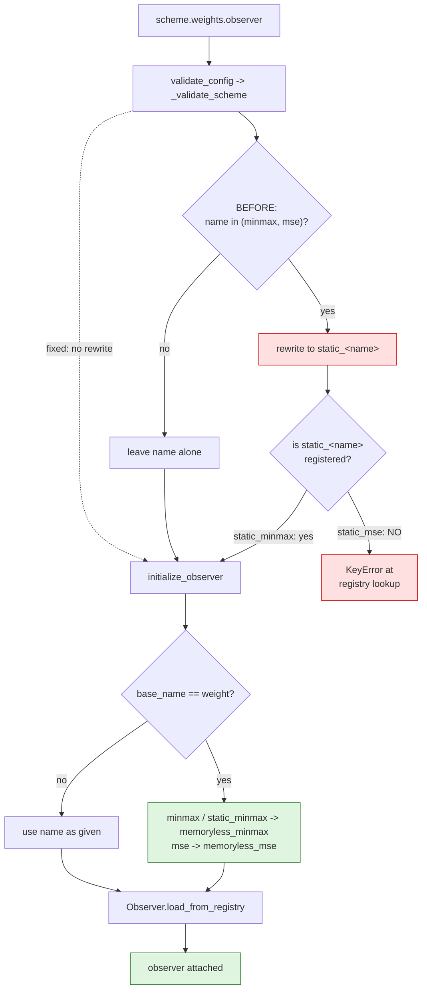
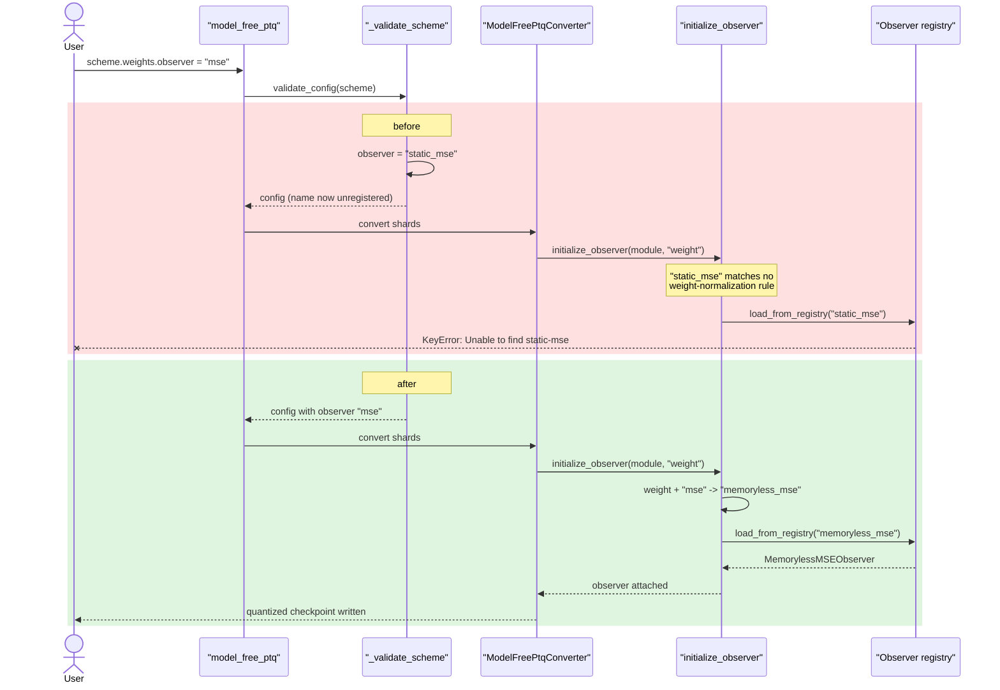

# Model-free PTQ: the `mse` weight observer

Upstream issue: [vllm-project/llm-compressor#3308](https://github.com/vllm-project/llm-compressor/issues/3308)

## Summary

`model_free_ptq` failed for any scheme whose weight observer was `"mse"`,
because `_validate_scheme` rewrote the name to `static_mse`, which is not a
registered observer. The rewrite was also redundant — `initialize_observer`
already resolves weight observer names — so it has been removed.

## Background

### What an observer name has to satisfy

An observer is looked up by name in a registry
(`Observer.load_from_registry`). The registered MSE observers are:

| Registered name | Notes |
|---|---|
| `mse` | Moving-average MSE |
| `memoryless_mse` | Each observed tensor independently |
| `nvfp4_expanded_mse` | NVFP4 variant with different search defaults |

There is **no** `static_mse`. For min/max the picture is different —
`static_minmax` *is* registered, alongside `minmax` and `memoryless_minmax` —
which is what made the broken rewrite look symmetrical when it was written.

### Where weight observer names are resolved

`initialize_observer` in
`src/llmcompressor/modifiers/quantization/calibration.py` already normalizes
weight observers, because training is no longer supported and weights should
always use the cheaper memoryless variant:

```python
if base_name == "weight" and args.observer in ("static_minmax", "minmax"):
    observer = "memoryless_minmax"
if base_name == "weight" and args.observer in ("mse",):
    observer = "memoryless_mse"
```

Model-free PTQ attaches its weight observers through exactly this function —
`entrypoints/model_free/converter.py` and `entrypoints/model_free/lifecycle.py`
both call `initialize_observer(module, "weight")`. So by the time an observer is
built, the name has already been resolved; nothing upstream of that needed to
rewrite it.

## Symptom

```python
scheme = preset_name_to_scheme("W4A16", ["Linear"])
scheme.weights.observer = "mse"
model_free_ptq(src, dst, scheme=scheme, ignore=["lm_head"], device="cpu")
```

```
KeyError: "Unable to find static-mse registered under type
<class 'llmcompressor.observers.base.Observer'>."
```

Observed across the three names a user might reasonably set:

| `scheme.weights.observer` | Before | After |
|---|---|---|
| `memoryless_minmax` | OK | OK |
| `minmax` | OK | OK |
| `mse` | `KeyError` | OK |

## Root cause

`src/llmcompressor/entrypoints/model_free/validate.py` rewrote the name before
the config was ever used:

```python
# Remove after https://github.com/vllm-project/compressed-tensors/pull/489
if scheme.weights.observer in ("minmax", "mse"):
    new_observer = f"static_{scheme.weights.observer}"
    logger.warning(...)
    scheme.weights.observer = new_observer
```

The `f"static_{...}"` construction treats `minmax` and `mse` as if both had a
`static_` variant. Only `minmax` does. For `mse` the result is a name that does
not exist, and the failure appears later as a registry `KeyError` rather than at
validation.

## Control flow



The diagram shows why removing the rewrite is safe: both arrows into
`initialize_observer` converge on the same normalization step, which handles
`minmax` and `static_minmax` identically.

## Call sequence



## The change

The rewrite block is deleted and replaced by a note recording why no rewrite
belongs here:

```python
# NOTE: weight observer names are not rewritten here. `initialize_observer`
# already resolves `minmax`/`static_minmax` to `memoryless_minmax` and `mse`
# to `memoryless_mse` for weights, which is the path model-free PTQ takes.
```

`mse` now works, and what `minmax` resolves to is unchanged — it reached
`memoryless_minmax` before via `static_minmax`, and reaches it now directly,
because `initialize_observer` maps both spellings to the same observer. The
`logger` import is still used by `validate_safetensors_index` in the same
module, so it stays.

## Testing

`tests/llmcompressor/entrypoints/model_free/test_model_free_validation.py`:

- `test_validate_config_keeps_weight_observer_name` — parametrized over
  `minmax`, `mse` and `memoryless_minmax`; asserts `validate_config` returns the
  name unchanged. Fails on `main` for `minmax` and `mse`.
- `test_weight_observer_resolves_to_registered_observer` — parametrized over all
  five spellings; attaches the observer via `initialize_observer` and asserts
  the class matches the expected registry entry. This is the assertion that
  would have caught the bug: it pins the mapping from a user-facing name to a
  registered observer, so a name with no registry entry cannot pass.

## Related

- The `compressed-tensors` PR referenced in the deleted comment
  ([#489](https://github.com/vllm-project/compressed-tensors/pull/489)) is what
  the rewrite was waiting on. The weight-observer normalization in
  `initialize_observer` has since made it unnecessary for this path.
