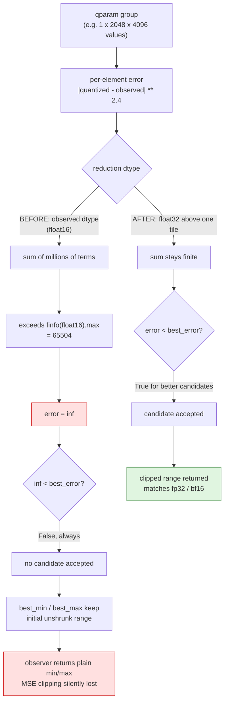
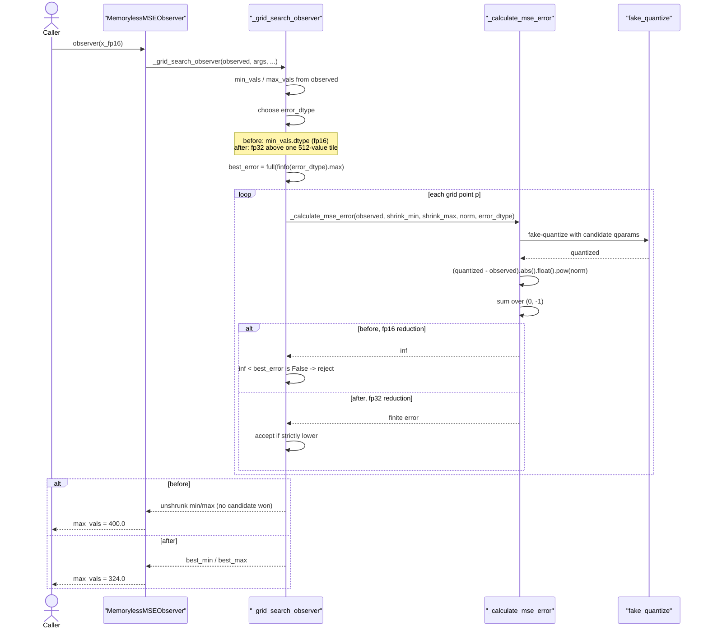

# MSE observer: accumulating the error in FP32

Upstream issue: [vllm-project/llm-compressor#3322](https://github.com/vllm-project/llm-compressor/issues/3322)

## Summary

The eager MSE grid search accumulated its error in the observed tensor's dtype.
For an FP16 model with a large qparam group the error sum exceeded FP16's maximum
and became `inf`, so no shrink candidate was ever accepted and the observer
silently returned the plain min/max range — losing MSE clipping with no warning.
The error is now reduced in FP32 above one tile, matching what the imatrix branch
and the Triton backend already did.

## Background

### What the grid search is comparing

An MSE observer does not take the raw min/max of what it observes. It sweeps
candidate ranges, shrinking the observed range step by step, fake-quantizes with
each candidate, and keeps whichever candidate has the lowest error:

```python
error = _calculate_mse_error(...)        # one scalar per qparam
improved = error < best_error            # strictly lower wins
if torch.any(improved):
    best_error[improved] = error[improved]
    best_min[improved] = shrink_min[improved]
    best_max[improved] = shrink_max[improved]
```

The key property is that acceptance requires an error *strictly lower* than the
best so far, and `best_error` starts at `torch.finfo(error_dtype).max`.

### The error is a sum over the whole group

`_calculate_mse_error` reduces over every value a single quantization parameter
covers:

```python
error = (quantized - observed).abs().pow(norm)
return error.sum(dim=(0, -1))
```

How many values that is depends entirely on the strategy. For per-channel
weights it is one row. For **per-tensor static activations or the KV cache it is
every token × every hidden value** — millions of elements, each contributing a
term raised to `norm` (default `2.4`).

### Why the dtype of that sum matters

FP16's maximum finite value is 65504. A sum of millions of positive terms
trivially exceeds it and saturates to `inf`. And `inf < inf` is `False`, so once
every candidate's error is `inf`:

- no candidate is ever strictly better than `best_error`,
- `best_min`/`best_max` keep their initial values — the unshrunk observed range,
- the observer returns plain min/max, as if MSE had never run.

Nothing raises. The only visible effect is worse accuracy.

### The tile rule that already existed

The same function's **imatrix** branch already guarded against this, and the
comment in the file explains why the threshold is where it is:

```python
# Count values for one qparam across observations. Triton uses its packed
# kernel up to 512 values and FP32 split reductions above that; eager mirrors
# the corresponding error rounding so the selected grid point matches.
```

So the Triton backend keeps half precision only for a single 512-value tile
(its packed kernel initializes `best_error` as `tl.float16` in that case) and
reduces into an FP32 buffer above it. The eager imatrix branch mirrored that.
The eager **MSE** branch did not — it used `error_dtype = min_vals.dtype`
unconditionally.

This is why the bug was platform-dependent: the same FP16 model got different
scales on CUDA with Triton than on CPU, MPS, XPU, NPU, or anywhere Triton was
unavailable.

## Symptom

```python
args = QuantizationArgs(num_bits=8, type="int", strategy="tensor",
                        symmetric=True, observer="mse")
x = torch.randn(1, 2048, 4096) * 3     # activations for 2048 tokens
x[0, 0, 0] = 400.0                     # a single outlier

for dtype in (torch.float32, torch.bfloat16, torch.float16):
    observer = Observer.load_from_registry("memoryless_mse", base_name="input", args=args)
    observer(x.to(dtype))
    print(dtype, observer.max_vals.float().item())
```

```
torch.float32   selected max = 324.00
torch.bfloat16  selected max = 324.00
torch.float16   selected max = 400.00     <- outlier not clipped at all
```

FP32 and BF16 clip the outlier to 324. FP16 returns 400 — the raw maximum.
BF16 escapes the bug not because it is more precise but because its exponent
range is as wide as FP32's, so the sum does not saturate.

## Why `inf` and not just imprecision



## Call sequence



## The change

The tile rule is hoisted so it governs **both** error formulas rather than only
imatrix:

```python
total_values = observed.shape[0] * observed.shape[-1]
# Both error formulas accumulate in FP32 above one tile. A half-precision
# error sum over a large qparam group (per-tensor activations or KV cache,
# where one group spans every token x hidden value) overflows the dtype's
# maximum and becomes `inf`. `inf < best_error` is never true, so no shrink
# candidate is ever accepted and clipping is silently lost.
if total_values <= _GRID_SEARCH_TILE_SIZE and observed.dtype in (
    torch.float16,
    torch.bfloat16,
):
    error_dtype = observed.dtype
else:
    error_dtype = torch.float32
error_norm = norm
if use_imatrix_error and error_dtype != torch.float32:
    error_norm = torch.tensor(norm, dtype=error_dtype).item()
```

`_calculate_mse_error` takes `error_dtype` and follows the structure
`_calculate_imatrix_error` already used — compute in float, round to
`error_dtype` only when it is not FP32, reduce, cast back:

```python
error = (quantized - observed).abs().float().pow(norm)
if error_dtype != torch.float32:
    error = error.to(error_dtype).float()
if group_absmax is not None:
    error = error * torch.sqrt(observed.float().square() + group_absmax.square())
result = error.sum(dim=(0, -1))
if error_dtype != torch.float32:
    result = result.to(error_dtype)
return result
```

Computing the per-element term in float before the reduction matters too: with
`norm = 2.4`, a large absolute difference can overflow FP16 on the `pow` alone,
before any summing.

Note the `error_norm` rounding stays specific to imatrix — that exists to match
Triton's rounding for grid-point parity, and the MSE branch continues to pass
`norm` through unchanged.

## Behaviour

| Input dtype | Group size | Before | After |
|---|---|---|---|
| FP32 | any | FP32 reduction | Unchanged |
| FP16 / BF16 | ≤ 512 values | Observed dtype | Observed dtype (unchanged, matches Triton's packed kernel) |
| BF16 | > 512 values | BF16 reduction | FP32 reduction (more accurate; BF16 never saturated) |
| FP16 | > 512 values | `inf`, clipping lost | FP32 reduction, clipping preserved |

Only the last row was broken; the third is a precision improvement that also
brings eager in line with Triton.

## Testing

`tests/llmcompressor/observers/test_mse.py`:

- `test_eager_mse_clips_outlier_in_half_precision` — parametrized over FP32,
  BF16 and FP16; reproduces the issue's per-tensor case and asserts every dtype
  selects the same clipped range. The FP16 case fails on `main`.
- `test_eager_mse_error_does_not_overflow_half_precision` — calls
  `_calculate_mse_error` directly on a large FP16 group and asserts the returned
  error is finite. This guards the mechanism rather than one observed outcome,
  so a future change that reintroduces a half-precision reduction fails here
  even if the selected range happens to look reasonable.

The existing 153 observer tests pass unchanged, which is the check that matters
for the BF16 and small-group rows above.
