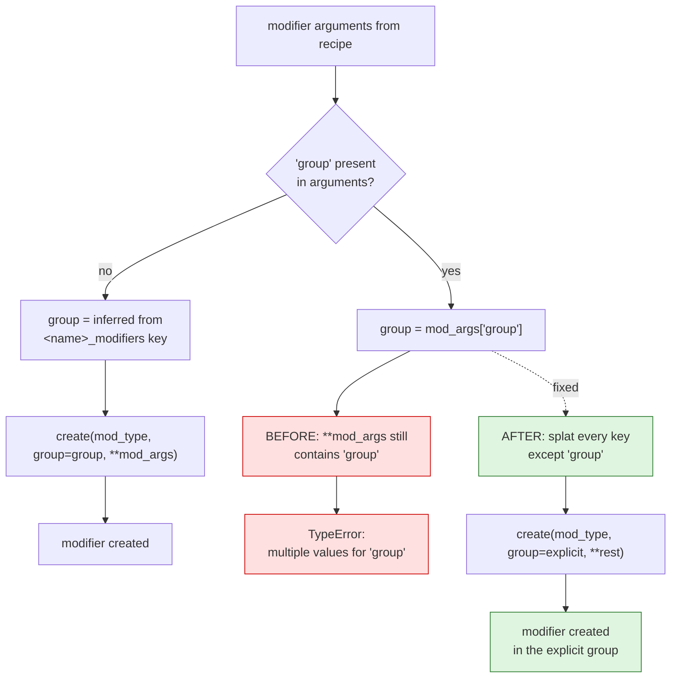
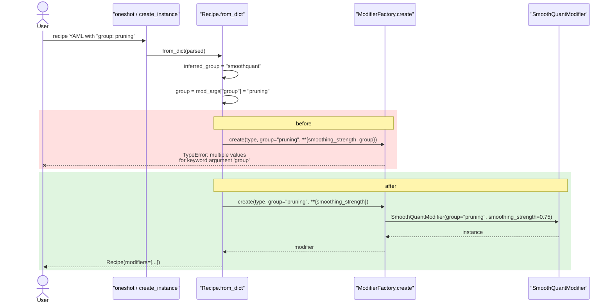

# Recipe loading: a modifier with an explicit `group`

Upstream issue: [vllm-project/llm-compressor#3358](https://github.com/vllm-project/llm-compressor/issues/3358)

## Summary

A recipe that set `group` on a modifier failed to load with
`TypeError: ... got multiple values for keyword argument 'group'`, because the
loader read `group` out of the modifier's arguments and then splatted those same
arguments alongside it. `group` is now excluded from the splat, so an explicit
`group` loads and wins over the one inferred from the group key.

## Background

### Where a modifier's group comes from

A recipe nests a **stage**, a **modifier group**, and the **modifiers** in that
group:

```yaml
quant_stage:              # stage
  quant_modifiers:        # modifier group -> group "quant"
    GPTQModifier:         # modifier
      scheme: W4A16
```

The group key carries the group name: the `_modifiers` suffix is stripped, so
`quant_modifiers` means every modifier under it belongs to the group `quant`.
`Recipe.from_dict` calls this the *inferred* group.

`group` is also a real field on `Modifier`, and the loader explicitly looks for
it in the modifier's arguments — `mod_args.get("group", inferred_group)` — so
honouring a `group` written in the recipe is clearly the intent.

### Why a recipe can contain `group` at all

Serialization deliberately *strips* `group` on the way out
(`get_yaml_serializable_dict`), because the group is already encoded in the
group key: a modifier in group `quant` is written under `quant_modifiers`, and
reading that key back recovers the group. A recipe therefore does not normally
round-trip a `group` entry.

It can still contain one. A recipe written by hand may set it, and a recipe
saved by an older release may carry it. Before this fix, such a recipe could not
be loaded at all.

## Symptom

```python
from llmcompressor.recipe import Recipe

Recipe.create_instance("""
test_stage:
    smoothquant_modifiers:
        SmoothQuantModifier:
            smoothing_strength: 0.75
            group: pruning
""")
```

```
TypeError: llmcompressor.modifiers.factory.ModifierFactory.create() got
multiple values for keyword argument 'group'
```

The message names an internal factory function and says nothing about recipes,
so there was no hint that the `group` entry in the YAML was the cause.

## Root cause

In `src/llmcompressor/recipe/recipe.py`, `group` was passed twice — once
explicitly, and once more inside `**mod_args`, which still contained it:

```python
group = mod_args.get("group", inferred_group)   # reads it...
modifier = ModifierFactory.create(
    mod_type,
    group=group,                                # ...passes it explicitly...
    allow_registered=True,
    allow_experimental=True,
    **mod_args,                                 # ...and again in the splat
)
```

Python rejects the duplicate keyword before the modifier is ever constructed, so
the failure is unconditional for any recipe containing `group`.

## Control flow



## Call sequence



## The change

Exclude `group` from the splatted arguments:

```python
# `group` is passed explicitly, so it must not also be splatted in from the
# modifier's arguments.
group = mod_args.get("group", inferred_group)
modifier = ModifierFactory.create(
    mod_type,
    group=group,
    allow_registered=True,
    allow_experimental=True,
    **{key: value for key, value in mod_args.items() if key != "group"},
)
```

The dict comprehension builds a new mapping rather than mutating `mod_args`, so
the caller's parsed recipe dictionary is left untouched — it may be reused, for
example when the same dict is filtered per stage.

## Behaviour

| Recipe | Before | After |
|---|---|---|
| No `group` entry | Group inferred from key | Unchanged |
| `group: custom_group` | `TypeError` | Modifier created in `custom_group` |
| Other arguments alongside `group` | `TypeError` | All still reach the modifier |

### Round trip

An explicit group survives a save and reload, by a slightly indirect route.
Serialization drops the `group` *argument*, but writes the modifier under
`custom_group_modifiers`, and loading that key infers `custom_group` again:

```python
recipe = Recipe.create_instance(yaml_with_group_custom_group)
recipe.modifiers[0].group                                    # "custom_group"
Recipe.create_instance(recipe.yaml()).modifiers[0].group      # "custom_group"
```

## Testing

`tests/llmcompressor/recipe/test_recipe.py`:

- `test_recipe_accepts_explicit_group` — loads the recipe from the issue and
  asserts the explicit group wins over the inferred one, and that the remaining
  arguments still reach the modifier.
- `test_recipe_infers_group_when_not_given` — guards the unchanged path, so the
  fix cannot silently stop inferring the group from the key.

The first fails on `main` and passes with this change.

## Related

- [vllm-project/llm-compressor#3359](https://github.com/vllm-project/llm-compressor/issues/3359)
  — the other `Recipe.from_dict` defect, a modifier written without arguments.
  Both fixes touch the same loop, so whichever lands second needs a one-hunk
  conflict resolution; the two changes are independent and both belong in the
  final version.
