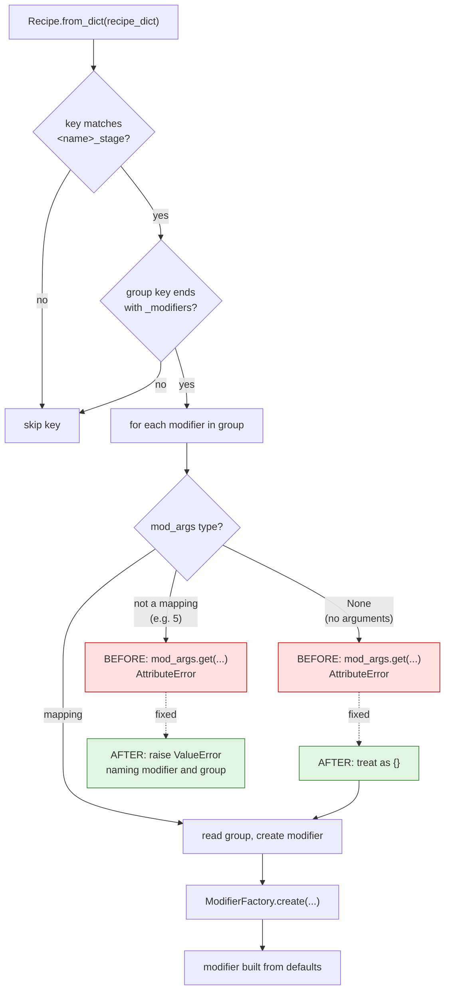
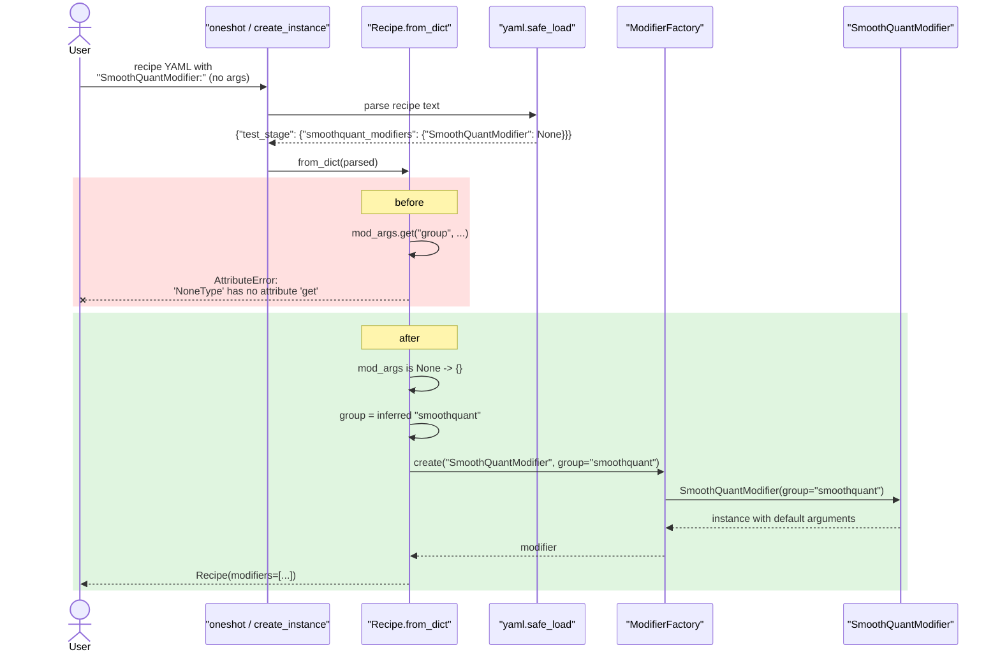

# Recipe loading: a modifier written without arguments

Upstream issue: [vllm-project/llm-compressor#3359](https://github.com/vllm-project/llm-compressor/issues/3359)

## Summary

A recipe that lists a modifier with no arguments failed to load with
`AttributeError: 'NoneType' object has no attribute 'get'`. Such a modifier is
now built from its defaults, and any value that is neither a mapping nor empty
is reported against the recipe instead of surfacing as an `AttributeError` from
inside the loader.

## Background

A recipe nests three levels — a **stage**, a **modifier group**, and the
**modifiers** in that group together with their arguments:

```yaml
quant_stage:              # stage
  quant_modifiers:        # modifier group
    GPTQModifier:         # modifier
      scheme: W4A16       # ...and its arguments
```

`Recipe.from_dict` walks that structure. For each stage key matching
`<name>_stage`, it visits each `<name>_modifiers` group, and for every modifier
in the group it reads the arguments mapping, pulls `group` out of it, and passes
the rest to `ModifierFactory.create`.

The important detail is what YAML does with a key that has no value. This:

```yaml
test_stage:
    smoothquant_modifiers:
        SmoothQuantModifier:
```

is not an empty mapping — it parses to `None`. That is the natural way to write
"use this modifier with all of its defaults", and many modifiers have no
required arguments at all, so it is a reasonable thing for a user to write.

## Symptom

```python
from llmcompressor.recipe import Recipe

Recipe.create_instance("""
test_stage:
    smoothquant_modifiers:
        SmoothQuantModifier:
""")
```

```
AttributeError: 'NoneType' object has no attribute 'get'
```

The same crash occurred through the public entrypoints, for example
`oneshot(model=..., recipe=<that yaml>)`. Because the message names neither the
recipe nor the modifier, there was nothing to connect it back to the line of
YAML that caused it.

## Root cause

`src/llmcompressor/recipe/recipe.py` assumed every modifier value is a mapping:

```python
for mod_type, mod_args in group_val.items():
    group = mod_args.get("group", inferred_group)   # mod_args is None
    ...
```

`mod_args` is the YAML value for the modifier key. When the modifier is written
without arguments that value is `None`, and `None.get` raises.

## Control flow



## Call sequence



## The change

In `Recipe.from_dict`, normalize the modifier value before reading it:

```python
for mod_type, mod_args in group_val.items():
    # A modifier written without arguments parses to `None` in YAML
    # (``SmoothQuantModifier:``). Such a modifier is created from its defaults.
    if mod_args is None:
        mod_args = {}
    elif not isinstance(mod_args, dict):
        raise ValueError(
            f"Modifier {mod_type!r} in recipe group {group_key!r} must map "
            f"argument names to values, got {type(mod_args).__name__}. "
            "Write the modifier's arguments as a YAML mapping, or leave the "
            "value empty to use its defaults."
        )
    group = mod_args.get("group", inferred_group)
    ...
```

Two cases are handled rather than one. `None` is the case the issue reports, and
is legitimate — it becomes an empty mapping so every argument keeps its default.
Any other non-mapping value (`SmoothQuantModifier: 5`) cannot be turned into
keyword arguments at all; raising a `ValueError` that names the modifier and its
group stops that from reaching the user as the same opaque `AttributeError`.

Note that the group is still inferred from the group key in both cases, so a
modifier written without arguments lands in the group its key implies.

## Behaviour

| Recipe value for the modifier | Before | After |
|---|---|---|
| Mapping of arguments | Modifier created | Unchanged |
| Empty (`None`) | `AttributeError` | Modifier created from defaults |
| Not a mapping (`5`) | `AttributeError` | `ValueError` naming modifier and group |

## Testing

`tests/llmcompressor/recipe/test_recipe.py`:

- `test_recipe_accepts_modifier_without_arguments` — loads the recipe from the
  issue, asserts one modifier of the right type, that its group is still
  inferred as `smoothquant`, and that its arguments equal the class defaults.
- `test_recipe_rejects_non_mapping_modifier_arguments` — asserts the new
  `ValueError` for a scalar value.

Both fail on `main` and pass with this change.

!!! note
    The issue's own reproducer uses `ConstantPruningModifier`, which no longer
    exists in the current tree — the bug reproduced regardless, because
    `mod_args.get` is evaluated before the modifier name is ever resolved. The
    tests use `SmoothQuantModifier`, which is registered and has no required
    arguments.

## Related

- [vllm-project/llm-compressor#3358](https://github.com/vllm-project/llm-compressor/issues/3358)
  — the other `Recipe.from_dict` defect, an explicit `group` being passed twice.
  Both fixes touch the same loop, so whichever lands second needs a one-hunk
  conflict resolution; the two changes are independent and both belong in the
  final version.

