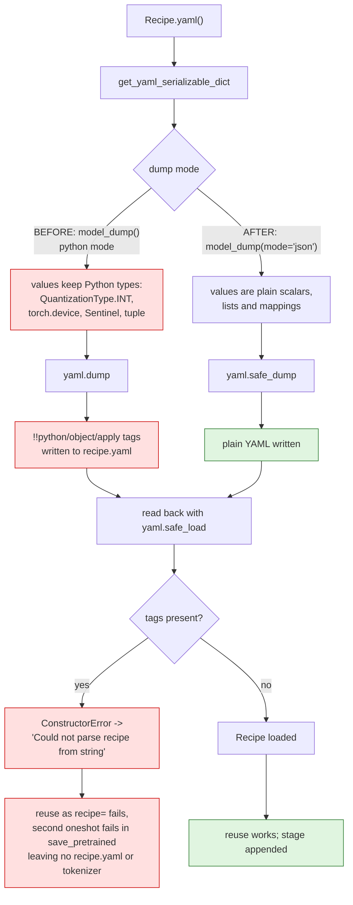
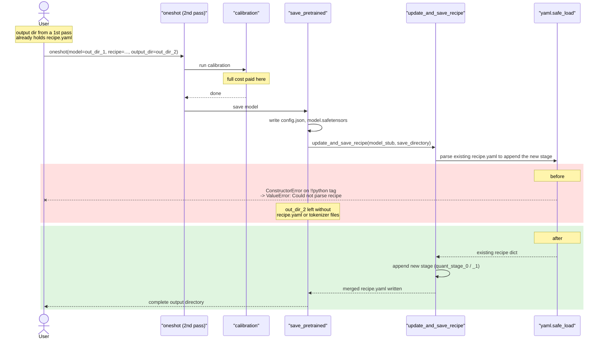

# Recipe serialization: no Python object tags

Upstream issue: [vllm-project/llm-compressor#3414](https://github.com/vllm-project/llm-compressor/issues/3414)

## Summary

The `recipe.yaml` saved next to a compressed model could contain
`!!python/object/apply:...` tags. Recipes are read with `yaml.safe_load`, which
refuses those tags, so llm-compressor could not load back a recipe it had just
written. Modifier arguments are now dumped in JSON mode and written with
`yaml.safe_dump`, so the writer cannot emit anything the reader will reject.

## Background

### The reader has always been strict

`_load_json_or_yaml_string` parses a recipe with `json.loads`, falling back to
`yaml.safe_load`. `safe_load` deliberately constructs only plain YAML types —
scalars, lists and mappings. Any `!!python/...` tag raises a `ConstructorError`.
This is the right choice: a recipe is untrusted input, and the unsafe loaders
can instantiate arbitrary Python objects.

### The writer was not

`get_yaml_serializable_dict` built each modifier's arguments with a
**python-mode** `model_dump()` and handed the result to `yaml.dump`:

```python
args = {
    k: v
    for k, v in modifier.model_dump().items()
    if v is not None and not k.endswith("_") and k != "group"
}
```

A python-mode dump preserves real Python objects. `yaml.dump` (as opposed to
`safe_dump`) happily serializes those by emitting a tag that records how to
reconstruct them. So the two halves of the round trip disagreed: the writer
could produce tags the reader was built to refuse.

### Why the round trip is load-bearing

A saved recipe is not just a record. It is read back in two places:

1. Passing a saved `recipe.yaml` as `recipe=` to another run.
2. **Saving a model that already carries a recipe.** `update_and_save_recipe`
   loads the existing `recipe.yaml` so it can append the new stage:

   ```python
   existing_recipe = infer_recipe_from_model_path(model_stub)
   recipe.yaml(file_path=recipe_path, existing_recipe_path=existing_recipe)
   ```

The second path is what makes this a data-loss bug rather than an
inconvenience. A second pass over a previously compressed directory runs all of
calibration, then fails inside `save_pretrained` with
`ValueError: Could not parse recipe from string`. The output directory is left
with `config.json`, `generation_config.json` and `model.safetensors` — no
`recipe.yaml`, and no tokenizer files.

## Symptom

```yaml
default_stage:
  default_modifiers:
    QuantizationModifier:
      config_groups:
        group_0:
          weights:
            num_bits: 8
            type: !!python/object/apply:compressed_tensors.quantization.quant_args.QuantizationType [
              int]
```

Five distinct cases produced a tag:

| Case | Tag written | Why |
|---|---|---|
| `config_groups` with `type` omitted | `QuantizationType` enum | compressed-tensors keeps the default as an enum member; a `type` you pass yourself is already a plain string |
| `kv_cache_scheme` with `type` omitted | `QuantizationType` enum | same |
| AWQ / QAD `offload_device` | `!!python/object/apply:torch.device [cpu]` | a real `torch.device`; AWQ's `on_initialize` sets this itself on MoE models |
| Uninitialized `AWQModifier` | `Sentinel` tag including the absolute path of `sentinel.py` | the "not provided" default has not resolved yet |
| SmoothQuant `mappings` as tuples | `!!python/tuple` | tuples are not a plain YAML type |

The enum cases are the easiest to hit by accident, because they need nothing
unusual — just leaving `type` out of a weights mapping, which is the documented
way to accept the default.

## Control flow



## The second-pass failure



## The change

Two edits, one per half of the round trip.

**Dump in JSON mode** (`recipe/utils.py`), which is what converts the values:

```python
# Dump in JSON mode so every value is a plain scalar, list or dict.
# A python-mode dump keeps objects such as `QuantizationType.INT`,
# `torch.device("cpu")`, `Sentinel` and tuples, which `yaml.dump` then
# writes as `!!python/object/apply:...` tags. ...
args = {
    k: v
    for k, v in modifier.model_dump(mode="json").items()
    if v is not None and not k.endswith("_") and k != "group"
}
```

JSON mode resolves each case: `QuantizationType.INT` → `"int"`,
`torch.device("cpu")` → `"cpu"`, `Sentinel("not_provided")` →
`"not_provided"`, and tuples → lists.

**Write with `safe_dump`** (`recipe/recipe.py`), which makes the invariant
enforced rather than hoped for:

```python
# `safe_dump` mirrors the `yaml.safe_load` used to read recipes back, so
# a value that is not a plain scalar, list or dict raises here instead
# of being written as a `!!python/object/apply:...` tag that no reader
# of this recipe can load.
yaml_str = yaml.safe_dump(merged_dict, ...)
```

The second edit is the more durable of the two. JSON mode fixes the five known
cases; `safe_dump` means a *future* field holding some new unconvertible type
fails loudly at save time instead of quietly writing an unloadable recipe.

`model_dump()` itself is untouched — only what the recipe serializer asks for
changes.

## Behaviour

| Case | Before | After |
|---|---|---|
| `config_groups` / `kv_cache_scheme` without `type` | Tag; unloadable | `type: int`; loads |
| `torch.device` argument | Tag; unloadable | `cpu`; loads |
| Uninitialized AWQ `Sentinel` | Tag with local file path | `not_provided`; loads |
| Tuple arguments | `!!python/tuple`; unloadable | Nested lists; loads |
| Reusing a saved recipe as `recipe=` | `ConstructorError` | Works |
| Second `oneshot` over a saved directory | Fails after calibration | Works; stage appended |
| A value JSON mode cannot convert | Written as a tag | Raises at save time |

## Testing

`tests/llmcompressor/recipe/test_recipe.py`:

- `test_serialized_recipe_has_no_python_tags` — parametrized over all five cases
  from the issue. Each asserts `"!!python" not in serialized` *and* that the
  result round-trips through `Recipe.create_instance`, which is the same loader
  that reads a saved `recipe.yaml`. All five fail on `main`.

Verified beyond the unit tests: the issue's end-to-end scenario was run against
a small random Llama — saving, reusing the saved recipe in a second `oneshot`,
and running a second pass over the saved output directory, confirming
`recipe.yaml` is present in the second output.

## Related

- [vllm-project/llm-compressor#3369](https://github.com/vllm-project/llm-compressor/issues/3369)
  — a different round-trip defect in the same function, GPTQ `actorder`. Both
  fixes touch `get_yaml_serializable_dict`, so whichever lands second needs a
  one-hunk resolution: the combined version iterates the JSON-mode dump *and*
  applies that fix's `None`/`Sentinel` rules.
