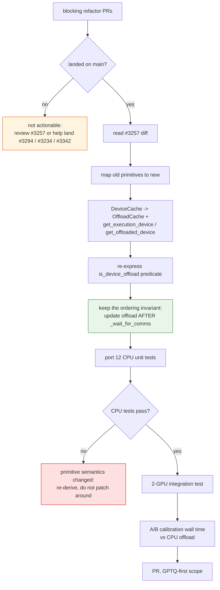
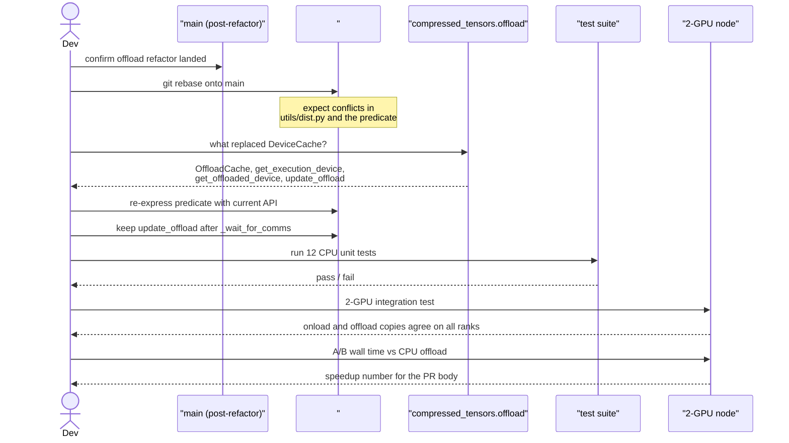

# #2480 approach A — rebase onto the new offload primitives (recommended)

Parent: [#2480 overview](2480-gpu-offload.md) · Alternatives:
[B — compressed-tensors primitive](2480-approach-b-compressed-tensors-util.md) ·
[C — open-code in `utils/dist.py`](2480-approach-c-dist-util.md)

Do not re-implement this. A working implementation exists in
[#3257](https://github.com/vllm-project/llm-compressor/pull/3257); the task is
to carry it onto the refactored offload layer once that lands.

This is what the maintainer asked for:

> Once those land if you want to update your PR we can work on getting this
> feature in but if we do it before, it's going to have to be redone with the new
> offloading changes.

## Why this is the right order

| | Rebase (A) | Fresh implementation |
|---|---|---|
| NCCL ordering constraint | Already solved and tested | Must be rediscovered |
| Multi-GPU validation | Done on 2×RTX 3090 | Needs hardware |
| Conflict with refactor | Resolved once, deliberately | Guaranteed rework |
| Maintainer expectation | Matches | Explicitly discouraged |

The expensive knowledge in #3257 is not the diff — it is that the offload copy
must be written **after** `_wait_for_comms`, because an NCCL broadcast's write is
only observable once the collective completes. Rewriting from the issue's
pseudocode throws that away and reintroduces a race that passes small tests.

## Flow



## Sequence



## Step-by-step

1. **Watch the blockers.** Subscribe to
   [#3294](https://github.com/vllm-project/llm-compressor/pull/3294),
   [#3234](https://github.com/vllm-project/llm-compressor/pull/3234),
   [#3342](https://github.com/vllm-project/llm-compressor/pull/3342). Until they
   merge, this issue is not actionable.

2. **Coordinate.** #3257's author offered to rebase it himself:

   > once @Roderick-Wu's offload changes land I can rebase the broadcast/offload-sync
   > logic onto the new primitives

   Ask before duplicating. Taking over someone's parked branch without asking is
   the fastest way to waste two people's work.

3. **Map the primitives.** Verified currently available from
   `compressed_tensors.offload`: `OffloadCache` (with `offloading_disabled`,
   `update_offload`, `cls_from_device`, `offload`, `onload`, `stage`,
   `is_staged`), `get_execution_device`, `get_offloaded_device`,
   `set_onload_device`, `update_offload_parameter`, `align_module_device`.
   `DeviceCache` and `update_parameter` do **not** exist — the issue's
   pseudocode predates them being removed or renamed.

4. **Re-express the predicate.** Conceptually:

   ```python
   def is_device_offload(module) -> bool:
       # GPU offload: the module is offloaded, and its offload device is a
       # different device from where it executes
       offload_dev = get_offloaded_device(module)
       exec_dev = get_execution_device(module)
       return offload_dev is not None and offload_dev != exec_dev
   ```

   Confirm against the post-refactor API; the shape matters more than the exact
   calls. Put it in compressed-tensors if the maintainers agree it is generic —
   the issue asks for that ("This function should likely live as a
   compressed-tensors utility").

5. **Preserve the ordering invariant.** The offload write goes after
   `_wait_for_comms`, never inline with the broadcast. Comment it with the NCCL
   reason, or someone will "optimize" it back.

6. **Port the tests before changing behaviour.** If a CPU test fails after the
   rebase, that is a changed primitive semantic — re-derive it rather than
   adjusting the test to pass.

7. **Keep the scope GPTQ-first**, as the issue states, behind
   `device_map="auto"`. CPU offload, `skip_cpu`, and single-GPU paths must be
   unchanged.

## Tests

| Test | Needs | Asserts |
|---|---|---|
| Device-selection policy | CPU | Predicate true only when offload ≠ onload |
| CPU-offload unchanged | CPU | Identical behaviour to `main` |
| Single-GPU unchanged | CPU mockable | No offload sync attempted |
| `skip_cpu` honoured | CPU | Existing semantics preserved |
| Offload copy synced | 2 GPUs | Offloaded (peer-GPU) and onloaded copies agree on every rank |
| Ordering | 2 GPUs | Offload write happens after collectives complete |
| Wall-time A/B | 2+ GPUs | GPU offload faster than CPU offload |

The 2-GPU tests are the ones that cannot be faked. Without that hardware, the
honest contribution is review, not implementation.

## Risks

| Risk | Mitigation |
|---|---|
| Refactor changes the primitives again | Rebase late, not early |
| Race reintroduced by eager copy | Keep the post-wait ordering; comment it |
| Duplicating the author's work | Ask on the issue first |
| No multi-GPU access | Pick a different issue |
| Silent stale weights | Assert on the offload copy, not just the onload copy |
