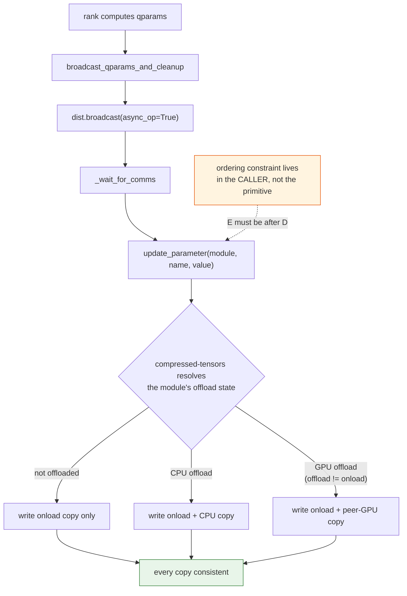
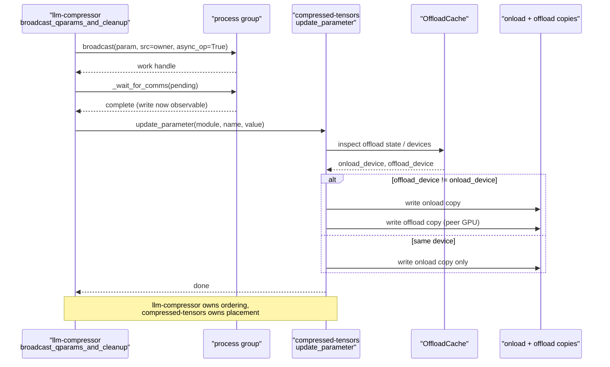

# #2480 approach B — route through a compressed-tensors update primitive

Parent: [#2480 overview](2480-gpu-offload.md) · Recommended instead:
[A — rebase onto the new primitives](2480-approach-a-wait-and-rebase.md)

Put the offload-aware update in **compressed-tensors**, as a generic parameter
update that knows about both copies, and have LLM Compressor call it. This is
`ishrith-gowda`'s proposal:

> The generic update primitive this needs looks like it's being built in
> compressed-tensors #703 (`update_parameter` / `update_parameter_async` with
> `update_offload`/`update_onload`), framed around the GPTQ async update case.
> That seems like the right home for the offload-aware broadcast rather than
> open-coding it in the modifier.

The issue agrees in principle: "This function should likely live as a
compressed-tensors utility".

## Status check

`update_parameter` does **not** exist in compressed-tensors 0.20.2a20261103.
What does exist is `OffloadCache.update_offload` and the module-level
`update_offload_parameter`. So either #703 did not land in this shape, or it
landed under different names. **Verify before planning around it** — this
approach is contingent on a primitive that may not be coming.

## Design

```
llm-compressor                     compressed-tensors
--------------                     ------------------
broadcast_qparams_and_cleanup  -->  update_parameter(module, name, value)
                                      ├─ writes the onload copy
                                      └─ writes the offload copy if
                                         offload_device != onload_device
```

LLM Compressor keeps the collectives; compressed-tensors owns "where does a
parameter's value actually live". That is the right split: offload topology is
compressed-tensors' concern, distribution is LLM Compressor's.

## Flow



## Sequence



## Step-by-step

1. **Verify the primitive exists.** Check the current compressed-tensors for
   `update_parameter` / `update_parameter_async`, and check what became of
   [#703](https://github.com/vllm-project/compressed-tensors/pull/703). If it is
   not there, this approach means *writing* it in another repo — a cross-repo
   change with its own review cycle, which is a much larger commitment than the
   issue's framing suggests.
2. **Land the compressed-tensors side first**, with its own tests, including a
   GPU-offload case.
3. **Pin the dependency** so LLM Compressor's CI gets a version containing it.
   Cross-repo ordering is the main practical cost here.
4. **Replace the write** in `broadcast_qparams_and_cleanup` with the primitive,
   keeping it after `_wait_for_comms`.
5. Keep GPTQ-first scope.

## Trade-offs

**For:**

- The offload predicate and the dual write live where offload topology is
  already modelled, so every consumer benefits — not just GPTQ, not just
  LLM Compressor.
- The issue explicitly asks for a generic, reusable function.
- LLM Compressor's `dist.py` stays about distribution, not device placement.

**Against:**

- **Cross-repo coordination.** Two PRs, two review queues, a version pin
  between them. For a blocked issue, that is a long pole.
- **Contingent on a primitive that is not in the installed version.** Planning
  around `update_parameter` today is planning around something unverified.
- **The ordering constraint does not move.** The NCCL "write visible only after
  wait" rule stays in the caller, so the hard part is not actually delegated —
  only the placement logic is.
- Overlaps with the in-flight offload refactor, which may introduce its own
  update path and make this redundant.

## When to choose this

If the refactor lands and *does not* provide an offload-aware update, and a
maintainer confirms the primitive belongs in compressed-tensors. Then this is
the clean long-term home.

Otherwise [approach A](2480-approach-a-wait-and-rebase.md) gets the feature in
sooner, and the primitive can be extracted later once there is a second
consumer — which is the usual order for deciding something is generic.
