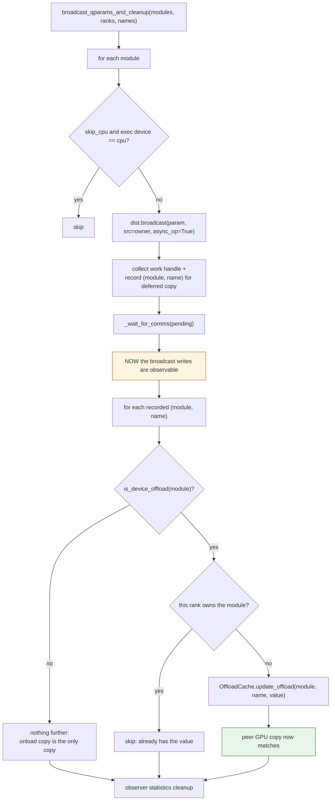
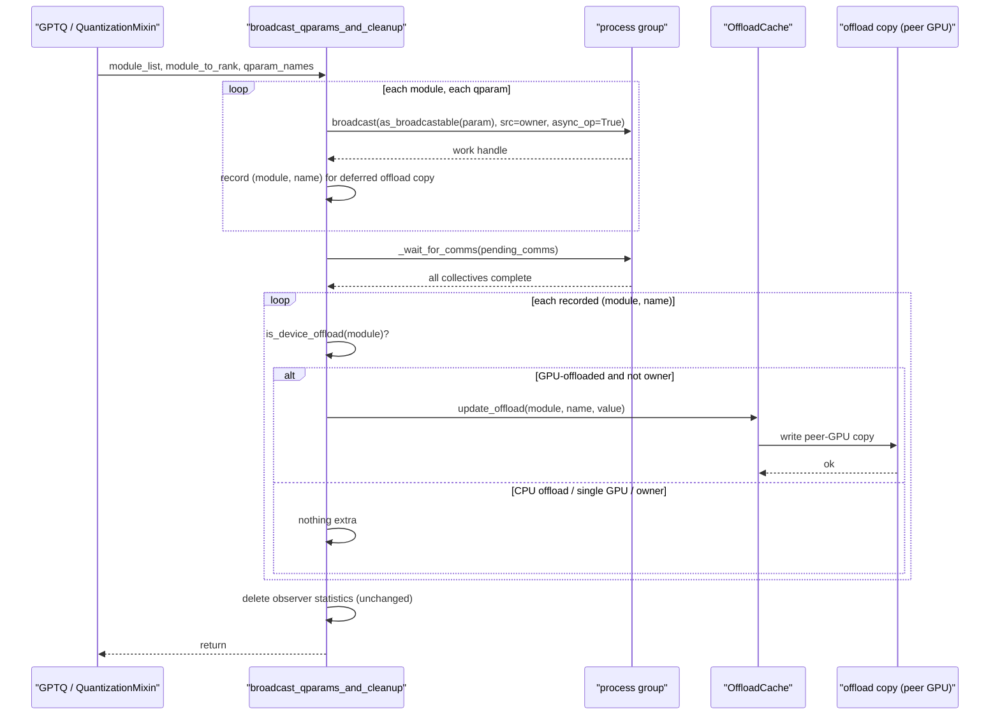

# #2480 approach C — open-code the offload sync in `utils/dist.py`

Parent: [#2480 overview](2480-gpu-offload.md) · Recommended instead:
[A — rebase onto the new primitives](2480-approach-a-wait-and-rebase.md)

Keep everything inside LLM Compressor: extend
`broadcast_qparams_and_cleanup` to sync the offloaded copy directly, using the
offload helpers compressed-tensors already exports. **This is what
[#3257](https://github.com/vllm-project/llm-compressor/pull/3257) does**, so
treat that PR as the reference implementation rather than starting over.

## Design

From the PR description:

> `broadcast_qparams_and_cleanup` (`src/llmcompressor/utils/dist.py`, shared by
> GPTQ and the `QuantizationMixin` path) now also keeps the **offloaded** copies
> in sync for GPU-offloaded modules — `DeviceCache` with
> `onload_device != offload_device` — not only the onloaded copies. On every
> non-owning rank the broadcast-received value is copied into the offloaded copy
> via `OffloadCache.update_offload`; the copy is deferred until the async
> broadcasts are waited on (`_wait_for_comms`) ... The collectives themselves
> stay on the process-group device — no cross-device NCCL dependency.

Three properties worth naming:

1. **One function covers both paths.** GPTQ and `QuantizationMixin` already
   share `broadcast_qparams_and_cleanup`, so the fix lands once.
2. **Only non-owning ranks copy.** The owning rank computed the value and
   already has it.
3. **Collectives stay on the process-group device.** The peer-GPU write is a
   local copy afterwards, not part of the collective.

Note the PR's `DeviceCache` reference is now stale — see the
[overview](2480-gpu-offload.md). The predicate must be rebuilt from
`get_offloaded_device` / `get_execution_device`.

## Flow

## Sequence

## Step-by-step

1. Read #3257 first. If the author is active, offer to help rather than
   duplicate — he said he would rebase it himself.
2. Add the `is_device_offload` predicate, built from `get_offloaded_device` and
   `get_execution_device`.
3. Restructure the loop into two phases: issue broadcasts and record what needs
   an offload copy, then after `_wait_for_comms` perform the copies. The
   two-phase shape is what makes the ordering correct by construction rather
   than by comment.
4. Skip the owning rank.
5. Leave `skip_cpu`, CPU offload, and single-GPU behaviour untouched.
6. GPTQ-first scope, behind `device_map="auto"`.

## Tests

Mirror #3257: 12 CPU-runnable unit tests for the device-selection policy and
fallbacks, plus a 2-GPU integration test asserting that **both** the offloaded
peer-GPU copy and the onloaded copy agree across ranks after the broadcast.

The offload-copy assertion is the one that matters. A test that only checks the
onloaded copy passes on `main` and proves nothing.

## Trade-offs

**For:**

- Single-repo change, one review cycle. Much shorter path than
  [approach B](2480-approach-b-compressed-tensors-util.md).
- A working implementation already exists, hardware-validated.
- The two-phase loop makes the NCCL ordering structural.

**Against:**

- **The issue asked for this to be generic** ("should likely live as a
  compressed-tensors utility"). This keeps the predicate in LLM Compressor, so a
  reviewer may ask for it to move — which is approach B wearing a different hat.
- Duplicates offload-topology knowledge that compressed-tensors already owns.
- Conflicts directly with the in-flight refactor, which is why the PR is parked.

## When to choose this

If the refactor lands and leaves `broadcast_qparams_and_cleanup` broadly intact,
this is the smallest correct change — and in that case approach A *is* this
approach, rebased. The two converge; the difference is only whether you start
from #3257 (A) or write it again (C). Starting from #3257 is strictly better.
