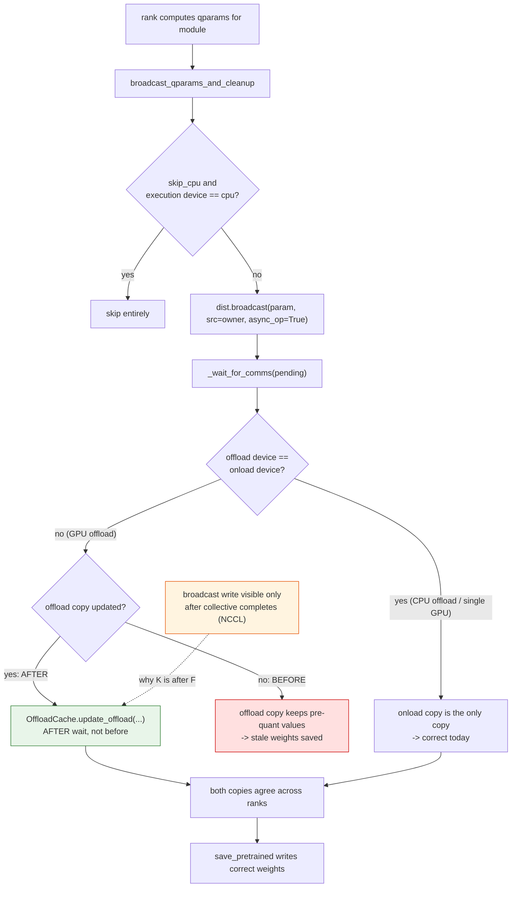
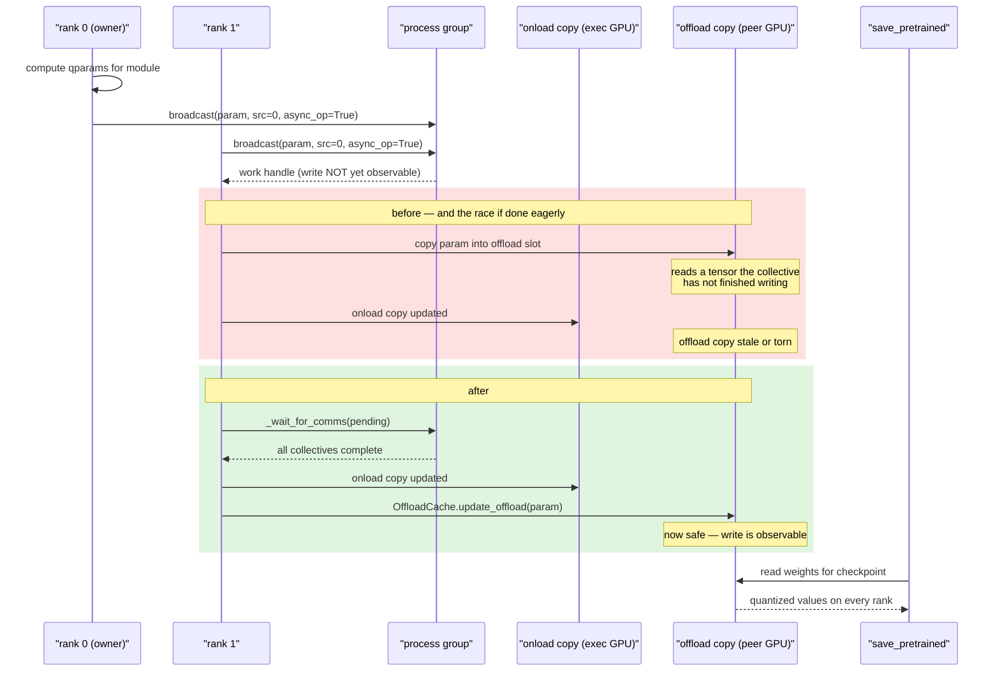

# #2480 — Enable GPU offloading for reduced weight movement

- **Issue:** [vllm-project/llm-compressor#2480](https://github.com/vllm-project/llm-compressor/issues/2480)
- **Labels:** `enhancement`, `good first issue`
- **Assignee:** `HDCharles`
- **Status:** ⚠️ **Blocked.** See below before writing any code.
- **Approaches:** [A — rebase onto the new offload primitives](2480-approach-a-wait-and-rebase.md) (recommended) ·
  [B — compressed-tensors update primitive](2480-approach-b-compressed-tensors-util.md) ·
  [C — open-code in `utils/dist.py`](2480-approach-c-dist-util.md)

## Read this first — the issue is blocked and partly stale

**It is blocked.** On 2026-10-21 `HDCharles` told a contributor with working
code:

> I think @Roderick-Wu is making a ton of offloading changes and this task will
> look different after that is done. Once those land if you want to update your
> PR we can work on getting this feature in but if we do it before, it's going
> to have to be redone with the new offloading changes.

As of this writing that refactor has **not** landed. Still open:
[#3294](https://github.com/vllm-project/llm-compressor/pull/3294) (async
offload writing and checkpoint streaming),
[#3234](https://github.com/vllm-project/llm-compressor/pull/3234) (lazy
linearization and repacking),
[#3342](https://github.com/vllm-project/llm-compressor/pull/3342) (refactor
initialization + calibration start).

**It is also stale.** The issue's pseudocode calls APIs that do not exist in the
current compressed-tensors (0.20.2a20261103). Verified:

```
DeviceCache               -> absent
OffloadCache              -> present
OffloadCache.offloading_disabled -> present
OffloadCache.update_offload      -> present
update_parameter          -> absent
```

So this, from the issue, cannot be written as-is:

```python
def is_device_offload(module):
  return isinstance(module._parameters, DeviceCache) and \
         module._parameters.onload_device != module._parameters.offload_device
```

`DeviceCache` is gone. The equivalent today is built from `OffloadCache` plus
the device helpers `get_execution_device` / `get_offloaded_device`, both exported
from `compressed_tensors.offload`.

**Despite the `good first issue` label, this is not a good first issue right
now.** It needs multi-GPU hardware to validate, it depends on an in-flight
refactor, and it reaches into distributed collectives. The four prior volunteers
and one abandoned assignment reflect that.

## What the feature is

Today LLM Compressor offloads large models to **CPU** and onloads each layer to
GPU for calibration. That protects against OOM but leaves GPU VRAM idle.

For medium models the weights can instead live on **other GPUs**, replacing slow
CPU↔GPU transfers over the host bus with fast GPU↔GPU transfers over PCIe or
NVLink. The user-facing shape is just:

```python
model = AutoModelForCausalLM.from_pretrained(..., device_map="auto")
oneshot(model, ...)
```

`kylesayrs` clarified it composes with DDP rather than competing with it:

> This feature is orthogonal and composable with DDP. DDP + GPU offloading means
> that each GPU holds a fraction of the model weights. At loading time, each rank
> onloads the layer, sourced from whichever GPU holds that fraction of the
> weights.

## The actual technical problem

When a rank finishes computing quantization parameters for a module, it
broadcasts them so every rank agrees. Today that updates only the **onloaded**
copy. With GPU offloading there are two distinct copies on two distinct devices:

- the **onload** copy on the execution device, and
- the **offload** copy on whichever GPU holds that slice of the model.

If only the onloaded copy is updated, the offloaded copy keeps pre-quantization
values — and that is the one that gets written to the checkpoint. The symptom is
not a crash. It is a model that saves stale or partially-quantized weights,
which is exactly the class of bug the
[frozen-save issue](https://github.com/vllm-project/llm-compressor/issues/3303)
describes elsewhere.

## Current code

`src/llmcompressor/utils/dist.py:55` — `broadcast_qparams_and_cleanup`, shared by
GPTQ and the `QuantizationMixin` path:

```python
def broadcast_qparams_and_cleanup(module_list, module_to_rank, qparam_names, skip_cpu=True):
    pending_comms = []
    for module in module_list:
        should_broadcast = not skip_cpu or (
            get_execution_device(module) != torch.device("cpu")
        )
        if should_broadcast:
            for name in qparam_names:
                if (param := getattr(module, name, None)) is not None:
                    pending_comms.append(
                        dist.broadcast(as_broadcastable(param),
                                       src=module_to_rank[module], async_op=True)
                    )
        ...
    _wait_for_comms(pending_comms)
```

Note `skip_cpu` keys off the **execution** device only. There is no notion of an
offload device being different from it, which is precisely the gap.

## The subtlety any approach must handle

From `stanleyIl`, who has it working:

> the copy is deferred until the async broadcasts are waited on
> (`_wait_for_comms`), because on the NCCL backend a broadcast's write to its
> target tensor is only observable after the collective work completes

So you cannot broadcast and immediately copy into the offload slot. The write
must happen after `wait()`. Getting this wrong produces a **race**: it will pass
on small models and single-node tests and corrupt weights intermittently under
load. This is the single most important detail on the issue, and it is in a
comment rather than the issue body.

He also notes the collectives themselves stay on the process-group device, so no
cross-device NCCL dependency is introduced.

## Flow



## Sequence



## Prior work

| Contributor | Contribution |
|---|---|
| `Etelis` | Original assignee (2026-03), no PR |
| `dzhengAP` | Offered the `is_device_offload` migration, from distributed-broadcast work in #2471 |
| `ishrith-gowda` | Proposed routing through the compressed-tensors `update_parameter` primitive ([approach B](2480-approach-b-compressed-tensors-util.md)) |
| `stanleyIl` | **Working implementation**, PR [#3257](https://github.com/vllm-project/llm-compressor/pull/3257) — 12 CPU unit tests plus a 2-GPU integration test, validated on a rented 2×RTX 3090 node. Open, last updated 2026-10-15. Parked pending the refactor. |

Also asked and unanswered, from `ishrith-gowda`:

> should offload device selection reuse the accelerate `device_map`, or do you
> want an explicit LLM Compressor setting?

Worth resolving before implementing, since it determines whether this is
configuration-free or needs a new user-facing argument.

## Recommendation

**Approach A** — do not start from scratch. Read
[#3257](https://github.com/vllm-project/llm-compressor/pull/3257), wait for the
offload refactor, then rebase its logic onto the new primitives. The maintainer
asked for exactly that, and #3257 already encodes the NCCL ordering constraint
that is the hard part.

If you want to contribute *now*, the useful work is not this issue: it is
reviewing #3257, or helping land the blocking refactor PRs.
