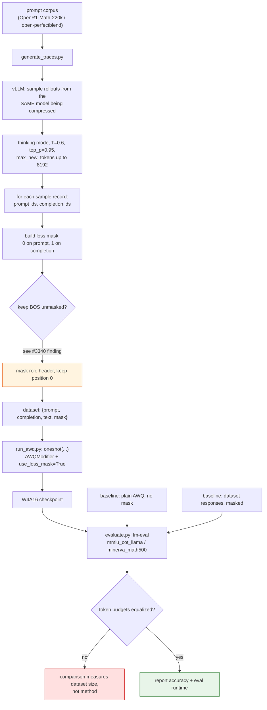
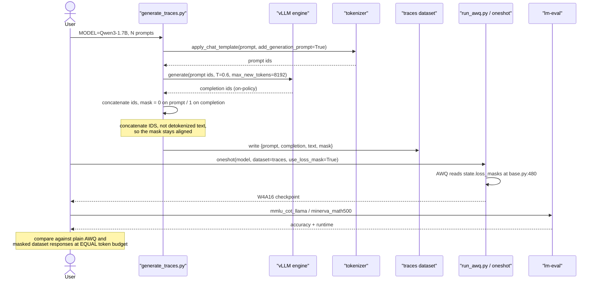

# #2974 approach A — standalone trace script plus example

Parent: [#2974 overview](2974-rac.md) · Alternative:
[B — datasets module](2974-approach-b-datasets-module.md) (declined)

**This is the scoped task.** A script that generates on-policy CoT traces with
vLLM, an AWQ example that calibrates on them with masking, and a reported
evaluation.

## Placement

Outside `src/`, following the speculators precedent and
`brian-dellabetta`'s suggestion:

> would it make sense to have this live elsewhere, perhaps in a top-level
> `scripts/` folder not in `src/`

```
examples/reasoning_aware_compression/
├── README.md                  # method, results table, how to re-run
├── generate_traces.py         # vLLM rollouts -> dataset with prompt/completion
├── run_awq.py                 # oneshot + AWQModifier(use_loss_mask=True)
└── evaluate.py                # lm-eval harness invocation
```

Keeping it in `examples/` means it is not importable from `llmcompressor`, which
is the point: vLLM never enters the dependency graph. `README.md` carries the
results, which is deliverable 3 ("a launchpoint for others").

## Flow



## Sequence



## Step-by-step

1. **Generation script.** Model the CLI on speculators'
   `response_regeneration`. Take `MODEL`, prompt dataset, sample count,
   `max_new_tokens`, temperature. `HDCharles` offered to re-run on a larger
   model, so a single `MODEL=...` override must be sufficient.

2. **Tokenize once, concatenate ids.** Apply the chat template with
   `add_generation_prompt=True` for the prompt segment, then append the raw
   generated ids. **Do not** round-trip through detokenized text — for
   R1-distill-style checkpoints the `<think>` markers and assistant-turn opener
   do not survive a detokenize/retokenize cycle cleanly, and any drift
   misaligns the mask by a token or two. A mask off by one is not a crash; it is
   a quietly wrong result.

3. **Build the mask** as 0 over prompt positions, 1 over completion positions.
   Keep position 0 unmasked, per the
   [attention-sink finding](3340-task-gptq-hessian.md) — masking BOS cost
   0.738 → 0.691 on gsm8k for GPTQ. Verify it holds for AWQ rather than
   assuming.

4. **Calibration script.** `oneshot` with `AWQModifier` and
   `use_loss_mask=True`. No modifier changes — AWQ already consumes
   `state.loss_masks`.

5. **Baselines, token-matched.** At minimum:
   - plain AWQ, no mask
   - masked dataset responses (the ablation that actually won in replication)
   - masked own CoT (RAC)

   Report realized loss-mask token counts per arm. The paper budgets in tokens;
   `oneshot` budgets in samples, so `num_calibration_samples × max_seq_length`
   has to be sized deliberately.

6. **Evaluate** on a long-form reasoning task. `mmlu_cot_llama` is what the
   maintainer named; `minerva_math500` discriminated better in replication.
   Report **eval runtime alongside accuracy** — the rambling effect is half the
   story and is what users notice.

7. **Report honestly.** If on-policy ties masked dataset responses, say so. That
   is a genuine finding at this scale, and `AbigaleD` has already published it on
   the issue.

## Tests

Light, since this lives in `examples/`:

| Test | Asserts |
|---|---|
| Mask alignment | On a tiny model, `mask.sum()` equals the completion token count exactly |
| Template round trip | Prompt ids from the template are a strict prefix of the concatenated ids |
| BOS unmasked | Position 0 has mask 1 |
| `use_loss_mask` plumbing | A short `oneshot` populates `state.loss_masks` with the expected shapes |
| Token accounting | Reported token count matches what calibration consumed |

The first is the one that matters — every silent failure mode here is a
misaligned mask.

## Risks

| Risk | Mitigation |
|---|---|
| Mask off by one from detokenization | Concatenate ids; assert prefix property |
| Comparison confounded by token budget | Equalize and report counts |
| Masking BOS | Keep position 0; verify for AWQ |
| vLLM / llm-compressor version conflict | Separate script, separate env; document versions |
| Overclaiming the result | Report replication numbers as-is |
| Scope creep back toward the RFC | Keep everything out of `src/` |

## Effort

Low-to-moderate in code; the cost is GPU time for generation and evaluation
across three calibration arms and two bit-widths. Structure the scripts so a
maintainer with more compute can re-run them unchanged.
