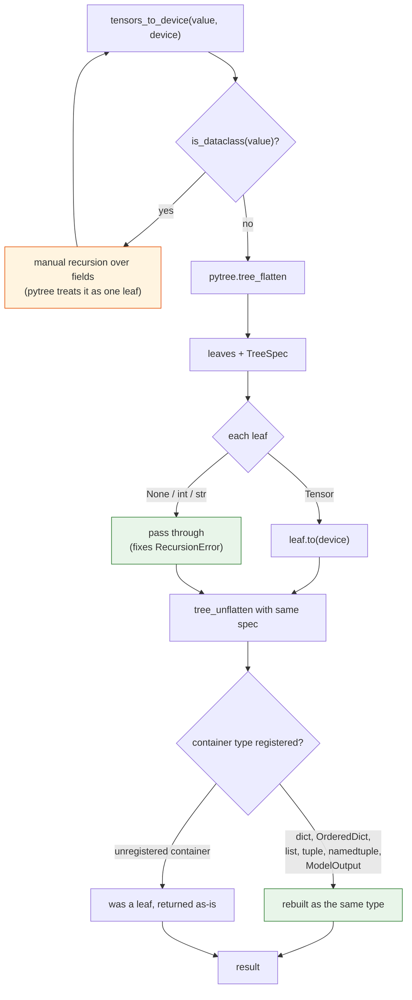
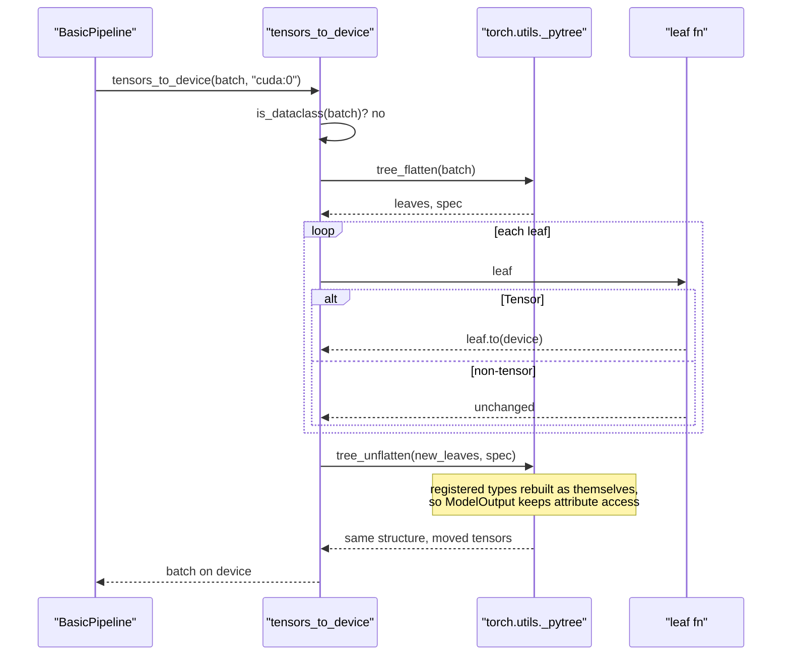

# #3161 approach A — full pytree migration

Parent: [#3161 overview](3161-pytree.md) · Alternatives:
[B — targeted fix](3161-approach-b-targeted-fix.md) ·
[C — pytree + registration](3161-approach-c-pytree-with-registration.md)

Replace each walker's `match` statement with `tree_map` / `tree_flatten`, keeping
the dataclass branch as a special case because pytree does not traverse plain
dataclasses.

**This is the approach that stalled the issue.** It takes the pytree dependency
without removing the dataclass handling, which is exactly what prompted
"we're not really saving that much code". Documented for completeness; prefer
[C](3161-approach-c-pytree-with-registration.md).

## Design

```python
from torch.utils import _pytree as pytree

def tensors_to_device(tensors, device):
    if is_dataclass(tensors) and not isinstance(tensors, type):
        return type(tensors)(**{
            f.name: tensors_to_device(getattr(tensors, f.name), device)
            for f in fields(tensors)
        })
    return pytree.tree_map(
        lambda leaf: leaf.to(device) if isinstance(leaf, torch.Tensor) else leaf,
        tensors,
    )
```

The dataclass pre-check stays, pytree handles everything else, and the leaf
lambda passes non-tensors through — which incidentally fixes both the `str`
recursion and the `None` `ValueError`.

## Flow



## Sequence



## Step-by-step

1. Confirm with `kylesayrs` that pytree is wanted at all, given his comment.
   Skipping this risks repeating the stall.
2. Migrate `tensors_to_device` first — one production caller, smallest surface.
3. Delete `tensors_to_precision` (maintainer-approved: "no use case for it").
   Its tests go too.
4. Migrate `IntermediatesCache`. Harder: `_offload_value` / `_onload_value`
   *transform* values rather than just mapping them, and offloaded leaves are
   wrapped in `IntermediateValue` with a `device` field. The container
   `device=None` convention must survive a flatten/unflatten round trip.
5. Keep `_pin_intermediate` and `_size_helper` as `tree_flatten` + a loop over
   leaves — they only traverse, so they are the easiest wins.
6. Decide the unknown-leaf policy explicitly (see the overview).

## Tests

| Test | Asserts |
|---|---|
| `ModelOutput` preserved | `tensors_to_device(BaseModelOutput(...))` returns a `BaseModelOutput` and attribute access works. **Fails on `main`.** |
| `str` passthrough | No `RecursionError`. **Fails on `main`.** |
| `None` / `int` passthrough | No `ValueError` |
| `OrderedDict` preserved | Returns `OrderedDict`, key order intact |
| `namedtuple` preserved | Rebuilt as the namedtuple type, not a plain tuple |
| dataclass traversed | Tensors inside move device |
| nested mix | dict of list of dataclass of tensor |
| `IntermediatesCache` round trip | offload then onload is identity for every supported structure |

## Risks

| Risk | Mitigation |
|---|---|
| Objection unresolved, PR stalls again | Ask first; or use approach C |
| `IntermediatesCache` offload semantics regress | Round-trip test per structure before refactoring |
| Private `torch.utils._pytree` API | State the torch floor and why in the PR |
| Silent dataclass skip if the pre-check is dropped | Explicit dataclass test |
| Behaviour change on unknown leaves | Call it out in the PR body |

## Effort

Moderate. `tensors_to_device` plus the deletion is an afternoon;
`IntermediatesCache` is the bulk, and is where the real review risk is.
Consider splitting into two PRs.
