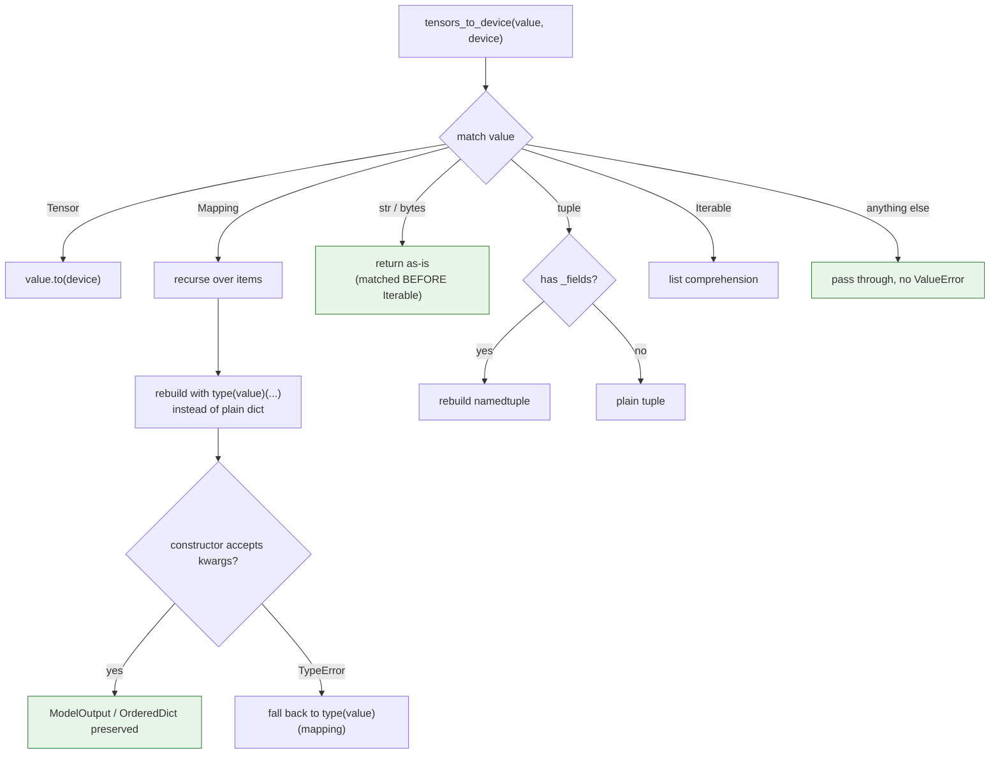
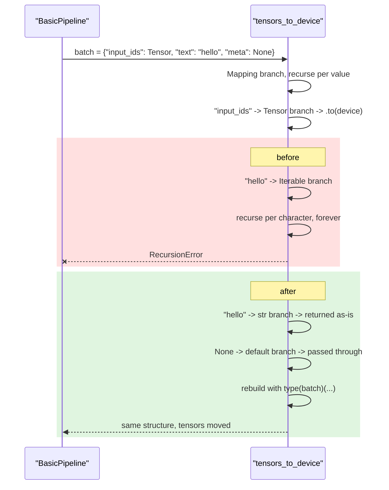

# #3161 approach B — targeted fix, no pytree

Parent: [#3161 overview](3161-pytree.md) · Alternatives:
[A — full pytree](3161-approach-a-full-pytree.md) ·
[C — pytree + registration](3161-approach-c-pytree-with-registration.md)

Keep the hand-rolled walkers and fix the two real bugs directly. The maintainer
himself pointed at this option: if pytree doesn't save much code, the honest
alternative is to not take the dependency and just fix the behaviour.

`kylesayrs` noted the current code *could* already preserve `ModelOutput` with
`type(value)(...)`. `aayush7511` agreed: "The current code could also preserve
`ModelOutput` with `type(value)(...)`."

## Design

Two changes per walker:

```python
match tensors:
    case Tensor():
        return tensors.to(device)

    case Mapping():                      # covers dict, OrderedDict, ModelOutput
        moved = {k: tensors_to_device(v, device) for k, v in tensors.items()}
        try:
            return type(tensors)(**moved)     # preserve the concrete type
        except TypeError:
            return type(tensors)(moved)       # dict-like that takes a mapping

    case str() | bytes():                # BEFORE Iterable: str is iterable
        return tensors

    case tuple():
        return type(tensors)(*(...)) if hasattr(tensors, "_fields") \
               else tuple(...)           # namedtuple vs plain tuple

    case Iterable():
        return [tensors_to_device(t, device) for t in tensors]

    case _:
        return tensors                   # pass through, do not raise
```

The ordering matters: `str` must be matched **before** `Iterable()`, which is
precisely the bug today.

## Flow



## Sequence



## Step-by-step

1. Add a `str() | bytes()` case **before** `Iterable()` in `tensors_to_device`.
2. Replace the dict rebuild with `type(tensors)(...)` so `ModelOutput` and
   `OrderedDict` survive. Keep the `TypeError` fallback — not every mapping
   subclass takes keyword arguments.
3. Preserve namedtuples by checking `_fields`.
4. Change the default case from `raise ValueError` to pass-through, and say so
   in the PR body — it is a deliberate behaviour change, and the thing that
   makes non-tensor batch fields work.
5. Delete `tensors_to_precision` (maintainer-approved) and its tests.
6. Apply the same `str` ordering and type-preserving rebuild inside
   `IntermediatesCache`'s `match` statements.

## Tests

The same table as [approach A](3161-approach-a-full-pytree.md) — the *behaviour*
being fixed is identical, only the mechanism differs. That is a useful property:
write the tests first, and they are valid whichever approach a reviewer prefers.

## Trade-offs

**For:**

- Lowest risk. No new dependency, no private API, no pytree semantics to learn.
- Fixes both real bugs — `ModelOutput` and `str` recursion.
- Each walker keeps its own documented unknown-leaf policy, which
  `amacharla15` asked to preserve.
- Likely to merge quickly.

**Against:**

- Does not answer the issue as written. The issue asks to *use pytree*; this
  declines to. Say that plainly in the PR and let the maintainer decide.
- Every new registered container type still needs a hand-written branch here.
  That is the structural argument pytree wins on, and this approach gives it up.
- Three walkers keep three near-identical `match` statements.

## When to choose this

If the maintainer confirms pytree isn't wanted, or if you want the bug fixes
landed without waiting on that decision. It is also a sound first PR that makes
approach C a smaller, cleaner follow-up: the tests carry over unchanged.
