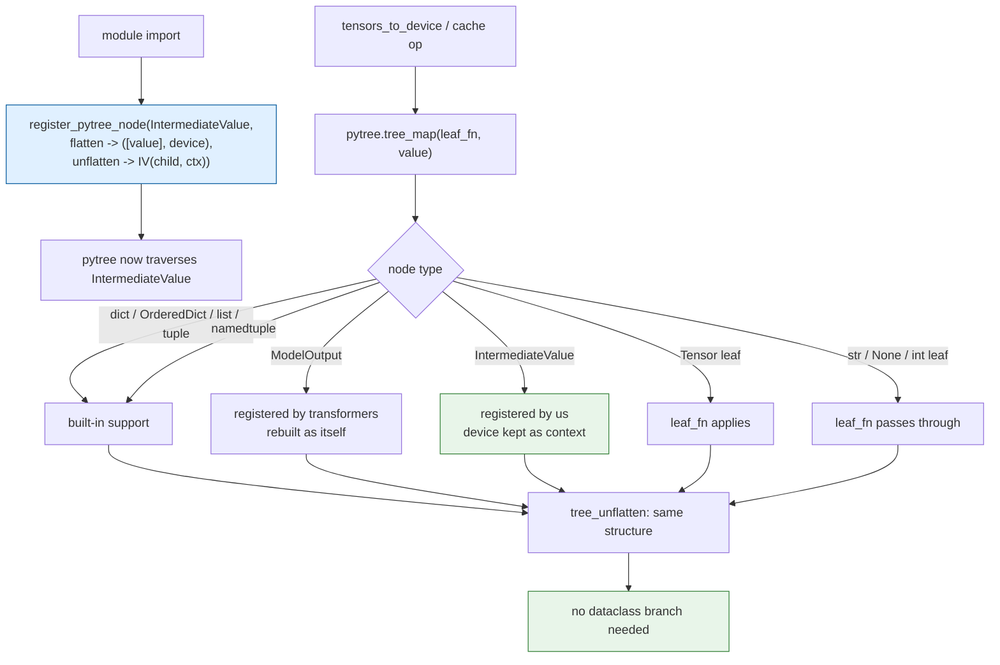
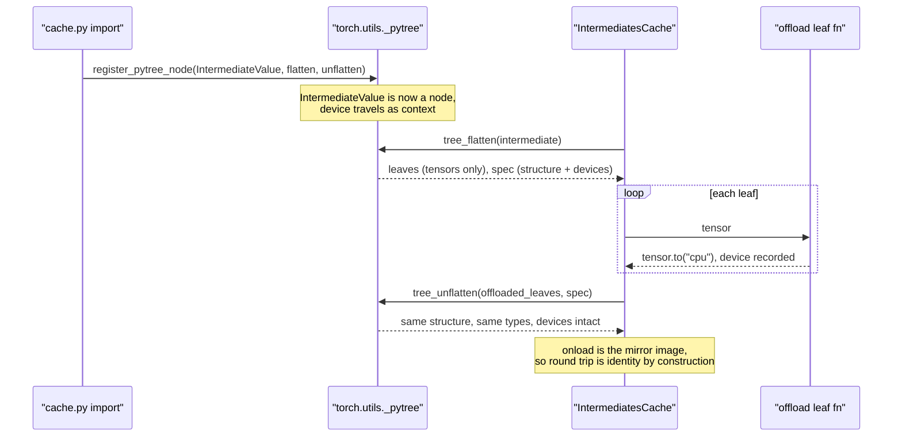

# #3161 approach C — pytree plus dataclass registration (recommended)

Parent: [#3161 overview](3161-pytree.md) · Alternatives:
[A — full pytree](3161-approach-a-full-pytree.md) ·
[B — targeted fix](3161-approach-b-targeted-fix.md)

Use pytree **and** register the project's own dataclasses with it, so the
dataclass branch genuinely disappears. This is the only approach that answers
the objection that stalled the issue rather than working around it.

## Why this resolves the disagreement

`kylesayrs`: pytree doesn't traverse dataclasses, so the special case stays, so
little is saved. Correct — *for unregistered* dataclasses. But pytree's whole
extension mechanism is registration, and the dataclasses here are the project's
own types.

Verified on this tree (torch 2.15.0):

```
before registration: spec = *                          # one opaque leaf
after registration:  spec = TreeSpec(IV, cpu, [*])      # traversed
rebuilt:             type=IV device_ctx='cpu'           # type and metadata preserved
nested tree_map:     {'a': [IV(value=tensor([10.]), device='cpu'),
                            IV(value=tensor([20.]), device='cuda')]}
```

The `device` field rides along as pytree **context** — the per-node metadata that
is not a leaf — and comes back intact through `tree_unflatten`. That maps
exactly onto `IntermediatesCache`'s `IntermediateValue(value, device)`, where
`device` is metadata and `value` is the payload. The convention that containers
carry `device=None` survives a round trip for free.

So after registration:

- the dataclass branch in every walker **goes away**,
- `ModelOutput` keeps attribute access,
- `str` / `None` / `int` pass through,
- any type another library registers later works with no change here.

## Flow



## Sequence



## Step-by-step

1. **Post the finding on the issue first.** The verified before/after spec output
   above is the argument that unblocks the discussion. Do this before writing
   code — it is a two-line comment that decides the whole PR's shape.
2. **Register `IntermediateValue`** in `cache.py` at module scope, flattening to
   `([value], device)`.
3. **Rewrite `_pin_intermediate` and `_size_helper`** as `tree_flatten` plus a
   loop. They only traverse, so they are pure deletion — do these first to build
   confidence.
4. **Rewrite `_offload_value` / `_onload_value`** as `tree_map`. These transform,
   so check the round trip per structure before and after.
5. **Rewrite `tensors_to_device`** as `tree_map` with a pass-through leaf
   function. Delete `tensors_to_precision`.
6. **Guard the registration against double registration** — pytree raises if a
   type is registered twice, which bites on module reload (notebooks, repeated
   imports in tests). Catch it or check first.
7. Decide and document the unknown-leaf policy change (see the overview).

## Tests

Everything from [approach A](3161-approach-a-full-pytree.md), plus:

| Test | Asserts |
|---|---|
| Registration round trip | `tree_unflatten(tree_flatten(iv))` returns an `IntermediateValue` with the same `device` |
| `device` as context | A nested mix of `IntermediateValue`s with different devices each keep their own |
| Container `device=None` | Survives the round trip |
| Double registration | Importing the module twice does not raise |
| Offload/onload identity | Per structure: tensor, list, tuple, dict, dataclass, nested mix |

## Risks

| Risk | Mitigation |
|---|---|
| Double registration on reload | Guard it; test it |
| Global registry is process-wide | Registering *our own* types only is safe; never register a third-party type |
| `IntermediatesCache` semantics regress | Round-trip tests per structure, written before the refactor |
| Private `torch.utils._pytree` | State the torch floor; check whether public `torch.utils.pytree` covers the floor |
| Objection not actually resolved | Post the verified output first and get agreement |

## Why this is the recommendation

It is the only option where the code-volume argument flips: with registration,
the dataclass branches are deleted rather than retained, so pytree *does* save
code, and the `ModelOutput` and `str` bugs are fixed as a side effect. It also
leaves the codebase extensible — a future registered container needs no change
to any walker.

The cost is one concept (pytree node registration) that a reader has to know.
That is a fair trade for deleting three near-identical recursive walkers, but
it is a judgement call, which is why [B](3161-approach-b-targeted-fix.md) stays
on file as the low-risk alternative.
