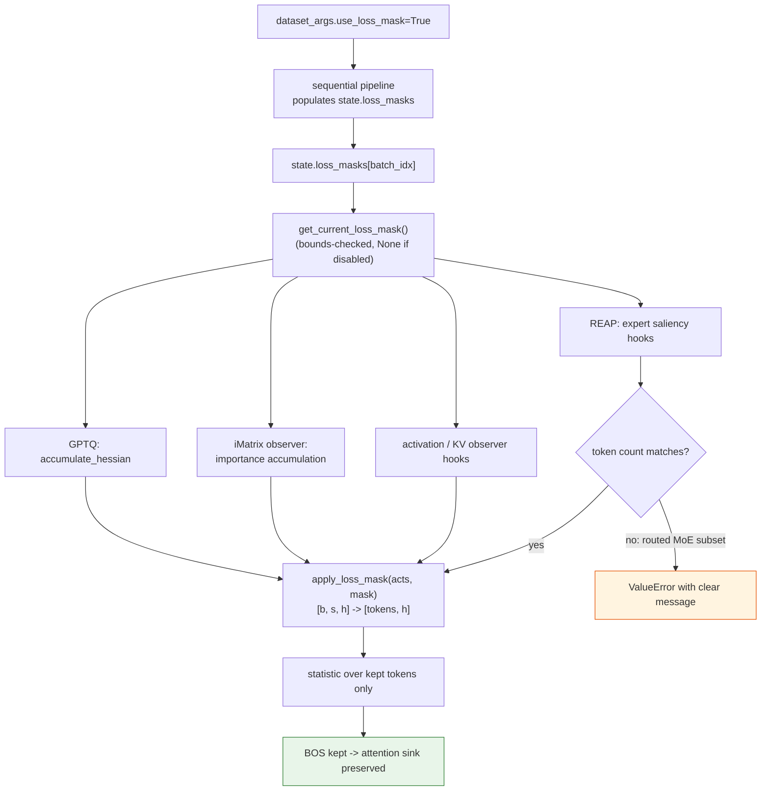
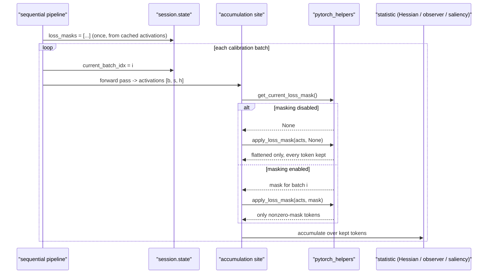

# #3340 — Add masking to modifiers and observers

- **Issue:** [vllm-project/llm-compressor#3340](https://github.com/vllm-project/llm-compressor/issues/3340)
- **Labels:** `enhancement`, `good first issue`, `good follow-up issue`, `gptq`
- **Assignee:** `HDCharles` (tracking issue)
- **Sub-tasks:** [GPTQ Hessian](3340-task-gptq-hessian.md) ·
  [iMatrix observer](3340-task-imatrix-observer.md) ·
  [REAP saliency](3340-task-reap-saliency.md) ·
  [activation & KV observers](3340-task-activation-kv-observers.md)

## What is being asked

AWQ has supported token masking since
[#2250](https://github.com/vllm-project/llm-compressor/pull/2250). The same
capability is wanted for everything else that accumulates statistics over
calibration tokens. The maintainer was explicit that this is **four separate
tasks**, one PR each:

> each modifier/masking situation can be a separate task. Pick one at a time

Each sub-task has its own plan file above. **All four are already claimed** — see
the status table below before starting anything.

## Why masking matters

A calibration batch is not uniformly informative. Chat-templated data begins
with an identical prefix on every sample (BOS plus a role header), and those
positions carry outsized activations. Any statistic averaged over all tokens is
therefore dominated by text the model will never be asked to predict.

The reported effect is large. From `BeichenHuang` on the issue, GPTQ on
Llama-3-8B-Instruct at INT3 g128, wikitext PPL at 2048 context:

| Calibration positions | PPL |
|---|---|
| All tokens | 179 |
| Prefix positions excluded | **13.3** |

A 13× perplexity difference from a masking decision alone.

## The counter-intuitive finding — keep BOS

PR [#3365](https://github.com/vllm-project/llm-compressor/pull/3365) found that
masking is **not** simply "drop the prefix". Dropping the first 5 tokens of each
sample — BOS plus the role header, about 1% of tokens — made things *worse*:

| Mask | gsm8k W4A16 | gsm8k W3A16 |
|---|---|---|
| No masking | 0.738 | 0.613 |
| First 5 tokens masked | 0.691 | 0.384 |
| Same, but position 0 kept | recovered | recovered |

The explanation is Llama's **attention sink**: position 0 carries massive
activations, and GPTQ must see them to compensate their quantization error.
Mask the sink and the Hessian no longer describes the tensor the model actually
runs.

Every sub-task should keep BOS in the mask, and every example should say why.
This is the single most valuable piece of inherited knowledge here — it is not
in the issue body, only in that PR.

## Shared mechanism (use it, don't re-invent)

The plumbing already exists end to end:

| Piece | Location |
|---|---|
| User-facing flag | `use_loss_mask` in `src/llmcompressor/args/dataset_arguments.py:318` |
| Per-batch masks | `state.loss_masks` in `src/llmcompressor/core/state.py:105` |
| Populated by | `src/llmcompressor/pipelines/sequential/pipeline.py:199-207` |
| Only consumer today | AWQ, `src/llmcompressor/modifiers/transform/awq/base.py:480` |

PR #3365 factors AWQ's inlined logic into two reusable helpers in
`src/llmcompressor/modifiers/utils/pytorch_helpers.py`:

```python
get_current_loss_mask()            # state.loss_masks[state.current_batch_idx], bounds-checked, None when disabled
apply_loss_mask(activations, mask) # [batch, seq, hidden] -> [num_tokens, hidden], keeping nonzero mask positions
```

The maintainer directed two claimants to build on it:

> @lightlefter stack yours on top of #3365 and use those helpers
> @sohom-cs same

**#3365 is still open.** Stacking on an unmerged PR means your branch moves if
review changes those helpers. Base on it anyway — duplicating the logic is worse
— but expect a rebase, and keep your own diff free of changes to the helpers
themselves.

## Approach decision, already made

| Option | Verdict |
|---|---|
| **Per-site masking via shared helpers** | **Chosen.** Each accumulation site asks for the current mask and filters its own tokens. Honours each site's token layout. |
| Central pre-filtering of the batch | Rejected implicitly. Dropping tokens before the forward pass changes attention context, so the surviving activations are no longer the ones the model computes at inference. It would also destroy the attention sink the finding above says must be preserved. |

So the shape of all four sub-tasks is the same: call `get_current_loss_mask()`
at the accumulation site, apply it with `apply_loss_mask()`, and leave behaviour
identical when `use_loss_mask` is unset.

## Shared design flow



## Per-batch sequence



## Status of the four sub-tasks

| Sub-task | Claimed by | State |
|---|---|---|
| GPTQ Hessian | `BeichenHuang` | PR [#3365](https://github.com/vllm-project/llm-compressor/pull/3365) open, defines the shared helpers |
| iMatrix observer | `biluohq` | Requested 2026-10-22 |
| REAP saliency | `lightlefter` | Told to stack on #3365 |
| Activation + KV observers | `sohom-cs` | Told to stack on #3365 |

`bigdaronlee163` claimed and then released the issue.

## Shared acceptance criteria

The issue sets these explicitly — all four apply:

1. Masking support for one target, one PR.
2. An example demonstrating it.
3. Run it and confirm it works.
4. Ideally, compare with and without masking on an eval set.

Plus two that fall out of the findings above:

5. **No behaviour change when `use_loss_mask` is unset** — the regression test
   that matters most, since masking is opt-in and every existing user is on the
   unset path.
6. **BOS retained** in any example mask, with a comment explaining the sink.
