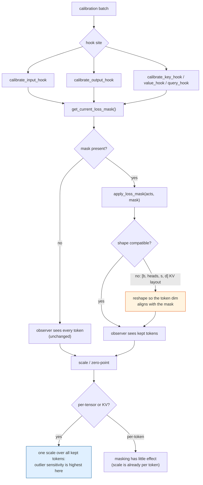
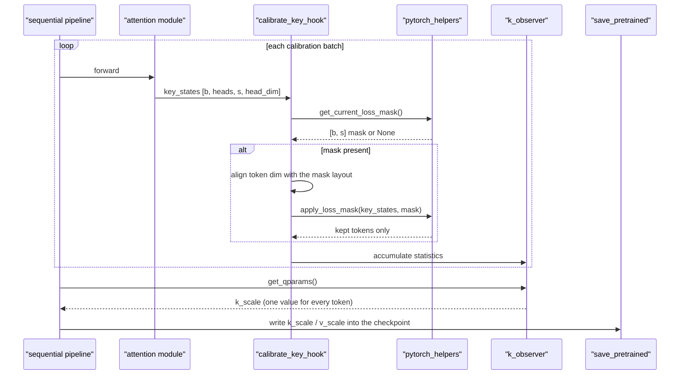

# #3340 sub-task — activation and KV-cache observer masking

Parent: [#3340 overview](3340-masking.md) · **Claimed by `sohom-cs`** (2026-11-02)

Maintainer direction: stack on
[#3365](https://github.com/vllm-project/llm-compressor/pull/3365) and use its
helpers.

## What accumulates here

`sohom-cs` surveyed this precisely on the issue, and the line numbers check out
against the current tree:

> On main the sequential pipeline fills `state.loss_masks` when `use_loss_mask`
> is set (`pipelines/sequential/pipeline.py:199`), but only AWQ reads it
> (`modifiers/transform/awq/base.py:480`). `calibrate_input_hook`,
> `calibrate_key_hook` and `calibrate_value_hook`
> (`modifiers/quantization/calibration.py:184-216`) pass every token to the
> observer, so static activation scales and `k_scale`/`v_scale` also cover the
> chat-template prefix tokens.

The four hooks in `calibration.py` are each a one-liner that forwards the whole
tensor to an observer:

```python
def calibrate_input_hook(module, args):
    args = args[0] if isinstance(args, tuple) else args
    module.input_observer(args)

def calibrate_key_hook(module, key_states):
    module.k_observer(key_states)

def calibrate_value_hook(module, value_states):
    module.v_observer(value_states)
```

So this sub-task has the **largest reach and the smallest diff** of the four: it
covers static input activations, output activations, and Q/K/V observers, and
each site is a single call.

## Why it matters most for per-tensor and KV scales

A per-tensor static activation scale, or a `k_scale`/`v_scale`, is one number
covering every token. Its calibration is driven by the **maximum** (min/max
observers) or by an error sum over every value (MSE observers). Either way a
single massive-activation prefix token can set the scale for the entire tensor,
wasting most of the numeric range on text the model never generates.

This is the same quantity-vs-group-size interaction documented in
the MSE observer FP32-accumulation change note (on the `fix/mse-observer-fp16-error-overflow` branch):
per-tensor and KV groups span every token × hidden value, so they are maximally
exposed to a few outlier tokens.

## The BOS tension — think before copying the GPTQ rule

The GPTQ finding is "keep BOS, because the solve must compensate the sink's
quantization error". For an **activation scale** the logic may well invert: if
the sink token sets a per-tensor max far above every other token, including it
costs range for all the tokens that matter.

Those two are not the same question. GPTQ needs the sink *represented*; an
activation range may be better off *clipping* it. Do not assume the GPTQ
conclusion transfers — measure it, and report both. If masking BOS helps
activation scales while hurting GPTQ, that is a genuinely useful finding for the
issue, and it means the two features should not share one example's mask.

Note also that MSE observers already have a clipping mechanism for exactly this
(the shrink grid search), so masking and MSE clipping partly overlap. Worth
reporting masked-minmax versus unmasked-MSE, not just masked versus unmasked.

## Flow



## Sequence



## The KV shape problem

`apply_loss_mask` assumes `[batch, seq, hidden]`. Key and value states are
typically `[batch, heads, seq, head_dim]` — the token dimension is **dim 2, not
dim 1**. Passing them straight in will either raise the helper's token-count
`ValueError` or, worse, mask along the head dimension if the counts happen to
coincide.

Handle the layout explicitly at the hook, and add a test with `heads != seq` so
a transposition bug cannot pass by coincidence. Picking `heads == seq` in a
fixture is the obvious way to ship this bug undetected.

## Step-by-step

1. Base on #3365.
2. Start with `calibrate_input_hook` — simplest layout, clearest win.
3. Then the output hook. Note it also calls `forward_quantize` and **returns**
   the quantized output; masking must affect only the observer, never the
   returned tensor. Quantizing a masked-down tensor would corrupt the forward
   pass.
4. Then Q/K/V hooks, with explicit layout handling.
5. Add an FP8 KV-cache example.
6. Compare scales and one eval with and without masking, including the BOS
   question above.

## Tests

| Test | Asserts |
|---|---|
| `use_loss_mask` unset | Every scale identical to `main` |
| All-ones mask | Equals unmasked, for input, output and KV |
| Partial mask, per-tensor | Scale equals the one computed from kept tokens alone |
| KV layout, `heads != seq` | Masking is along the token dim; a transposition fails |
| Output hook | The returned quantized tensor keeps its original shape |
| Per-token strategy | Masking does not change per-token scales |
| Empty mask | Defined behaviour, no NaN scale |

## Risks

| Risk | Note |
|---|---|
| KV token dim mistaken for heads | Highest-probability bug; test `heads != seq` |
| Masking the output hook's return value | Corrupts the forward pass, not just the statistic |
| Assuming the GPTQ BOS rule transfers | May be the opposite for activation ranges — measure |
| Overlap with MSE clipping | Report masked-minmax vs unmasked-MSE to separate the effects |
