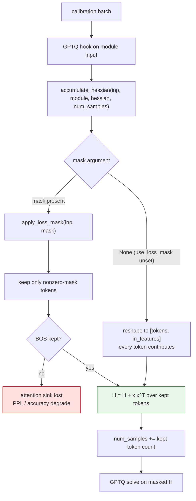
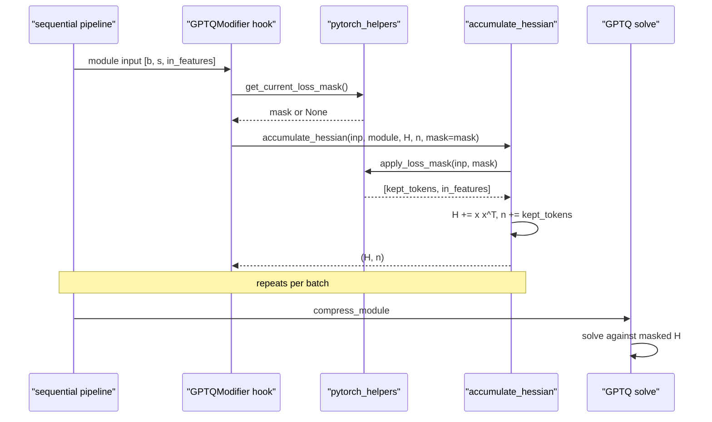

# #3340 sub-task — GPTQ Hessian masking

Parent: [#3340 overview](3340-masking.md) · **Claimed by `BeichenHuang`** ·
PR [#3365](https://github.com/vllm-project/llm-compressor/pull/3365) (open)

This sub-task is **already implemented and under review**. It is documented
because it defines the shared helpers the other three depend on, and because its
evaluation produced the attention-sink finding. Read this before starting any of
the others.

## Why GPTQ is the most sensitive target

GPTQ solves, per layer, `min || W X − Ŵ X ||²` using the Hessian
`H = Σ x xᵀ` accumulated over calibration tokens. `H` is a second-moment matrix,
so a token's contribution scales with the **square** of its activation
magnitude. A handful of massive-activation prefix tokens can therefore dominate
`H` outright, and the solve compensates error for text the model will never
generate.

Measured on Llama-3-8B-Instruct, INT3 g128, wikitext PPL @ 2048:

| Calibration positions | PPL |
|---|---|
| All tokens | 179 |
| Prefix excluded | **13.3** |

## The trap this PR uncovered

Excluding the prefix wholesale is wrong. Masking the first 5 tokens — BOS plus
role header, ~1% of tokens — made gsm8k *worse*:

| Mask | W4A16 | W3A16 |
|---|---|---|
| None | 0.738 | 0.613 |
| First 5 masked | 0.691 | 0.384 |
| First 5 masked, position 0 restored | recovered | recovered |

Position 0 is Llama's **attention sink**. Its activations are enormous, and
GPTQ needs them in `H` precisely so it can compensate their quantization error.
Removing the sink leaves a Hessian that does not describe the tensor at
inference.

**Rule: keep BOS.** Mask role headers and padding, never position 0.

## Flow

## Sequence

## What the PR changes

| File | Change |
|---|---|
| `modifiers/utils/pytorch_helpers.py` | **New shared helpers**: `get_current_loss_mask()`, `apply_loss_mask()` (+60/−3) |
| `modifiers/gptq/helpers.py` | `accumulate_hessian` takes optional `mask`, applies it for Linear and Conv1D (+8/−3) |
| `modifiers/gptq/base.py` | Passes the current mask into the hook (+2) |
| `modifiers/transform/awq/base.py` | AWQ's inlined logic replaced by the helpers (+9/−17 — a net deletion) |
| `examples/quantization_w4a16/llama3_example_with_masking.py` | New example, keeps BOS (+143) |
| `tests/.../gptq/test_loss_mask.py`, `tests/.../utils/test_pytorch_helpers.py` | New tests (+231) |

Two details worth copying in the other sub-tasks:

- **The sample counter must track kept tokens, not input rows.** `H` is
  normalized by `num_samples`; counting masked-out tokens would scale the
  Hessian wrongly and silently change the solve.
- **A token-count mismatch raises `ValueError` with a clear message.** Routed
  MoE experts see only a subset of the batch, so a batch-shaped mask does not
  apply. AWQ previously hit an opaque indexing error here.

## If you are reviewing or rebasing onto it

- The helpers are the public surface. Keep your own sub-task's diff free of
  changes to them; propose changes on #3365 instead.
- `Conv2d` is not covered by the mask path — only Linear and Conv1D. Confirm
  whether that is deliberate before assuming it is an omission.
- Verify `use_loss_mask` unset is bit-identical to `main`. That is the path every
  existing user is on.
