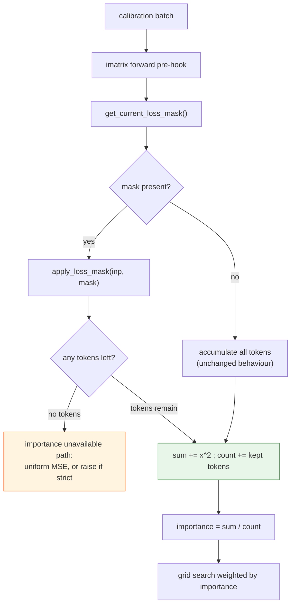
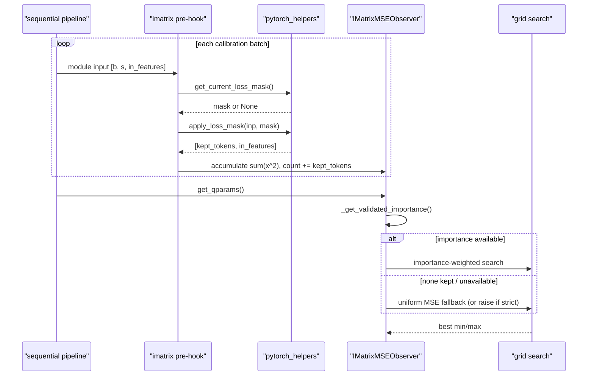

# #3340 sub-task — iMatrix observer masking

Parent: [#3340 overview](3340-masking.md) · **Claimed by `biluohq`** (2026-10-22)

## What accumulates here

The iMatrix observer weights quantization error by per-channel **importance**,
`E[x²]`, estimated from calibration activations. Its objective is

```
importance * |QDQ(w) − w| ** norm
```

summed over the tensor. Importance is derived from running sum/count statistics
(`_get_validated_importance` → `_prepare_importance` in
`src/llmcompressor/observers/imatrix.py`), accumulated by a forward pre-hook
attached in `attach()` (`imatrix.py:124-141`).

Like GPTQ's Hessian this is a **second-moment** statistic, so massive-activation
prefix tokens dominate it quadratically. Unlike GPTQ, the consequence is not a
distorted solve but a distorted *importance vector*: channels that only look
important because of the chat prefix get over-protected, and channels that
matter for generated text get under-protected.

## Where to apply the mask

The accumulation site is the hook in `attach()`, which receives the module input
before the forward call. That is the natural place to filter tokens, for the
same reason as GPTQ: the statistic is a reduction over tokens, so dropping rows
before accumulation is exact rather than approximate.

Two things must stay consistent:

- **Sum and count must be filtered together.** Importance is `sum / count`;
  masking the sum while counting every token biases importance low by the mask
  ratio, which is a silent, uniform scale error — the worst kind, because the
  observer still produces plausible numbers.
- **The fallback path must be preserved.** The observer falls back to uniform MSE
  when importance is unavailable, and `strict=True` raises instead. A mask that
  removes *every* token from a group must take the existing unavailable path, not
  divide by zero. Worth an explicit test.

## Flow



## Sequence



## Step-by-step

1. Base on [#3365](https://github.com/vllm-project/llm-compressor/pull/3365) and
   use its two helpers. Do not re-implement mask lookup.
2. In the `attach()` hook, fetch the mask and filter the input before
   accumulating.
3. Filter sum and count together.
4. Confirm the "no importance" path still triggers correctly when a mask empties
   a group, including `strict=True`.
5. Add an example mirroring the AWQ and GPTQ masking examples, keeping BOS.
6. Report importance vectors and one eval with and without masking.

## Tests

| Test | Asserts |
|---|---|
| `use_loss_mask` unset | Statistics bit-identical to `main`. The priority test. |
| All-ones mask | Equals the unmasked result. Proves the mask path itself adds no drift. |
| Partial mask | Importance equals the value computed on the kept tokens alone, hand-computed on a small tensor. |
| Empty mask | Takes the unavailable-importance path; `strict=True` raises; no division by zero. |
| Count consistency | `count` equals kept tokens, not input rows. |
| Token-count mismatch | Raises the helper's `ValueError`, not an index error. |

CPU-runnable; follow the existing `tests/llmcompressor/observers/test_imatrix.py`
patterns.

## Risks

| Risk | Note |
|---|---|
| Masking sum but not count | Uniform low bias in importance; invisible without a count assertion |
| Masking the attention sink | Same failure as GPTQ — see the [overview](3340-masking.md) |
| Empty group after masking | Must reach the existing fallback, not NaN |
| `nvfp4_expanded_imatrix` subclass | Inherits the hook; confirm it is covered or explicitly out of scope |
