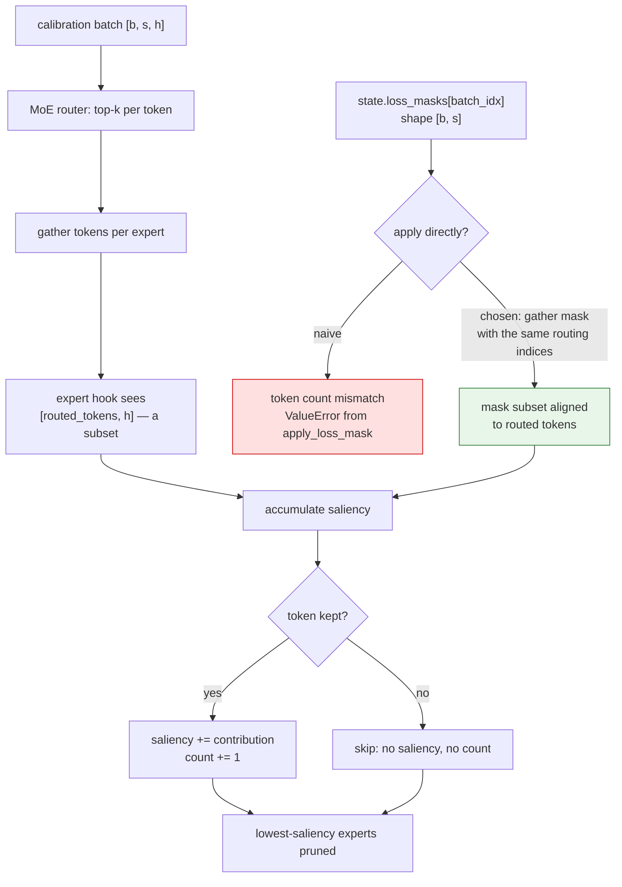
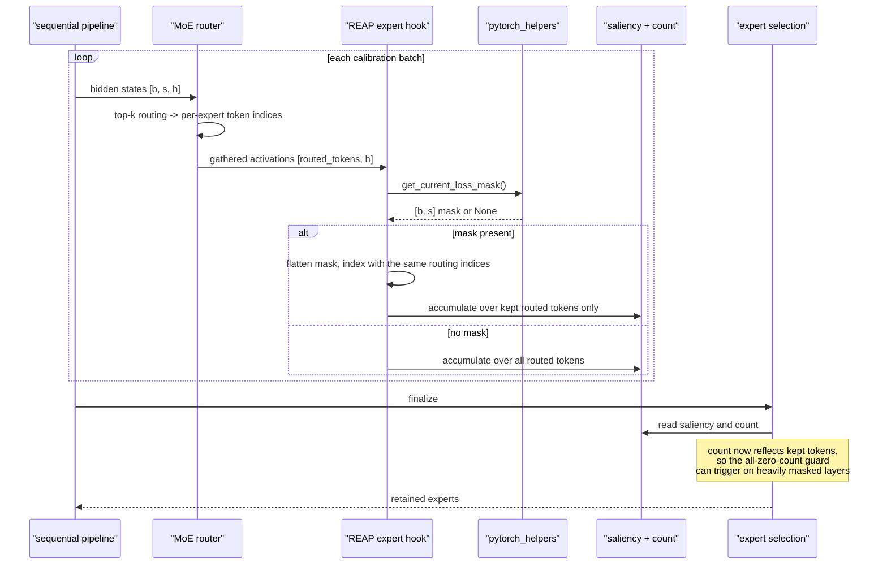

# #3340 sub-task — REAP expert saliency masking

Parent: [#3340 overview](3340-masking.md) · **Claimed by `lightlefter`** (2026-11-03)

Maintainer direction:

> @lightlefter stack yours on top of #3365 and use those helpers

## What accumulates here

REAP (`src/llmcompressor/modifiers/pruning/reap/base.py`) scores each MoE expert
by a **saliency** statistic gathered during calibration, then prunes the
lowest-scoring experts. It also records a routed-token `count` per expert, which
feeds the "skip layers with no routed tokens" guard and the saliency report the
[`ExpertPruner` converter](3453-approach-a-converter.md) can read back.

Unmasked, saliency answers "which experts matter for the calibration text,
including its chat prefix". With a prefix identical across every sample, the
experts that happen to serve those tokens accumulate saliency on text the model
never generates — so an expert can be retained for the wrong reason, or pruned
despite mattering for generation.

## The complication unique to this sub-task

**Expert hooks do not see the whole batch.** MoE routing sends each token to a
subset of experts, so an expert's hook receives a *gathered* subset of the
batch's tokens. A batch-shaped `[batch, seq]` mask therefore cannot be applied
directly — the token counts do not match.

PR #3365 anticipated exactly this. Its `apply_loss_mask` raises a `ValueError`
with a clear message when the mask's token count disagrees with the activations,
specifically citing "routed MoE experts, which only see a subset of the batch".
So the helper will stop you rather than silently mis-index — but it will not
solve the problem for you.

This is the real design work in this sub-task: **carry the mask through the
routing gather**. Options, in rough order of preference:

1. **Gather the mask with the tokens.** Wherever routing produces the per-expert
   token index list, index the flattened mask with the same indices. Exact, and
   keeps the mask aligned by construction. Requires access to the routing
   indices at the hook site.
2. **Flatten the mask once per batch and pass positions alongside activations.**
   Equivalent, but needs a channel to carry positions into the hook.
3. **Mask before routing.** Rejected for the same reason as central
   pre-filtering in the [overview](3340-masking.md) — it changes what the router
   sees, so the gathered activations are no longer the inference-time ones.

Settle this with the maintainer before writing much: it determines whether the
change is local to REAP or touches shared MoE routing helpers.

## Flow

## Sequence

## Interaction with the zero-count guard

REAP's base skips layers whose routed-token `count` is all zeros. Masking
**lowers** counts, so a layer whose tokens are entirely masked out now trips a
guard it previously passed. That is arguably correct — there is genuinely no
signal — but it changes which layers get pruned, so:

- Decide and document whether an all-masked layer should be skipped (pruning
  nothing) or fall back to unmasked counts.
- Note that this is the mirror image of the
  [AIMER approach-B blocker](3453-approach-b-modifier.md), where a modifier has
  no counts at all. Both point at the same under-specified base-class contract.

## Step-by-step

1. Base on #3365; use `get_current_loss_mask` / `apply_loss_mask`.
2. Locate where routing indices are available relative to the expert hooks.
3. Implement mask gathering (option 1 above) and confirm token counts agree.
4. Decide the all-masked-layer policy and document it.
5. CPU test with the existing `FakeMoEConfig` fixture.
6. Example based on the AWQ masking example, keeping BOS.
7. Report saliency ordering and one eval with and without masking.

## Tests

| Test | Asserts |
|---|---|
| `use_loss_mask` unset | Saliency and counts identical to `main` |
| All-ones mask | Equals unmasked |
| Partial mask | Saliency equals the value over kept routed tokens, on a tiny deterministic MoE |
| Counts | Reflect kept tokens, not all routed tokens |
| All-masked layer | Hits the documented policy, no NaN or crash |
| Mask/activation mismatch | Raises the helper's `ValueError` if gathering is bypassed |

## Risks

| Risk | Note |
|---|---|
| Mask misaligned with routed tokens | The central risk; gathering with routing indices is the only exact fix |
| Changed zero-count behaviour | Shifts which layers prune; must be deliberate |
| Saliency report consumers | The converter can read these reports; masked counts change their meaning |
| Touching shared routing helpers | Widens blast radius — confirm scope first |
