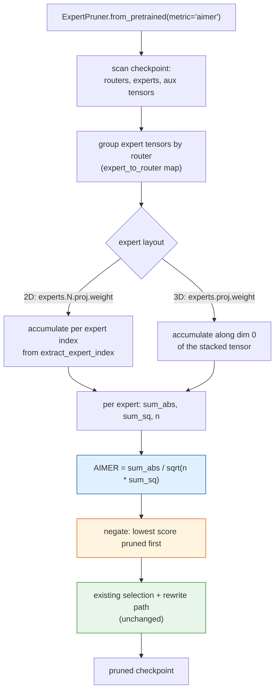
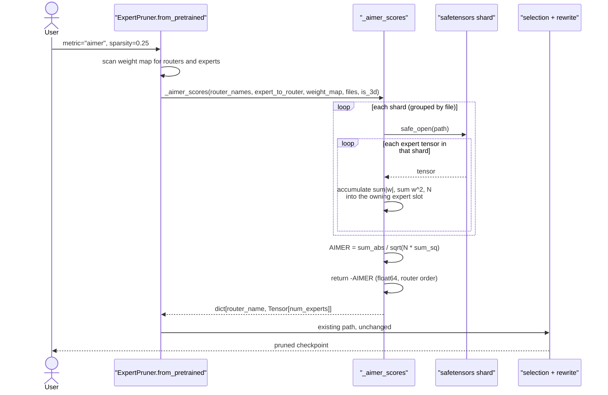

# #3453 approach A — AIMER as a calibration-free converter

Parent: [#3453 overview](3453-aimer.md) · Alternative: [approach B](3453-approach-b-modifier.md)

**This is the approach `kylesayrs` asked for.** AIMER needs no calibration data,
so it belongs on the checkpoint-rewriting converter path rather than the
in-memory modifier path.

## Design

Add AIMER as a new `metric` on the existing `ExpertPruner` converter, rather
than a new class. Everything downstream of scoring — expert selection, router
slicing, renumbering, auxiliary tensors, hash layers, group-limited routing,
config updates — is already implemented and shared by all metrics.

```python
ExpertPruner.from_pretrained(
    "org/MoE-model",
    sparsity=0.25,
    metric="aimer",        # new
    uniform=True,
)
```

A subclass (`AIMERExpertPruner(ExpertPruner)`) is the literal reading of the
comment, but a new `metric` value is the smaller change and matches how
`magnitude` / `saliency` / `count` are already distinguished. **Confirm which
shape the maintainer wants before writing much code** — it is a five-minute
question on the issue and changes the diff substantially.

## Why the converter path fits

| Property | Consequence |
|---|---|
| Score depends only on weights | No dataset, no forward pass, no hooks |
| Converter reads shards with `safe_open` | Never materializes the full model; works on a laptop |
| Scoring is already pluggable | Selection/rewriting logic is reused untouched |
| No routed-token statistics involved | The assignee's `count` question does not arise |

## Flow



## Scoring sequence



## Step-by-step

1. **Extend the metric enum.** Add `"aimer"` to the `Literal` in
   `from_pretrained` and to the validation at `expert_pruner.py:181`. AIMER must
   *not* require `saliency_report_path` — it belongs with `magnitude`, so the
   `metric in REPORT_METRICS` guard already excludes it. Add `"aimer"` to the
   docstring's `:param metric:` list.

2. **Write `_aimer_scores()`** next to `_magnitude_scores()`. Signature differs:
   it needs the expert tensor names and `expert_to_router`, not router names
   alone. Accumulate three running quantities per expert — `sum|w|`, `sum w²`,
   and element count — so each shard is read once and no expert's full weight
   set is ever held in memory at the same time.

   Accumulate in `float64`, matching `_magnitude_scores`. A 4-bit-ready MoE
   expert can have tens of millions of elements, and `sum w²` in `float32` over
   that many terms loses precision in exactly the way
   the MSE observer FP32-accumulation change note (on the `fix/mse-observer-fp16-error-overflow` branch) did
   — a lesson already paid for once in this codebase.

3. **Handle both layouts.** For 2D, use the existing `extract_expert_index` to
   map a tensor name to its expert slot. For 3D, reduce over all dims except
   dim 0, giving the whole `[num_experts]` vector from one tensor. The converter
   already records `is_3d` and `expert_indices`, so both are available.

4. **Negate.** Return `-AIMER` so the shared "lowest score pruned first" logic
   prunes the highest AIMER. Put the reason in a comment with a link to the
   reference implementation — a future reader will otherwise "fix" the sign.

5. **Wire it in** at `expert_pruner.py:260`, where `metric == "magnitude"`
   branches to `_magnitude_scores`, and store `instance.metric` as the existing
   code does.

## Tests

`tests/llmcompressor/entrypoints/converter/`:

| Test | Asserts |
|---|---|
| `test_aimer_score_matches_formula` | On a hand-built tensor, the score equals `sum_abs / sqrt(n * sum_sq)` computed directly. Use a tensor where the value is not 1.0 by construction. |
| `test_aimer_prunes_highest_scoring` | Build two experts, one deliberately high-AIMER, assert the high one is pruned. **This is the regression guard for the sign.** |
| `test_aimer_2d_and_3d_agree` | The same logical weights in 2D and 3D layouts produce equal scores. |
| `test_aimer_requires_no_report` | `metric="aimer"` without `saliency_report_path` succeeds, unlike the report metrics. |
| `test_aimer_shard_split` | Experts split across two shards score the same as co-located ones — guards the accumulate-don't-concatenate structure. |

Use the existing MoE checkpoint fixtures in that directory; the converter path
is CPU-only and needs no GPU.

## Risks

| Risk | Mitigation |
|---|---|
| Sign inverted | Dedicated test; comment at the negation |
| `float32` accumulation loses precision on large experts | Accumulate in `float64` |
| Subclass vs. metric shape | Ask on the issue first |
| 3D reduction over wrong dims | Cross-layout equality test |
| Scores not in router order | Mirror `_magnitude_scores`'s final reordering |

## Effort

Roughly 150–250 lines of source plus tests. The scoring function is the only
real logic; the rest is enum plumbing and docstrings.
