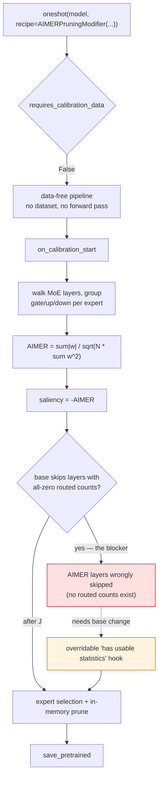
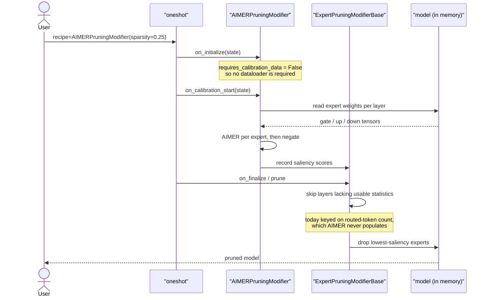

# #3453 approach B — AIMER as a pruning modifier

Parent: [#3453 overview](3453-aimer.md) · Recommended instead: [approach A](3453-approach-a-converter.md)

This is the literal reading of the issue title and the assignee's original plan.
**A maintainer has since steered away from it.** It is documented here because
it is the only option if AIMER needs to run inside an in-memory `oneshot`
alongside other modifiers, and because the assignee's open question only makes
sense in this frame.

## Design

```python
class AIMERPruningModifier(ExpertPruningModifierBase):
    requires_calibration_data: bool = False

    def on_calibration_start(self, state):
        # score every expert from weights, no forward pass needed
        ...
```

Scores are computed from module weights during the data-free lifecycle, then
handed to the base class's existing expert-selection and pruning machinery.

## Flow



## Lifecycle sequence



## The blocker

`ExpertPruningModifierBase` skips layers whose routed-token `count` is all
zeros — a sensible guard for REAP, which genuinely cannot score a layer no token
reached. AIMER never populates `count`, so **every layer looks unusable**.

Two ways out:

1. **Overridable predicate** (the assignee's proposal): a small
   `_has_usable_statistics(layer)` on the base that REAP implements via `count`
   and AIMER implements as "always true". Clean, but it changes a shared base
   class for one subclass — a maintainer may reasonably decline.
2. **Populate `count` with ones.** Fastest, and wrong: it makes a diagnostic
   field lie, and any future logic reading `count` as a real token count
   silently misbehaves. Avoid.

That this blocker exists at all is the clearest argument for approach A, where
routed-token counts are not part of the model.

## Step-by-step

1. Confirm with a maintainer that the modifier path is wanted *despite* the
   converter comment. Do not skip this — it is the difference between a merged
   PR and a rewrite.
2. Add `AIMERPruningModifier(ExpertPruningModifierBase)` under
   `src/llmcompressor/modifiers/pruning/expert_sparsity/`, with
   `requires_calibration_data = False`.
3. Score in `on_calibration_start`, accumulating `sum|w|`, `sum w²` and element
   count per expert in `float64`.
4. Negate the score before handing it to the base.
5. Resolve the statistics guard via option 1 above.
6. Register the modifier so `ModifierFactory` resolves it from a recipe, and
   confirm it loads from YAML.

## Tests

- Score correctness against a hand-computed value (as approach A).
- Pruning direction: highest AIMER pruned.
- A data-free `oneshot` run with **no `dataset=` argument at all**, asserting it
  does not raise — this is the property that justifies
  `requires_calibration_data = False`.
- Recipe round trip: `AIMERPruningModifier` loads from a YAML recipe.
- Layers are not skipped for want of routed-token statistics.

Use the `FakeMoEConfig` fixture other expert-sparsity tests use for CPU runs.

## Trade-offs versus approach A

| | A (converter) | B (modifier) |
|---|---|---|
| Maintainer-endorsed | Yes | Superseded |
| Needs base-class change | No | Yes |
| Memory | Shard-at-a-time | Whole model in memory |
| Composable in a recipe | No | Yes |
| New surface | One `metric` value | New class + base hook |

The one real advantage of B is recipe composability — AIMER running in the same
`oneshot` as a quantization modifier. If nobody needs that, B is strictly more
work for the same result.
