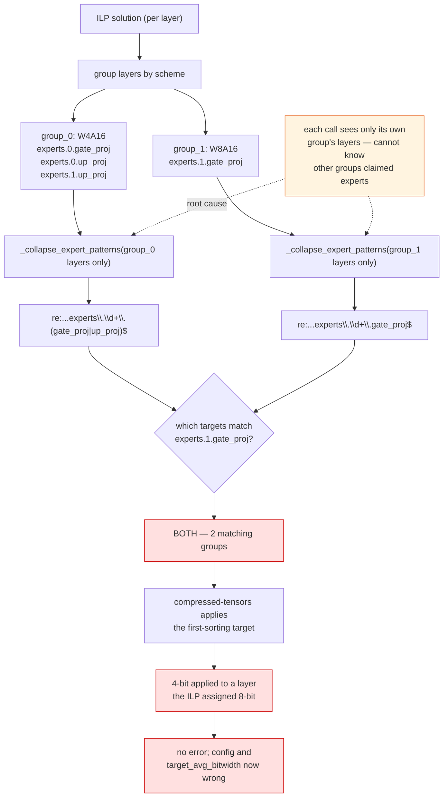
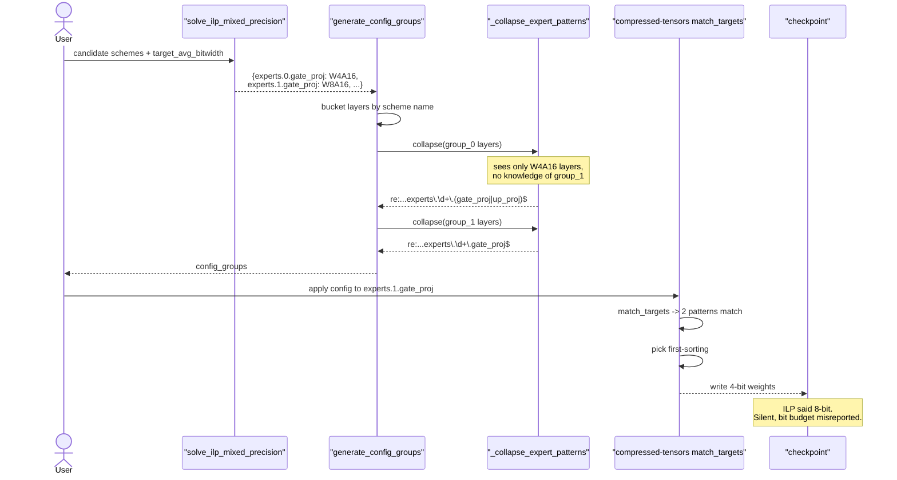

# #3301 — HIGGS applies the wrong scheme to MoE experts the ILP assigned differently

> Issue explained in detail. The fix plan is in [3301-plan.md](3301-plan.md).

- **Issue:** [vllm-project/llm-compressor#3301](https://github.com/vllm-project/llm-compressor/issues/3301)
- **Labels:** none · **Assignee:** none · **Open PR:** none
- **Reproduced:** ✅ exactly as reported, on CPU, in this tree
- **Severity:** silent wrong result — no error is raised

## Symptom

HIGGS is a *mixed-precision* method: its integer linear program chooses a
scheme **per layer**, so two experts of the same projection can legitimately
receive different precisions. When they do, the generated config quantizes some
of them at the wrong precision:

```
experts.0.gate_proj: ILP=W4A16  applied_bits=4  matching_groups=2
experts.0.up_proj  : ILP=W4A16  applied_bits=4  matching_groups=1
experts.1.gate_proj: ILP=W8A16  applied_bits=4  matching_groups=2   <-- wrong
experts.1.up_proj  : ILP=W4A16  applied_bits=4  matching_groups=1
```

`experts.1.gate_proj` was assigned **W8A16** by the ILP and receives **4-bit**
weights. Nothing warns. The run completes and writes a checkpoint.

Three consequences, from the report:

- An expert assigned a higher-precision scheme is quantized with another
  group's lower-precision scheme (or the reverse).
- With `allow_unquantized=True`, an expert the ILP deliberately left
  **unquantized** is still matched by a quantized group's wildcard and gets
  quantized anyway.
- The saved config no longer matches the ILP solution, so the achieved average
  bitwidth differs from the requested `target_avg_bitwidth` — the optimizer's
  entire output is misrepresented.

That last point is the real damage: HIGGS exists to spend a bit budget
optimally, and this silently spends it somewhere else.

## Root cause

`_collapse_expert_patterns` (`src/llmcompressor/entrypoints/higgs/utils.py:150`)
compresses per-expert layer names into a wildcard so the config does not list
hundreds of experts individually:

```python
if len(suffixes) == 1:
    targets.append(f"re:^{escaped}\\.\\d+\\.{re.escape(suffixes[0])}$")
else:
    alt = "|".join(re.escape(s) for s in suffixes)
    targets.append(f"re:^{escaped}\\.\\d+\\.({alt})$")
```

The `\d+` matches **every** expert index. That is correct only if every expert
of that projection belongs to this group.

And the function **cannot know whether that holds**, because
`generate_config_groups` calls it once per scheme group, passing only that
group's own layers:

```python
for idx, (scheme_name, layer_list) in enumerate(quantized_groups):
    ...
    scheme_dict["targets"] = _collapse_expert_patterns(sorted(layer_list))
```

So each group collapses in isolation, with no view of which expert indices the
other groups claimed. The information needed to collapse safely is available in
`ilp_solution` — one scope up — but is never passed down.

## The actual generated targets

From the reproducer in this tree:

```
group_0  bits=4
    re:^model\.layers\.0\.mlp\.experts\.\d+\.(gate_proj|up_proj)$
group_1  bits=8
    re:^model\.layers\.0\.mlp\.experts\.\d+\.gate_proj$
```

Both patterns match `...experts.1.gate_proj`. `group_0`'s `\d+` was meant to
cover only experts 0 and 1's `up_proj` plus expert 0's `gate_proj`, but it also
sweeps up expert 1's `gate_proj`, which belongs to `group_1`.

compressed-tensors then applies whichever matching target sorts first — and
`(gate_proj|up_proj)` sorts before `gate_proj` here — so the 4-bit group wins.
**Which group wins is incidental**, a consequence of string ordering rather than
of anything meaningful. The same bug could resolve the other way on a different
projection name.

## Mechanism



## Sequence



## Verification in this tree

The reporter's script needs no ILP solver and no model — it calls
`generate_config_groups` directly with a hand-written solution, so it runs on
CPU in under a second. Output here matches the report exactly, including the
`matching_groups` counts.

Worth noting: this makes #3301 **more testable than most of the HIGGS code**,
which normally needs PuLP plus a CBC binary. The bug lives entirely in pure
string/regex logic.

## Relationship to #3329

[#3329](https://github.com/vllm-project/llm-compressor/issues/3329) — candidate
schemes colliding on a bitwidth-only key — is in the same subsystem
(`entrypoints/higgs/`) and has the same shape: **a name is used as an identity
when it is not unique.** There, two candidate schemes collapsed onto one dict
key; here, two groups' expert sets collapse onto one regex.

They are independent defects in different files (`base.py` vs `utils.py`) and
can be fixed in either order. Both must be fixed for a mixed-precision HIGGS run
to mean what it says: #3329 ensures the ILP *sees* every candidate, #3301
ensures its *decision is applied*.
