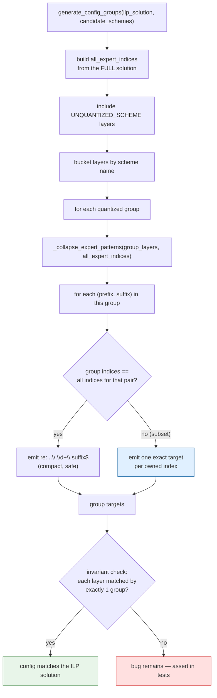
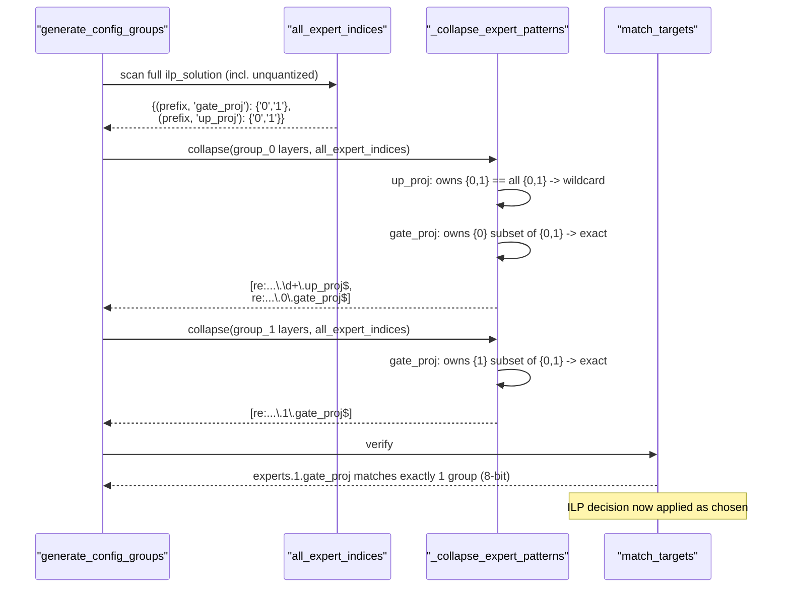

# #3301 — Fix plan

> Detailed explanation of the bug is in [3301-issue.md](3301-issue.md).

**Summary:** give `_collapse_expert_patterns` the whole ILP solution so it can
tell whether a wildcard is safe. Collapse to `\d+` only when **every** expert of
that projection shares the scheme; otherwise emit exact names.

This is the reporter's proposal:

> A fix that only collapses an expert projection into a wildcard when all of its
> experts share a scheme, and targets the remaining experts by exact name, is
> available.

## The invariant to establish

> A config group's targets must match **exactly** the layers the ILP assigned to
> that group — no more, no fewer.

Today the "no more" half is violated. Stating it this way makes the test
obvious: for every layer in the solution, the number of matching groups must be
exactly 1, and the matching group must be the assigned one.

## Design

`_collapse_expert_patterns` currently receives one group's layer list. It needs
one extra input: which expert indices exist for each `(prefix, suffix)` across
**all** groups, including unquantized ones.

```python
def _collapse_expert_patterns(
    layer_list: list[str],
    all_expert_indices: dict[tuple[str, str], set[str]] | None = None,
) -> list[str]:
    """Collapse MoE expert layers into wildcards.

    A ``\\d+`` wildcard matches every expert index, so it is only safe when this
    group owns every expert of that projection. ``all_expert_indices`` maps
    (prefix, suffix) -> every index present in the full ILP solution; when this
    group's indices are a strict subset, the experts are targeted by exact name
    instead.
    """
```

Keeping the parameter optional with a `None` default preserves the current
behaviour for any other caller and makes the diff reviewable, but the HIGGS path
must always pass it.

### Decision per `(prefix, suffix)`

| This group's indices vs. all indices | Emit |
|---|---|
| Equal (group owns every expert) | `re:^<prefix>\.\d+\.<suffix>$` — safe, compact |
| Strict subset | One exact target per index: `re:^<prefix>\.<i>\.<suffix>$` |

The multi-suffix `(gate_proj|up_proj)` alternation needs the same treatment
**per suffix**, not for the group as a whole: a group may own every expert for
`up_proj` but only some for `gate_proj`. Collapsing the alternation as one unit
is what produced the reproduced failure.

### Unquantized experts must count

With `allow_unquantized=True`, experts the ILP left unquantized appear in
`ilp_solution` under `UNQUANTIZED_SCHEME`. They are **not** in any quantized
group, but they *are* indices that a `\d+` would wrongly sweep up. So
`all_expert_indices` has to be built from the full solution including
`UNQUANTIZED_SCHEME`, not from `quantized_groups`.

Missing this is the second of the three reported consequences, and it is easy to
miss because the unquantized layers are filtered out a few lines earlier.

## Implementation flow



## Fix sequence



## Expected target output after the fix

For the reproduced case:

```
group_0  bits=4
    re:^model\.layers\.0\.mlp\.experts\.0\.gate_proj$      <- exact
    re:^model\.layers\.0\.mlp\.experts\.\d+\.up_proj$      <- wildcard still safe
group_1  bits=8
    re:^model\.layers\.0\.mlp\.experts\.1\.gate_proj$      <- exact
```

Note `up_proj` keeps its wildcard. The fix should **not** degrade to exact names
everywhere — that would undo the readability the collapse exists for, and real
models have hundreds of experts. Only the genuinely-split projection expands.

## Step-by-step

1. Reproduce with the reporter's script (CPU, no solver, no model).
2. Add a helper that builds `(prefix, suffix) -> set(indices)` from the full
   `ilp_solution`, including `UNQUANTIZED_SCHEME` entries.
3. Thread it into `_collapse_expert_patterns` and decide per `(prefix, suffix)`.
4. Handle the multi-suffix case per suffix, not as one alternation.
5. Keep non-expert layers unchanged — they are already exact.
6. Add the tests below.

## Tests

`tests/llmcompressor/entrypoints/higgs/` — all CPU, no PuLP or CBC needed:

| Test | Asserts |
|---|---|
| `test_split_experts_match_exactly_one_group` | The reporter's case: every layer matched by exactly 1 group, and the applied bits equal the ILP assignment. **Fails on `main`.** |
| `test_uniform_experts_still_collapse` | When all experts share a scheme, a `\d+` wildcard is still emitted — guards against over-expanding |
| `test_partial_split_keeps_other_suffix_collapsed` | `up_proj` keeps its wildcard while `gate_proj` expands |
| `test_unquantized_experts_not_swept_up` | With an `UNQUANTIZED_SCHEME` expert present, no quantized group's target matches it. **The second reported consequence.** |
| `test_non_expert_layers_unchanged` | Plain layer names still exact, as today |
| `test_achieved_bitwidth_matches_solution` | Average bitwidth computed from matched groups equals the one computed from the ILP solution — the user-visible promise |
| `test_many_experts_scaling` | 128 experts, one assigned differently: output stays compact (1 wildcard + 1 exact), not 128 exact targets |

The invariant test (`exactly 1 group`) is the one that matters most: it is a
property, not a case, so it catches future regressions in the collapse logic
regardless of shape.

## Risks

| Risk | Mitigation |
|---|---|
| Over-expanding to exact names everywhere | `test_uniform_experts_still_collapse`, `test_many_experts_scaling` |
| Forgetting unquantized experts | Dedicated test; build the index map from the *full* solution |
| Alternation collapsed as a unit | Decide per suffix; `test_partial_split_keeps_other_suffix_collapsed` |
| Config bloat on large MoEs | Only split projections expand; scaling test asserts it |
| 3D stacked expert layouts | Confirm whether `_EXPERT_RE` matches them, and whether HIGGS supports that layout at all before claiming coverage |

## Effort

Small-to-moderate: one helper plus a signature change, maybe 60–80 lines with
comments. The test matrix is the bulk, and all of it runs on CPU — unusually
cheap for this subsystem.

## Note on ordering with #3329

Independent files, so either order works. If both are taken, do them as separate
PRs: #3329 is in `higgs/base.py` (candidate resolution), #3301 is in
`higgs/utils.py` (config emission). A fix for #3301 is also what makes #3329's
benefit observable — once every candidate reaches the ILP, mixed assignments
become *more* likely, which makes this bug fire more often.
