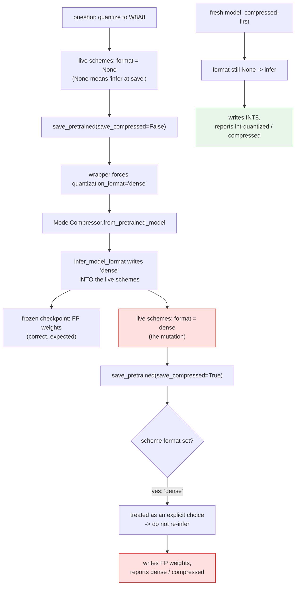
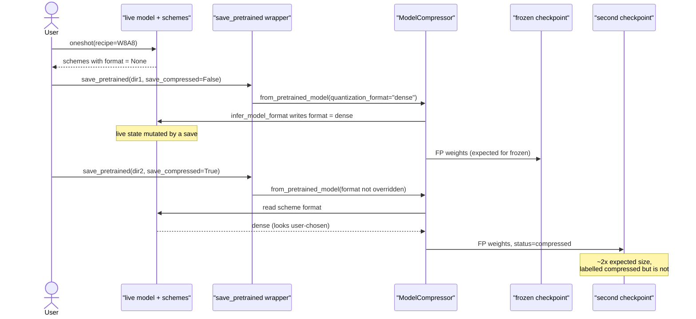

# #3303 — A frozen save makes a later compressed save retain dense weights

> Issue explained in detail. The fix plan is in [3303-plan.md](3303-plan.md).

- **Issue:** [vllm-project/llm-compressor#3303](https://github.com/vllm-project/llm-compressor/issues/3303)
- **Labels:** none · **Assignee:** none · **Open PR:** none
- **Reproduced:** ✅ exactly as reported, on CPU, in this tree
- **Severity:** silent — the second checkpoint is ~2× the expected size and not
  actually compressed

## Symptom

Quantize a model, save it once with `save_compressed=False` (a "frozen" save),
then save the same live model again with `save_compressed=True`. The second
checkpoint still contains **floating-point weights**, while reporting
`quantization_status=compressed`.

Reproduced here on a tiny Llama, W8A8, comparing against a fresh
compressed-first save of an identically seeded model:

| Scenario | `k_proj.weight` dtype | File bytes | Saved format / status |
|---|---|---:|---|
| Compressed-first (control) | `torch.int8` | 107,152 | `int-quantized` / `compressed` |
| **Frozen, then compressed** | **`torch.float32`** | **219,064** | **`dense`** / `compressed` |

Just over 2× the size, with the same `quantization_status=compressed` label. The
reporter's numbers on real Qwen3-0.6B are the same story at scale: all **195
targeted weight tensors stay FP16**, 1,193,207,360 bytes versus 754,536,352 for
a compressed-first save.

The frozen checkpoint itself being floating-point is **expected and correct** —
that is what frozen means. The defect is that the choice *persists into the next
save*.

## Root cause

The chain, as the reporter diagnosed and the code confirms:

1. A frozen save forces `quantization_format='dense'`.
2. `ModelCompressor.from_pretrained_model` calls `infer_model_format`, which
   **writes that forced format into the live schemes** on the model.
3. The next save sees a format already set on each scheme and treats it as an
   explicit, user-chosen per-layer format — so it does not re-infer
   `int-quantized`.

The live model is mutated by an operation that reads like serialization. Nothing
in the call signals that `save_pretrained(..., save_compressed=False)` changes
the model's future behaviour.

Confirmed in the reproduction: the per-group `format` is `None` before the
frozen save and `CompressionFormat.dense` after it. `None` is the sentinel
meaning "infer at save time", so overwriting it with `dense` permanently
converts "infer" into "explicitly dense".

This is the same class of bug as
[#3369](https://github.com/vllm-project/llm-compressor/issues/3369) (GPTQ
`actorder`): **an unresolved default is overwritten with a concrete value, and
the information that it was only a default is lost.** There the sentinel was
`Sentinel("static")` serialized as the string `"static"`; here it is
`format=None` replaced by `dense`.

## Mechanism

## Sequence

## What the reporter established

Unusually thorough for a bug report:

- **Three-way comparison** isolating the cause: compressed-first gives INT8;
  frozen-then-default gives FP32; frozen-then-**explicitly** `int-quantized`
  gives INT8. So an explicit format override still works — only inference is
  broken.
- **Scale check** on cached Qwen3-0.6B at a pinned revision: 195 tensors, exact
  byte counts.
- **Control invariants**: `lm_head` and an explicitly ignored `q_proj` stay
  byte-identical through save/reload, so the effect is confined to targeted
  weights.
- **Prior-art search**: open/closed issues, path history, and all 118 open PR
  file lists across both repositories, finding no active fix. Notes #1747
  (compression happens at save) and unmerged #2588 / compressed-tensors #669 as
  related but not duplicates.
- **A local prototype**: 4 failed / 5 passed on baseline, 9 passed with the
  change.

They also ask the right design question rather than assuming:

> The [saving guide] describes these as serialization options, but I did not find
> an explicit promise about repeated saves in different formats. Is this
> persistence intentional?

## The open question a maintainer must answer

**Is `save_pretrained` allowed to mutate the live model's schemes?**

- If **no** (the reporter's assumption, and the natural reading of
  "serialization options"), this is a bug and the fix is to scope the override
  to the one checkpoint.
- If **yes**, then the behaviour is intentional and the fix is documentation
  plus possibly a warning — the saving guide should state that a frozen save
  changes subsequent saves.

The reporter is careful not to presume: *"it does not assume saving is generally
non-mutating"*. This should be settled on the issue before code is written,
because it decides whether the deliverable is a patch or a doc change.

## Why it is worth fixing either way

The failure is silent and the symptom is misleading. A user who saves a frozen
checkpoint for inspection and then saves a real one gets a model that is twice
the expected size, is labelled `compressed`, and will be slower in vLLM — with
no error, no warning, and nothing in the config that looks wrong except a
`format` field most users never read.
