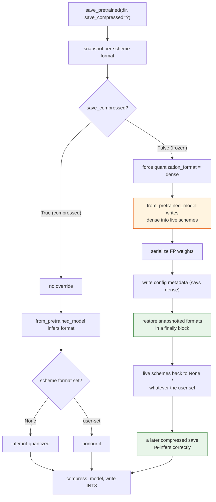
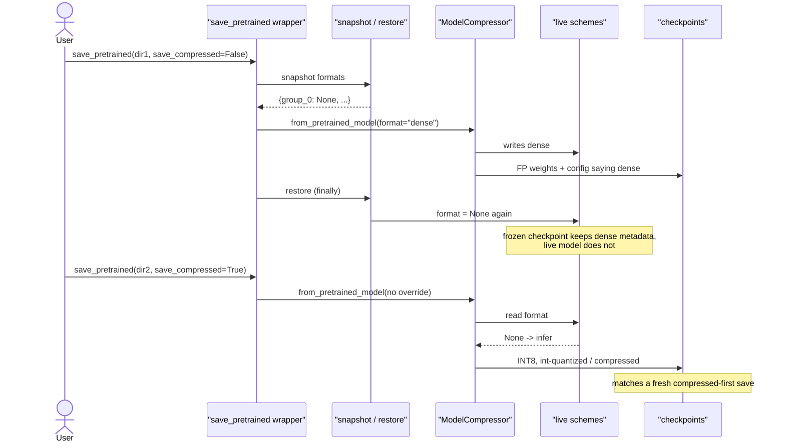

# #3303 — Fix plan

> Detailed explanation of the bug is in [3303-issue.md](3303-issue.md).

**Summary:** scope the frozen save's `dense` format override to that one
checkpoint, instead of letting it persist in the live schemes. Snapshot each
scheme's format before the override and restore it after serialization.

⚠️ **Settle the design question first.** This fix presumes
`save_pretrained` should not mutate the live model. A maintainer needs to
confirm that — see [the issue write-up](3303-issue.md#the-open-question-a-maintainer-must-answer).
If the mutation is intentional, the deliverable is documentation plus a warning,
not this patch.

## The exact site

`src/llmcompressor/transformers/compression/compressed_tensors_utils.py:145`:

```python
# without this, quantization format will be inferred from the model
if not save_compressed and quantization_format is None:
    quantization_format = CompressionFormat.dense.value

# Use `ModelCompressor` to construct a quantization config
compressor = ModelCompressor.from_pretrained_model(
    model, quantization_format=quantization_format
)
```

The override itself is correct — a frozen save *should* report `dense`. The
problem is downstream: `from_pretrained_model` → `infer_model_format` writes
that value into the live schemes, so `format` goes from `None` ("infer at save")
to `dense` ("explicitly dense") permanently.

## Approach A — snapshot and restore (recommended)

The reporter's proposal, and the smallest scoped change:

```python
# A frozen save forces `dense`, and `from_pretrained_model` writes that into
# the live schemes, turning "infer at save time" (format=None) into an explicit
# per-layer choice. Scope the override to this checkpoint so a later compressed
# save still infers its own format.
original_formats = _snapshot_scheme_formats(model)
try:
    if not save_compressed and quantization_format is None:
        quantization_format = CompressionFormat.dense.value

    compressor = ModelCompressor.from_pretrained_model(
        model, quantization_format=quantization_format
    )
    ...  # serialization and metadata writing
finally:
    if not save_compressed:
        _restore_scheme_formats(model, original_formats)
```

Three properties to preserve, all named by the reporter:

| Must keep working | Why it survives |
|---|---|
| Automatic inference | `None` is restored, so the next save re-infers |
| Explicit INT8 | A user-set format is snapshotted and restored unchanged |
| Intentional `dense` | Same — a user who set `dense` keeps it |
| Mixed recipes | Snapshot is per scheme, not global |

**Restore after metadata writing, not just after serialization.** The config
written to disk must still say `dense`; only the in-memory state reverts. Restore
too early and the frozen checkpoint's own metadata becomes wrong — trading one
bug for another.

Use `try/finally` so an exception mid-save does not leave the model mutated.

### Why only `if not save_compressed`

The compressed path's in-place behaviour is existing, relied-upon behaviour
(`compressor.compress_model(model, ...)` genuinely replaces weights). The
reporter is explicit about not touching it:

> It leaves the compressed-save path's existing in-place behavior intact; it
> does not assume saving is generally non-mutating.

Keep that boundary. Widening the fix to "saving never mutates" is a much larger
change with real regression risk.

## Approach B — stop writing inferred formats into live schemes

Deeper fix: have `from_pretrained_model` / `infer_model_format` compute the
format for the config it builds **without** writing it back onto the model's
schemes. That removes the whole class of bug rather than one instance.

| | A: snapshot/restore | B: stop the write-back |
|---|---|---|
| Repo | llm-compressor only | compressed-tensors (then a version pin) |
| Blast radius | One function | Every `from_pretrained_model` caller |
| Fixes the class | No — one call site | Yes |
| Risk | Low | Medium-high; other code may rely on the write-back |
| Review cycles | 1 | 2, cross-repo |

Start with A. Mention B in the PR as the principled follow-up, and let a
maintainer decide whether the write-back is load-bearing elsewhere — that is not
something to determine unilaterally.

## Implementation flow



## Fix sequence



## Step-by-step

1. Ask on the issue whether saving may mutate the live model. Do not skip —
   it decides patch vs. docs.
2. Reproduce. A tiny Llama W8A8 on CPU is enough; compare
   `k_proj.weight` dtype and file size across compressed-first,
   frozen-then-default, and frozen-then-explicit.
3. Add snapshot/restore helpers over the model's schemes.
4. Wrap the frozen path in `try/finally`, restoring only for
   `save_compressed=False`.
5. Confirm the frozen checkpoint's own config still reports `dense`.
6. Add the tests below.
7. Note approach B in the PR body as a possible follow-up.

## Tests

`tests/llmcompressor/transformers/compression/`, CPU-only with a tiny model:

| Test | Asserts |
|---|---|
| `test_frozen_then_compressed_writes_int8` | The reported case: second checkpoint has `int8` weights and `int-quantized` format. **Fails on `main`.** |
| `test_compressed_first_unchanged` | Control: still `int8` / `int-quantized` |
| `test_frozen_checkpoint_still_dense` | The frozen checkpoint's own config reports `dense` and FP weights — the restore must not break this |
| `test_live_schemes_not_mutated_by_frozen_save` | Scheme `format` is `None` before **and after** a frozen save. This is the invariant; the others are symptoms. |
| `test_explicit_format_preserved` | A user-set `int-quantized` survives a frozen save and is still honoured |
| `test_intentional_dense_preserved` | A user-set `dense` is still `dense` afterwards |
| `test_mixed_recipe_formats_preserved` | Per-group formats restored independently |
| `test_restore_on_save_failure` | An exception during serialization still restores (the `finally`) |
| `test_file_size_sanity` | Second checkpoint is materially smaller than the frozen one — catches a "format says int8 but weights are FP" regression |

The reporter reports their prototype moved this from 4 failed / 5 passed to
9 passed, which is roughly this matrix.

## Risks

| Risk | Mitigation |
|---|---|
| Restoring too early corrupts the frozen config | Restore after metadata writing; `test_frozen_checkpoint_still_dense` |
| Clobbering a user's explicit format | Snapshot/restore per scheme; two dedicated tests |
| Exception leaves the model mutated | `try/finally` + `test_restore_on_save_failure` |
| Compressed path regressions | Restrict the restore to `save_compressed=False` |
| Other code depends on the write-back | Why approach B is deferred to a maintainer |

## Effort

Small-to-moderate in code — two helpers and a `try/finally`. The value is the
test matrix, and the prerequisite is a one-line design answer from a maintainer.
