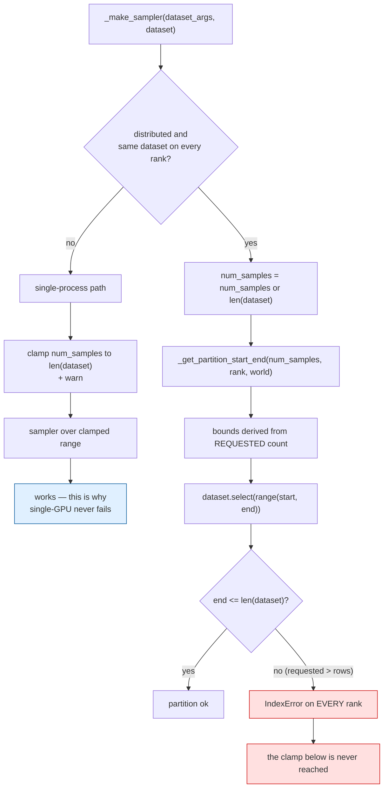
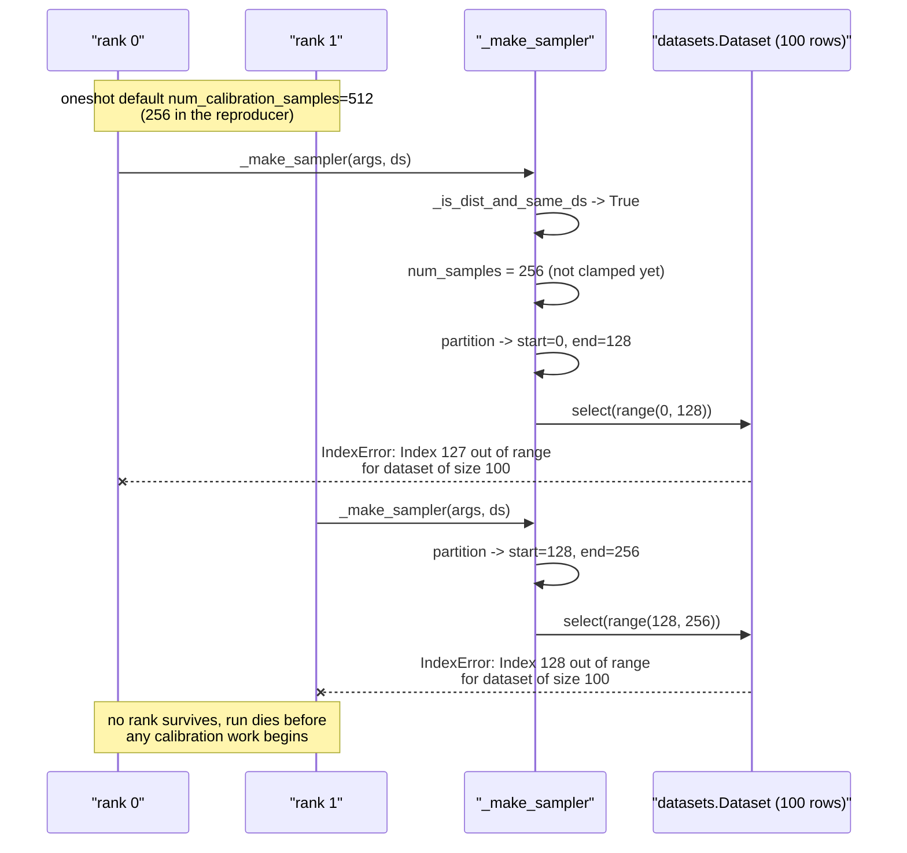

# #3306 — Distributed calibration `IndexError` when `num_calibration_samples` exceeds the dataset

> Issue explained in detail. The fix plan is in [3306-plan.md](3306-plan.md).

- **Issue:** [vllm-project/llm-compressor#3306](https://github.com/vllm-project/llm-compressor/issues/3306)
- **Labels:** none · **Assignee:** none · **Open PR:** none
- **Reproduced:** ✅ exactly as reported, on CPU, in this tree

## Symptom

Every rank in a distributed run crashes before calibration starts:

```
rank 0: IndexError: Index 127 out of range for dataset of size 100.
rank 1: IndexError: Index 128 out of range for dataset of size 100.
```

Not one rank — *all* of them. There is no partial progress and no usable error
message pointing at the cause.

## Why this matters more than it looks

`oneshot` defaults to `num_calibration_samples=512`. So **any multi-GPU run on a
calibration set with fewer than 512 rows fails at default settings.** Small
curated calibration sets are normal — a few hundred domain-specific samples is a
common and sensible choice.

Worse, the same call **works in a single process**, because the single-process
path reaches the clamp that the distributed path skips. So the failure appears
only when a user scales up, which is exactly when they are least likely to
suspect their dataset size.

## Root cause

`_make_sampler` in `src/llmcompressor/datasets/utils.py` partitions the dataset
across ranks **before** clamping `num_samples` to the dataset length:

```python
if _is_dist_and_same_ds(dataset):
    num_samples = num_samples or len(dataset)
    start, end = _get_partition_start_end(
        num_samples, dist.get_rank(), dist.get_world_size()
    )
    dataset = dataset.select(range(start, end))   # <-- can index past the end

if num_samples is not None and num_samples > len(dataset):   # <-- too late
    ...                                                       # warn and clamp
```

Two statements in the wrong order. The partition is computed from the
*requested* count, not the *available* count, so with 256 requested over 100
rows and 2 ranks the bounds become roughly `[0, 128)` and `[128, 256)` — both
past the end of a 100-row dataset.

The clamp, with its existing warning, sits immediately below and would have
produced correct bounds had it run first.

## Arithmetic of the reproduced case

| | Requested | World size | Rank 0 bounds | Rank 1 bounds | Dataset rows |
|---|---|---|---|---|---|
| Today | 256 | 2 | `[0, 128)` | `[128, 256)` | 100 → both out of range |
| Clamp first | 256 → 100 | 2 | `[0, 50)` | `[50, 100)` | 100 → 50 + 50 ✅ |

## Mechanism



## Per-rank sequence



## Verification in this tree

The reporter's mocked reproducer runs in a single CPU process — the distributed
calls are patched, so no GPUs are needed:

```python
with (mock.patch.object(du, "_is_dist_and_same_ds", return_value=True),
      mock.patch.object(du.dist, "get_rank", return_value=rank),
      mock.patch.object(du.dist, "get_world_size", return_value=2)):
    du._make_sampler(args, ds)
```

Output here matches the report byte for byte:

```
rank 0: IndexError: Index 127 out of range for dataset of size 100.
rank 1: IndexError: Index 128 out of range for dataset of size 100.
```

That the bug is reachable with mocked collectives is the single best property of
this issue: **the regression test needs no GPU.**

## Expected behaviour

From the reporter, and it is the obviously right answer:

> clamp `num_samples` to `len(dataset)` (with the existing warning) before
> partitioning, so 100 rows on 2 ranks gives 50 + 50.

## Why this is a strong first issue

| Property | |
|---|---|
| Fix size | Moving a conditional above another — a few lines |
| Reproducer | Supplied, CPU-only, mock-based |
| Test | CPU-only, no GPU, no model |
| Blast radius | One function, one branch |
| Ambiguity | None — the clamp already exists, it just runs too late |
| Competing work | None: no PR, no assignee |

The only reason it is not labelled `good first issue` is that nobody has
triaged it.
