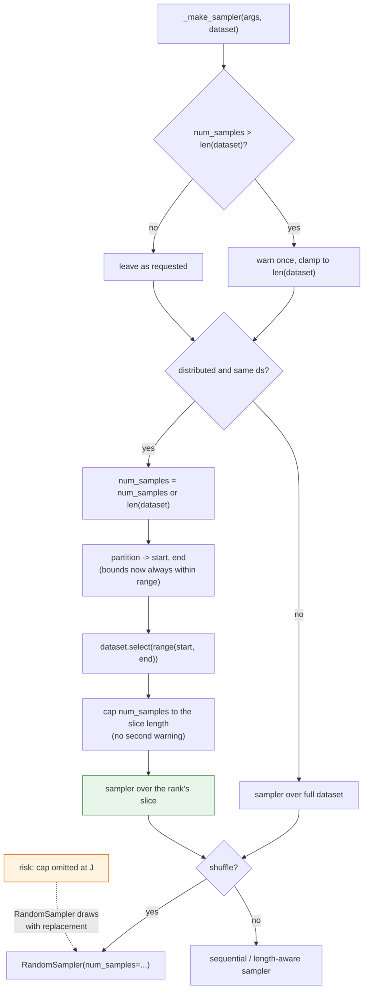
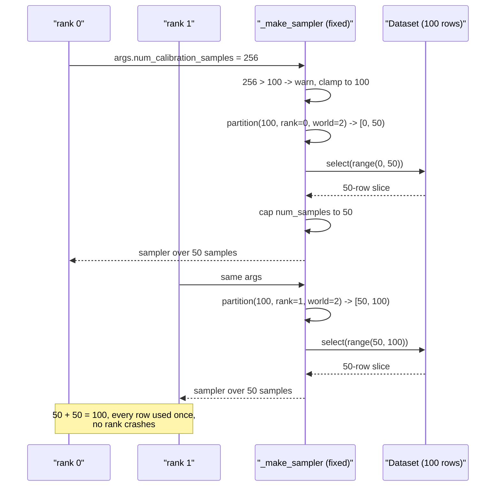

# #3306 — Fix plan

> Detailed explanation of the bug is in [3306-issue.md](3306-issue.md).

**Summary:** move the existing clamp above the distributed partition in
`_make_sampler`. Roughly ten lines of source, a CPU-only regression test, no new
API.

## Current code

`src/llmcompressor/datasets/utils.py`:

```python
def _make_sampler(args: DatasetArguments, dataset: Dataset) -> Sampler:
    num_samples = args.num_calibration_samples
    shuffle = args.shuffle_calibration_samples
    batch_size = args.batch_size

    if _is_dist_and_same_ds(dataset):
        logger.info(...)
        num_samples = num_samples or len(dataset)
        start, end = _get_partition_start_end(
            num_samples, dist.get_rank(), dist.get_world_size()
        )
        dataset = dataset.select(range(start, end))     # (1) partitions first

    if num_samples is not None and num_samples > len(dataset):
        logger.warning(
            f"Requested {num_samples} samples but the provided dataset only has "
            f"{len(dataset)} samples."
        )
        num_samples = len(dataset)                      # (2) clamps second
```

(1) and (2) are in the wrong order.

## The change

Hoist the clamp above the distributed branch, so the partition is computed from
a count that is known to fit:

```python
def _make_sampler(args: DatasetArguments, dataset: Dataset) -> Sampler:
    num_samples = args.num_calibration_samples
    shuffle = args.shuffle_calibration_samples
    batch_size = args.batch_size

    # Clamp before partitioning. The distributed branch derives each rank's
    # slice bounds from `num_samples`, so a request larger than the dataset
    # produces bounds past the end and `dataset.select` raises on every rank.
    if num_samples is not None and num_samples > len(dataset):
        logger.warning(
            f"Requested {num_samples} samples but the provided dataset only has "
            f"{len(dataset)} samples."
        )
        num_samples = len(dataset)

    if _is_dist_and_same_ds(dataset):
        logger.info(
            "Detected distributed setting with identical datasets across ranks. "
            "partitioning dataset across ranks."
        )
        num_samples = num_samples or len(dataset)
        start, end = _get_partition_start_end(
            num_samples, dist.get_rank(), dist.get_world_size()
        )
        dataset = dataset.select(range(start, end))
```

### The fix is additive, not a move — and this matters

Do **not** move the existing clamp. After partitioning, `len(dataset)` is the
**rank's slice**, not the full dataset, so the existing clamp is already doing a
second, necessary job: capping `num_samples` to the slice length. With 100 rows
over 2 ranks, `num_samples` becomes 100 while each rank holds only 50.

Moving the block would leave `num_samples=100` against a 50-row slice, and
`RandomSampler(dataset, num_samples=100)` draws 100 samples **with replacement**
from 50 rows — no error, just silently duplicated calibration data. That is a
worse bug than the crash it replaces, because nothing surfaces it.

So: **add** a clamp before the partition and **keep** the one after. The only
cosmetic concern is that the warning could fire twice; in practice the second
clamp's condition is false once the first has run against the full dataset.

### Verified

Applying exactly the additive change above to this tree:

```
before:  rank 0: IndexError: Index 127 out of range for dataset of size 100.
         rank 1: IndexError: Index 128 out of range for dataset of size 100.

after:   rank 0: 50 samples
         rank 1: 50 samples
```

And across world sizes, with 256 requested against 100 rows:

| World size | Per-rank counts | Sum |
|---|---|---|
| 2 | 50, 50 | 100 |
| 3 | 33, 33, 34 | 100 |
| 7 | 14, 14, 14, 15, 14, 14, 15 | 100 |

Every row is used exactly once, with no oversampling, including when the count
does not divide evenly.

## Implementation flow



## Fix sequence



## Step-by-step

1. Reproduce first with the reporter's mocked script (CPU, no GPU).
2. **Add** a clamp above the distributed branch. Do not move the existing one.
3. Leave the post-partition clamp in place — it caps `num_samples` to the rank's
   slice, which is still needed.
4. Confirm the single-process path is unchanged — it already clamped, so
   behaviour must be identical.
5. Check the two sampler branches (`RandomSampler` when shuffling, otherwise the
   sequential/length-aware one) both receive a count that fits their slice.
6. Add the regression tests below.

## Tests

`tests/llmcompressor/datasets/`, all CPU-only using the mock pattern:

| Test | Asserts |
|---|---|
| `test_dist_num_samples_exceeds_dataset` | 100 rows, 256 requested, world=2: each rank gets 50, **no `IndexError`**. Fails on `main`. |
| `test_dist_partition_covers_dataset_once` | Rank slices are disjoint and together cover all 100 rows |
| `test_dist_num_samples_within_dataset` | 100 rows, 50 requested, world=2: unchanged behaviour |
| `test_dist_num_samples_none` | `num_samples=None` still defaults to `len(dataset)` and partitions |
| `test_single_process_unchanged` | Non-distributed path identical to `main` |
| `test_no_oversampling_after_partition` | Realized sample count ≤ slice length, so no draw-with-replacement |
| `test_warning_emitted_once` | The shortfall warning fires once, not per clamp |
| `test_uneven_world_size` | 100 rows, world=3: slices still disjoint, within range, sum to 100 |

The last one is worth having: `_get_partition_start_end` with a count that does
not divide evenly by world size is where off-by-one bugs live, and the fix
changes the count being divided.

## Risks

| Risk | Mitigation |
|---|---|
| `num_samples` left larger than the rank's slice → silent oversampling | Post-partition cap + `test_no_oversampling_after_partition` |
| Duplicate warning now that the clamp moved | Warn only in the pre-partition clamp |
| Uneven world sizes | Explicit test |
| Single-process regression | Explicit unchanged-behaviour test |

## Effort

Small. The code change is minutes; the value is in the test matrix, which is
also the part that makes the PR reviewable without a multi-GPU machine.
