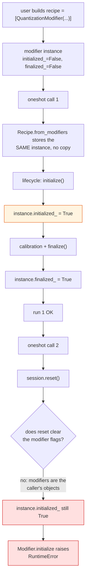
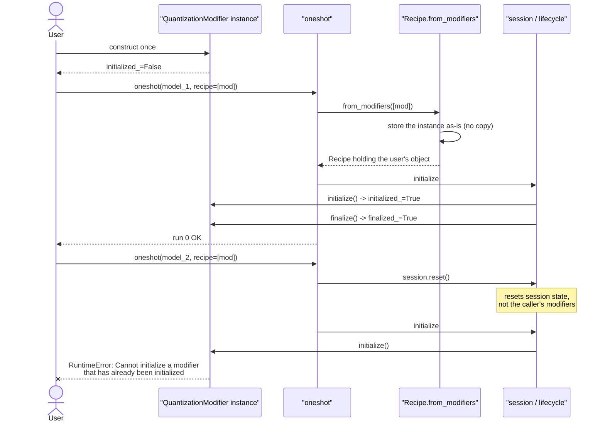

# #3324 — Reusing a recipe in a second `oneshot` call raises

> Issue explained in detail. The fix plan is in [3324-plan.md](3324-plan.md).

- **Issue:** [vllm-project/llm-compressor#3324](https://github.com/vllm-project/llm-compressor/issues/3324)
- **Labels:** none · **Assignee:** none
- **Open PR:** ⚠️ [#3353](https://github.com/vllm-project/llm-compressor/pull/3353) — open, unmerged, approach already chosen
- **Reproduced:** ✅ exactly as reported, on CPU, in this tree

## Symptom

```python
recipe = [QuantizationModifier(targets="Linear", scheme="FP8_DYNAMIC", ignore=["lm_head"])]

for model in models:
    oneshot(model=model, recipe=recipe)
```

```
run 0: OK
run 1: RuntimeError: Cannot initialize a modifier that has already been initialized
```

The first call succeeds, the second fails. Reproduced here byte-for-byte on a
tiny Llama.

## Why the pattern matters

Defining a recipe once and reusing it is the natural way to write several
obvious things:

- quantize a family of checkpoints with identical settings
- sweep models in a loop to compare recovery
- re-run a notebook cell after changing the model

All of them fail on the second iteration. The user's only recourse today is to
rebuild the modifiers every call, and **nothing in the docs or the error message
says so**. The message names an internal lifecycle rule and gives no hint that
the fix is "construct new modifier objects".

## Root cause

`Recipe.from_modifiers` stores the user's modifier **instances** in the recipe
as-is — no copy. `oneshot` then initializes and finalizes them, which sets
`initialized_` / `finalized_` on those very objects.

`session.reset()` at the start of the next `oneshot` resets the *session*, but
not the modifiers it previously used, because they are not owned by the session —
they are the caller's objects. So `Modifier.initialize` sees
`initialized_ == True` and raises.

The lifecycle flag lives on an object whose lifetime the library does not
control. That is the whole bug: **per-run state is stored on a user-supplied
object.**

## Mechanism



## Sequence



## The two approaches the reporter offered

> - `Recipe.from_modifiers` (or `oneshot`) works on copies of the modifiers, so
>   the user's objects stay reusable, or
> - the run resets each modifier's lifecycle state when the session is reset.
>
> If modifiers are meant to be single-use, a clearer error message that suggests
> creating new modifier instances would also help.

Three options, then: copy on build, reset on session reset, or keep the
restriction but explain it. See [the plan](3324-plan.md) for the comparison —
the copy approach has already been chosen and implemented.

## Current state: a PR exists

This issue is **not open work** in the usual sense.

| Date | Event |
|---|---|
| 2026-10-19 | `kjoshiDTX` proposes the copy-on-build approach |
| 2026-10-22 | `Saged679` opens [#3353](https://github.com/vllm-project/llm-compressor/pull/3353) implementing it |
| 2026-11-03 | PR last updated; still open and unmerged |

Neither contributor is assigned to the issue, and the PR has not merged. So the
useful contribution here is **reviewing #3353**, not reimplementing it.

What #3353 does, per its description:

- `Recipe.from_modifiers` deep copies each leaf modifier before storing it.
- `Recipe.create_instance` also copies a recipe passed to it — without this,
  `recipe=Recipe.create_instance([...])` would still reuse already-initialized
  modifiers, so only the `recipe=[...]` form would have been fixed.
- Regression tests cover the list form, the `Recipe` form, and that the caller's
  modifiers are not mutated.

That second point is the non-obvious one, and it is why the PR is worth reading
before writing anything: a fix that only touches `from_modifiers` leaves a hole.
