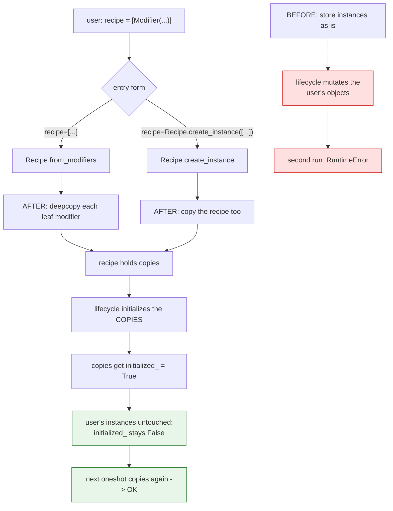
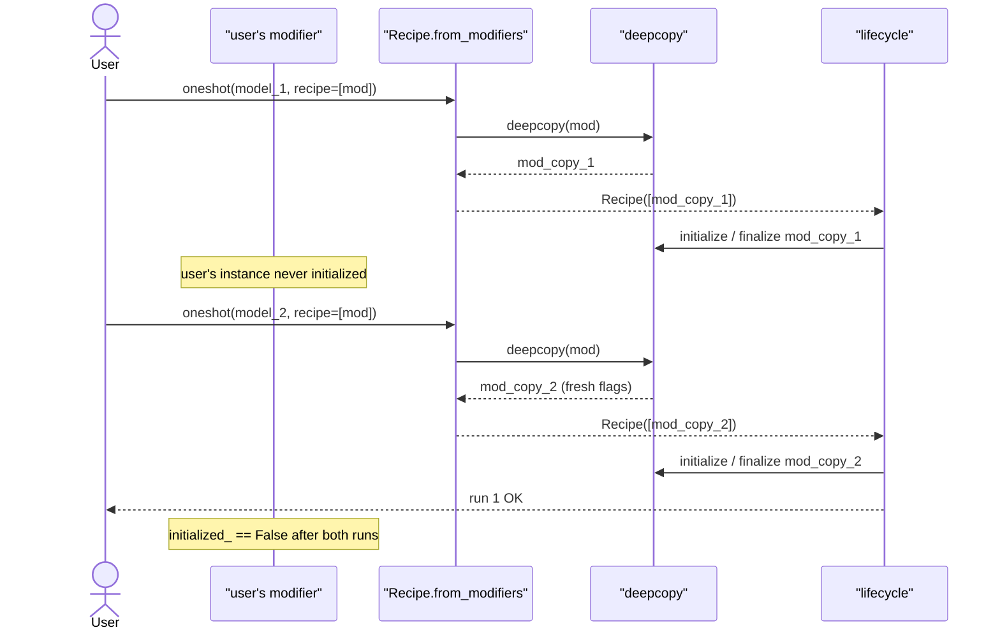

# #3324 — Fix plan

> Detailed explanation of the bug is in [3324-issue.md](3324-issue.md).

⚠️ **An implementation already exists:**
[PR #3353](https://github.com/vllm-project/llm-compressor/pull/3353), open and
unmerged since 2026-11-03. **Review it rather than reimplementing.** The plan
below describes what it does, how to verify it, and what a reviewer should
check.

## Approach comparison

The reporter offered two fixes plus a fallback. All three are viable; the first
has been chosen.

| | A: copy on build ✅ | B: reset on session reset | C: keep single-use, improve the error |
|---|---|---|---|
| User's objects stay clean | Yes, by construction | No — still mutated, then un-mutated | No |
| Works for `recipe=[...]` | Yes | Yes | n/a |
| Works for `recipe=Recipe(...)` | Yes, with the extra copy in `create_instance` | Yes | n/a |
| Risk | Deep-copying modifiers holding tensors/modules | Reset must clear *every* piece of per-run state | None |
| Fixes the pattern | Yes | Yes | No — documents the limitation |
| Chosen | **Yes** (`kjoshiDTX`, implemented in #3353) | | |

### Why A over B

B resets state the library knows about *today*. Any future per-run field on a
modifier has to remember to clear itself, or the bug returns in a new form — the
reset list and the state list drift apart silently.

A removes the shared object entirely: a run never touches the caller's instance,
so there is no state to reset. The invariant is structural rather than
maintained.

`kjoshiDTX` put it exactly this way:

> The user's objects are never touched, so they stay reusable by construction.

### The risk A carries

`copy.deepcopy` on a modifier is not free. Modifiers can hold:

- resolved mappings referencing `torch.nn.Module` objects (AWQ's
  `ResolvedMapping`),
- observers with accumulated statistics,
- `torch.device` objects,
- private attributes set during initialization.

Deep-copying a **freshly constructed** modifier is cheap — that is the intended
case. Deep-copying one that has already run could duplicate large tensors. The
copy happens at recipe-build time, before initialization, so it should be the
cheap case, but a reviewer should confirm there is no path that copies a
post-calibration modifier.

Pydantic models with `arbitrary_types_allowed` (AWQ sets this) can also surprise
on deepcopy. Worth a test with AWQ specifically, not just
`QuantizationModifier`.

## Flow



## Sequence



## What a reviewer should check on #3353

1. **Both entry forms covered.** `recipe=[...]` *and*
   `recipe=Recipe.create_instance([...])`. The PR says both; confirm the second,
   since it is the easy one to miss.
2. **`recipe=` as a YAML string or path is unaffected** — those construct fresh
   modifiers already, so they must not now be double-copied.
3. **The caller's instance is genuinely unmutated**, asserted directly
   (`mod.initialized_ is False` after a run), not inferred from the second run
   succeeding.
4. **Deepcopy cost.** Confirm the copy happens pre-initialization. A test
   asserting a modifier with a large tensor attribute is not duplicated at
   build time would be ideal.
5. **AWQ-style modifiers.** `arbitrary_types_allowed` plus `PrivateAttr` is the
   most likely deepcopy failure mode. At least one test with
   `AWQModifier` + a following `QuantizationModifier`.
6. **Nested lists.** `Recipe.from_modifiers` already handles nested modifier
   lists via `tree_leaves` (the deprecated `llmcompressor.modifiers.awq.AWQModifier`
   returns two modifiers). The copy must apply to leaves, not the outer list.
7. **Session reset interaction.** With copies, `session.reset()` no longer needs
   to touch modifiers — confirm nothing else relied on the old aliasing.

## Tests

If reviewing, confirm these exist; if #3353 stalls and a maintainer asks for a
fresh PR, write them:

| Test | Asserts |
|---|---|
| `test_recipe_list_reusable_across_oneshot` | The reporter's loop runs twice. **Fails on `main`.** |
| `test_recipe_instance_reusable` | Same via `Recipe.create_instance([...])` |
| `test_user_modifiers_not_mutated` | `initialized_`/`finalized_` stay `False` on the caller's objects |
| `test_yaml_recipe_unaffected` | String/path recipes behave as before |
| `test_nested_modifier_list_copied` | Leaf-level copying for nested lists |
| `test_awq_modifier_deepcopy` | An `arbitrary_types_allowed` modifier copies cleanly |
| `test_three_consecutive_runs` | Not just two — guards an off-by-one in copy placement |

## If the PR is abandoned

Option C is a legitimate fallback and much smaller: keep modifiers single-use
but make the error actionable.

```
RuntimeError: Cannot initialize a modifier that has already been initialized.
Modifier instances are single-use — construct new ones for each `oneshot`
call, e.g. build the recipe inside the loop rather than outside it.
```

Plus a line in the recipes documentation. That does not fix the pattern, but it
converts a dead end into a solvable one, and it is a genuinely useful PR if the
maintainers decide copying is too invasive.

## Effort

As a review: an hour. As a fresh implementation: small, but **do not start
without checking in on #3353** — two contributors have already worked this and
duplicating it wastes everyone's time, which is exactly what
`CONTRIBUTING.md`'s claiming step exists to prevent.
