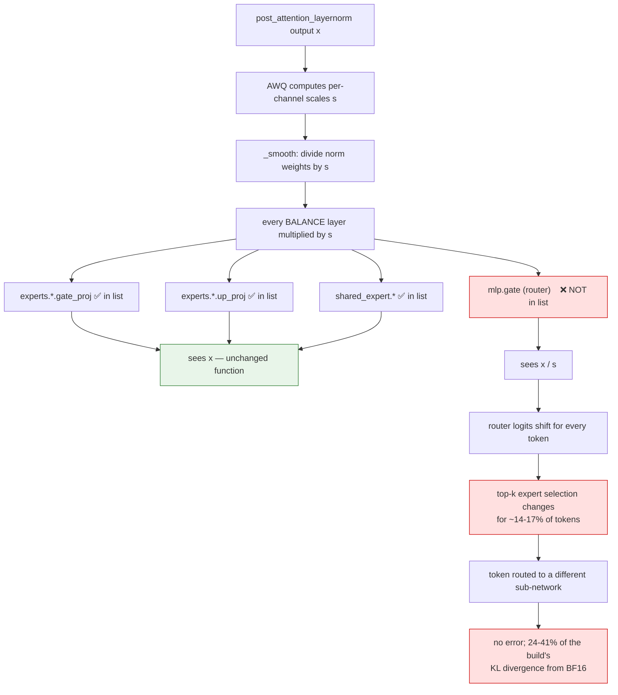
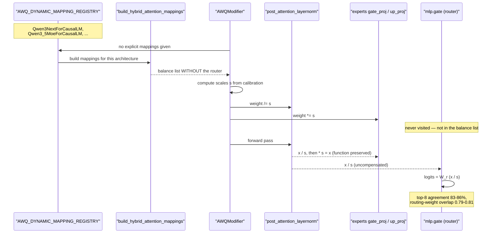

# #3337 — AWQ leaves the MoE router out of the hybrid-attention balance layers

> Issue explained in detail. The fix plan is in [3337-plan.md](3337-plan.md).

- **Issue:** [vllm-project/llm-compressor#3337](https://github.com/vllm-project/llm-compressor/issues/3337)
- **Labels:** none · **Assignee:** none
- **Open PR:** ⚠️ [#3338](https://github.com/vllm-project/llm-compressor/pull/3338) — open, unmerged since 2026-10-20
- **Verified:** ✅ at source level in this tree (the end-to-end numbers need a Qwen3.5-MoE checkpoint)
- **Affects:** Qwen3-Next, Qwen3.5-MoE, Qwen3.6 — i.e. `AWQModifier()` with no explicit mappings

## What AWQ is supposed to preserve

AWQ smooths activations by dividing a normalization layer's weights by
per-channel scales `s` and multiplying every layer that *consumes* those
activations by `s`. The product is unchanged, so the network computes the same
function — that is the whole premise.

The contract only holds if **every** consumer is in the balance list. Miss one,
and that layer silently receives `x / s` instead of `x`.

## The defect

`build_hybrid_attention_mappings`
(`src/llmcompressor/modifiers/transform/awq/dynamic_mappings.py:116`) builds:

```python
AWQMapping(
    "re:.*post_attention_layernorm$",
    [
        # TODO: should add "re:.*mlp.gate.weight$" but is a Parameter
        "re:.*mlp.experts.*.gate_proj$",
        "re:.*mlp.experts.*.up_proj$",
        "re:.*mlp.shared_expert_gate$",
        "re:.*mlp.shared_expert.gate_proj$",
        "re:.*mlp.shared_expert.up_proj$",
    ],
)
```

The **MoE router** reads `post_attention_layernorm`'s output like the experts
do, but is not listed. So after smoothing it computes `W_r · (x / s)` instead of
`W_r · x`. Router logits shift for every token, and the top-k expert selection
changes for a fraction of them.

**The routing decision is not an approximation that degrades gracefully.** A
token sent to the wrong expert gets a different sub-network, not a slightly
noisier result.

### Verified in this tree

The asymmetry the issue describes is real:

| Builder | Router in balance list? | Location |
|---|---|---|
| `_moe_default_mappings` (static MoE) | ✅ `"re:.*mlp.gate$"` | `mappings.py:64` |
| `build_hybrid_attention_mappings` (hybrid) | ❌ only a TODO comment | `dynamic_mappings.py:120` |

So the static path was already fixed — by
[#2451](https://github.com/vllm-project/llm-compressor/pull/2451) — and the
hybrid path inherited a TODO instead of the fix.

### Why the TODO's stated reason no longer applies

The comment says the router "is a Parameter", implying it cannot be treated as a
balance layer. The reporter establishes that this is no longer true:

> In transformers 5 the router is a `Qwen3_5MoeTopKRouter` / `Qwen3NextTopKRouter`
> module with a `[num_experts, hidden_size]` `.weight`. That is the same
> situation as `Qwen3MoeTopKRouter`, which `_moe_default_mappings` already
> balances with `"re:.*mlp.gate$"`. So the same entry works here: resolution
> matches it by name, and `_smooth` multiplies `module.weight` by
> `scales.view(1, -1)`.

A module with a `.weight`, matched by name, smoothed the same way as the static
case. The blocker was removed by a transformers change and the TODO was never
revisited.

## Why the impact is larger than the earlier fix suggested

#2451 measured a modest effect on Qwen3-30B-A3B (wikitext word PPL 11.65 →
11.28) and noted the scales for that layer were all near 1 — if `s ≈ 1`, an
uncompensated router barely notices.

On the Qwen3.5-MoE family they are **not** near 1. From the reporter's
Qwen3.6-35B-A3B W4A16 build: `post_attention_layernorm` scales have a per-layer
median of **0.46–0.87** and a maximum of **1.4–2.7**.

Feeding identical hidden states through the reference and quantized norm+router,
over 40 layers and 943k tokens:

| | Top-8 expert agreement | Routing-weight overlap |
|---|---|---|
| Uncompensated routers | **83–86 %** | 0.79–0.81 |
| Routers compensated post hoc (`W_r[:, j] *= s_j`) | — | **0.994** (bf16 rounding) |

So roughly **one token in seven is routed to a different set of experts**, and
compensation recovers agreement to numerical noise — demonstrating the scales
are the entire cause.

## End-to-end cost

Compensating only the routers post hoc, changing nothing else, scored with vLLM
over 99k positions each of zh-wiki and wikitext-2:

| Reference | Metric | zh: uncomp → comp | en: uncomp → comp |
|---|---|---|---|
| Public BF16 `Qwen/Qwen3.6-35B-A3B` | KL | 0.085 → 0.062 (**−27 %**) | 0.096 → 0.073 (**−24 %**) |
| | top-1 agreement | 87.7 % → 88.8 % | 85.2 % → 86.8 % |
| The build's own pre-quantization BF16 | KL | 0.067 → 0.039 (**−41 %**) | 0.076 → 0.047 (**−39 %**) |
| | top-1 agreement | +1.80 pp [+1.54, +2.05] | +2.39 pp [+2.19, +2.59] |

**A quarter to two fifths of that build's divergence from BF16 is the router gap
alone.** With paired 95 % confidence intervals.

### An honest caveat the reporter raises

That build had a LoRA fine-tune *after* quantization, which had partly adapted
to the broken routing — on its own training domain, the post-hoc fix *lowered*
agreement by 1.3 pp. Their conclusion:

> The compensation has to happen in the mapping, before any further training.

and they are explicit that the from-scratch result is not yet measured:

> We expect a build quantized with the fixed mapping from the start to do at
> least as well as these post-hoc numbers, but we have not measured that yet.

## The same gap in a published checkpoint

`openbmb/MiniCPM-V-4.7-35B-A3B-AWQ` (rev e61c9b9) passes explicit mappings
copied from this builder, without the router. All 40 routers in that checkpoint
are **byte-identical to BF16**, sitting next to 40 smoothed
`post_attention_layernorm`s — the signature of this bug.

Against BF16 (vLLM 0.32, 214k positions):

| Build | Top-1 agreement | KL |
|---|---|---|
| Their AWQ | 85.5 % | 0.161 |
| Their int4, no AWQ at all | **93.1 %** | **0.031** |

**AWQ smoothing — which is supposed to preserve the function — made the model
worse than plain round-to-nearest.** The reporter notes they have not isolated
how much of that gap is the router specifically, but the direction is damning.

## Mechanism



## Sequence



## Proposed fix

One line, per the reporter:

> replace the TODO with `"re:.*mlp.gate$"` in the MoE branch of
> `build_hybrid_attention_mappings`. PR with two unit tests: #3338.

See [the plan](3337-plan.md) for what to verify.
