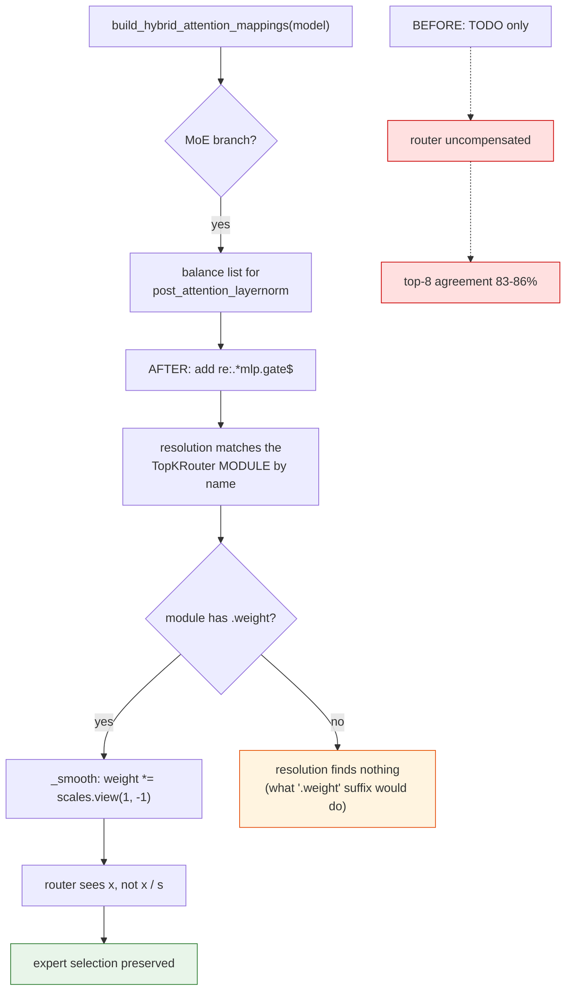
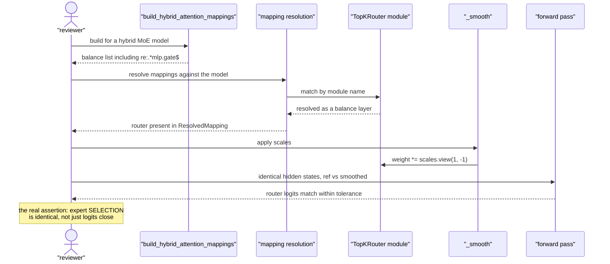

# #3337 — Fix plan

> Detailed explanation of the bug is in [3337-issue.md](3337-issue.md).

⚠️ **An implementation already exists:**
[PR #3338](https://github.com/vllm-project/llm-compressor/pull/3338), open and
unmerged since 2026-10-20. It is **+4/−1 in source** plus 115 lines of tests.
**Review it rather than reimplementing.**

## The change

One balance-layer entry, replacing the stale TODO. From the PR diff:

```diff
         AWQMapping(
             "re:.*post_attention_layernorm$",
             [
-                # TODO: should add "re:.*mlp.gate.weight$" but is a Parameter
+                # the router reads the smoothed activations too; it is a
+                # TopKRouter module with a [num_experts, hidden] weight, so
+                # it is balanced like any other layer (as in #2451)
+                "re:.*mlp.gate$",
                 "re:.*mlp.experts.*.gate_proj$",
                 "re:.*mlp.experts.*.up_proj$",
                 "re:.*mlp.shared_expert_gate$",
```

That is the whole source change. It makes the hybrid builder match
`_moe_default_mappings` (`mappings.py:64`), which has carried
`"re:.*mlp.gate$"` since [#2451](https://github.com/vllm-project/llm-compressor/pull/2451).

### Why `mlp.gate` and not `mlp.gate.weight`

The TODO's phrasing — *"should add `re:.*mlp.gate.weight$` but is a Parameter"* —
points at the original confusion. The target must name the **module**, not the
parameter:

- Resolution matches modules by name, so `mlp.gate` resolves the
  `TopKRouter` module.
- `_smooth` then multiplies `module.weight` by `scales.view(1, -1)`.

A `.weight` suffix would match nothing, which is presumably why the original
author thought it was impossible. The static mapping had already demonstrated
the module-name form works.

## Fix flow



## Verification sequence



## What a reviewer should check

1. **The router is actually resolved**, not merely present in the pattern list.
   The PR's `test_router_is_resolved_as_balance_layer` covers this; confirm it
   asserts on the resolved mapping, not the raw strings.
2. **`_TopKRouter` stand-in is faithful.** The PR defines a plain `nn.Module`
   with a `[num_experts, hidden]` `Parameter` and no `Linear`. That is the right
   shape — a `Linear` stand-in would pass even if the code only handled
   `Linear`, hiding the real bug.
3. **Function preservation end to end.** The valuable assertion is that smoothed
   and reference models select the **same experts** for the same input, not that
   logits are close. Routing is a discrete decision; a logit tolerance can pass
   while the argmax flips.
4. **Non-MoE hybrid models unaffected.** The builder has an `else` branch for
   dense hybrid models; it must be untouched.
5. **The three registered architectures.** `Qwen3NextForCausalLM`,
   `Qwen3_5MoeForCausalLM`, `Qwen3_5MoeForConditionalGeneration` all route
   through this builder.
6. **`shared_expert_gate` is distinct from `mlp.gate`.** The list already had
   `shared_expert_gate`; confirm the new pattern does not accidentally also
   match it, or double-scale it.
7. **No regression for explicit mappings.** Users passing their own mappings
   (like the MiniCPM recipe) are unaffected by a builder change — worth stating
   in the PR so nobody expects published checkpoints to be retroactively fixed.

## Tests

The PR adds a `TestHybridMoeRouterBalancing` class (115 lines). A complete
matrix looks like:

| Test | Asserts |
|---|---|
| `test_router_is_resolved_as_balance_layer` | The router appears in the resolved mapping for MoE hybrid models. **Fails on `main`.** |
| `test_router_weight_is_scaled` | After `_smooth`, `router.weight` differs from the original by exactly `scales` |
| `test_expert_selection_preserved` | Same input → same top-k expert indices, reference vs smoothed. The behavioural assertion. |
| `test_dense_hybrid_unchanged` | Non-MoE branch mappings byte-identical to `main` |
| `test_all_registered_architectures` | All three registry entries get the router |
| `test_shared_expert_gate_not_double_matched` | `mlp.gate` and `shared_expert_gate` resolve to distinct modules |

All CPU-runnable against a synthetic hybrid model — no Qwen3.5-MoE download
needed for the unit tests.

## What is *not* yet measured

The reporter is explicit that the end-to-end numbers are from **post-hoc**
compensation of an existing build, not from a model quantized with the fixed
mapping:

> We expect a build quantized with the fixed mapping from the start to do at
> least as well as these post-hoc numbers, but we have not measured that yet.

So a reviewer with GPU capacity could add real value here: quantize a
Qwen3.5-MoE model with and without the fix and compare. The unit tests prove
the mapping resolves; they cannot prove the accuracy gain. Given the measured
24–41 % KL contribution, that is a worthwhile experiment and the main thing
standing between this PR and a confident merge.

## Why this is worth pushing on

Of the five unassigned bugs, this one has the **best evidence-to-diff ratio**:
four lines of source, against measurements across two reference models, two
languages, 943k tokens of routing analysis, paired confidence intervals, and a
third-party published checkpoint exhibiting the same signature. It has been
sitting unmerged for roughly three weeks with no assignee.

If you only review one thing from this set, review #3338.

## Effort

As a review: an hour or two. With a GPU for the from-scratch A/B: a day,
and that is the contribution that would most help it land.
