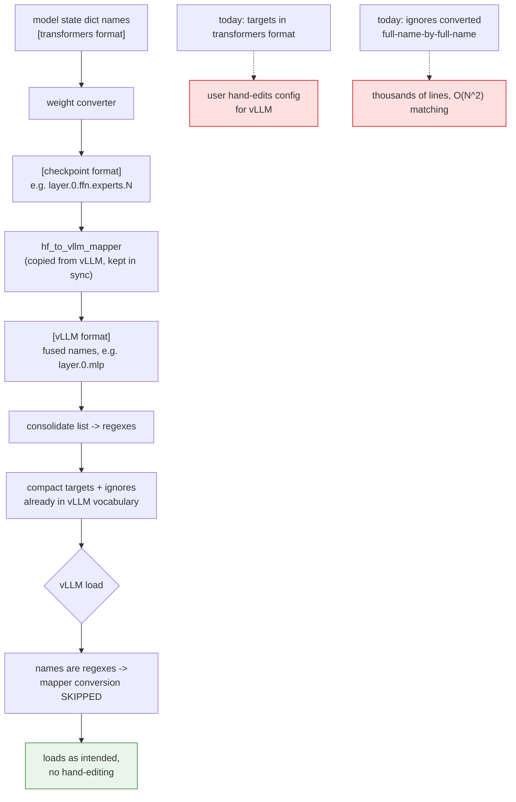
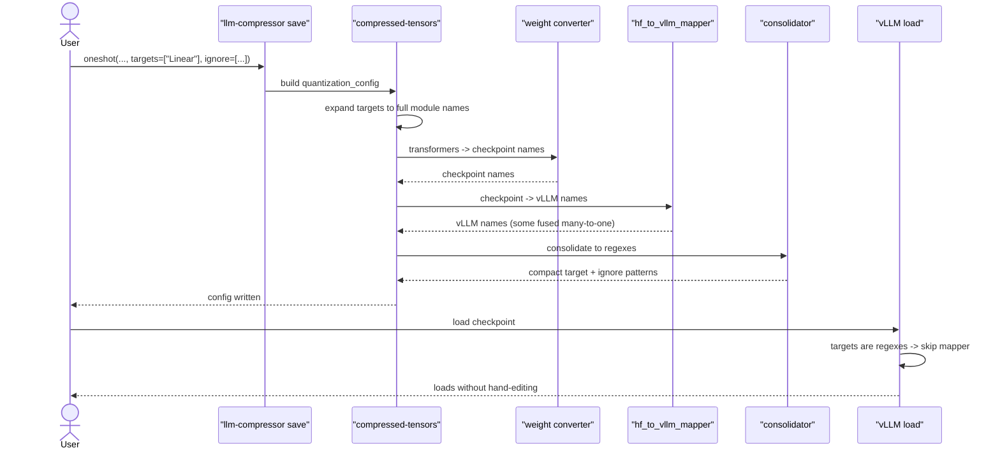

# #3468 — Tighter vLLM integration by consolidating and converting targets

> Issue explained in detail. The plan is in [3468-plan.md](3468-plan.md).

- **Issue:** [vllm-project/llm-compressor#3468](https://github.com/vllm-project/llm-compressor/issues/3468)
- **Labels:** `enhancement`, `compressed-tensors`, `good follow-up issue`
- **Assignee in this repo:** none
- ⚠️ **But:** the issue body is one line — *"Mirror of
  [compressed-tensors#1006](https://github.com/vllm-project/compressed-tensors/issues/1006)"* —
  and **that upstream issue is assigned to `GOavi101`.**

## Read this first

This issue carries no content of its own. It is a **tracking mirror** so the
work is visible from the llm-compressor board; the design and the assignment
both live in compressed-tensors#1006.

So "unassigned" here is an artefact of the mirror. Treat the upstream assignment
as authoritative and **ask before starting** — see [the plan](3468-plan.md).

## The two problems

Both concern the `quantization_config` that llm-compressor writes and vLLM
reads.

### 1. Names don't match between frameworks

Three distinct naming conventions exist for the same modules:

| Convention | Meaning |
|---|---|
| **transformers format** | names in the `transformers` modeling files |
| **checkpoint format** | names as saved in the safetensors files |
| **vLLM format** | names in vLLM's model definitions |

They differ because vLLM fuses modules for throughput: transformers has
`q_proj`, `k_proj`, `v_proj` where vLLM has a single `qkv_proj`.

The user-visible consequence, from the upstream issue:

> users must select targets that match transformers, quantize the model, then
> manually adjust the quantization config to match vllm's expectations, which is
> a bad UX.

So a correctly produced checkpoint can need hand-editing before it loads
optimally in the engine it was produced for.

### 2. Ignore lists are enormous

```json
"ignore": [
  "model.layers.1.mlp.gate",
  "model.layers.2.mlp.gate",
  "model.layers.3.mlp.gate",
  "model.layers.4.mlp.gate",
  ...
]
```

Thousands of lines for a large MoE. Called *"more of an aesthetic issue"*
upstream, but it is also a correctness hazard: a config that long is unreviewable,
and a naive matcher over thousands of literal names is **O(N²)**.

## Why it is awkward today

Mappers exist but only handle **full names, not regexes**:

- checkpoint ↔ transformers: `conversion_mapping.py` in transformers
- checkpoint → vLLM: `hf_to_vllm_mapper` in vLLM (*"badly named"*)

compressed-tensors already solves the ignore list by chaining
`_map_to_checkpoint_names` then `hf_to_vllm_mapper` — but because both work on
full names, the result **must** be an exhaustive list. That is exactly why the
ignore list is huge rather than a compact regex.

Applying the same chain to *targets* would produce a thousands-of-lines targets
list, which the upstream issue rejects as too verbose and too slow.

Two further constraints:

- Released vLLM **skips** mapper conversion when names are regexes
  ([source](https://github.com/vllm-project/vllm/blob/7045518494fdf62472947e38fdbe9367ecbd1b71/vllm/model_executor/layers/quantization/compressed_tensors/compressed_tensors.py#L143)).
  Awkward — but it is also the lever the proposed design pulls.
- `hf_to_vllm_mapper` has **no inverse**, and cannot simply have one: the
  mappings are sometimes one-to-many (fusing `q/k/v` into `qkv`), so the
  reverse direction is ambiguous.

## The proposed design

Convert while names are still concrete, then compress:

```
1. Gather full-path model state dict names          [transformers]
2. Convert to checkpoint format (weight converter)  [checkpoint]
3. Convert to vLLM format (hf_to_vllm_mapper)       [vLLM]
4. Consolidate the name list into a few regexes
```

Worked example from upstream:

```
# targeted modules [transformers]
layer.0.mlp.experts.0
layer.0.mlp.experts.1
layer.0.mlp.experts.2

# after the checkpoint mapper [checkpoint]
layer.0.ffn.experts.0
layer.0.ffn.experts.1
layer.0.ffn.experts.2

# after hf_to_vllm_mapper [vLLM]
layer.0.mlp          # experts fused, last suffix removed

# consolidate
layer.(0).mlp.(d+)
```

The ordering is the insight: **convert first, consolidate last.** Conversion
needs concrete names (the mappers cannot handle regexes), and consolidation
needs to happen after conversion or it would be undone by it. Because the final
targets are regexes, vLLM's load-time skip means no further conversion is
attempted — the config is already in vLLM's vocabulary.

## Flow



## Sequence



## Downsides the author names

Stated upfront upstream, and both are real:

1. **Consolidation is imperfect.** *"It's very difficult to craft a regex which
   perfectly excludes/includes the names you want, but a naive approach will
   catch 95% of all use cases."* The remaining 5 % is the risk: a regex that
   over-matches silently quantizes a module that should have been ignored — the
   same failure shape as
   [#3301](3301-issue.md), where an over-broad `\d+` swept up layers belonging
   to another group.

2. **Checkpoints become inflexible to vLLM renames.** Baking vLLM names into a
   saved config means *"if vLLM changes its names, historical CT configs will no
   longer be supported."* That is a durable compatibility commitment, which is a
   maintainer-level decision, not a contributor one.

## The alternative

> if we can find a reliable way to apply mappers to regexes, that we can convert
> transformers regexes into checkpoint regexes, and then modify [vLLM's loader]
> to convert checkpoint regexes to vllm regexes.

Keeps configs in a framework-neutral form and moves conversion to load time, so
downside 2 disappears. But it needs regex-to-regex mapping — hard in general,
and hardest exactly where it matters (one-to-many fusions) — plus a change in
vLLM itself. Strictly more work, strictly more correct.

## Why this is the hardest of the seven

| Dimension | |
|---|---|
| Repositories | three — llm-compressor, compressed-tensors, potentially vLLM |
| Design | unsettled, with a named alternative |
| Correctness risk | regex over-matching, silent |
| Commitment | bakes another project's naming into saved artifacts |
| Assignment | taken upstream |

It is labelled `good follow-up issue`, not `good first issue`, and that is
right.
