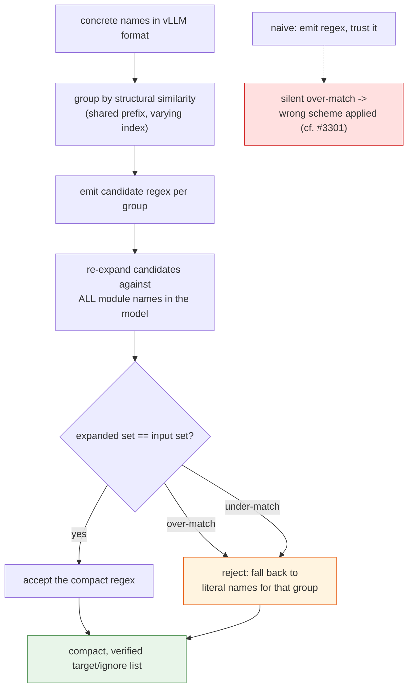
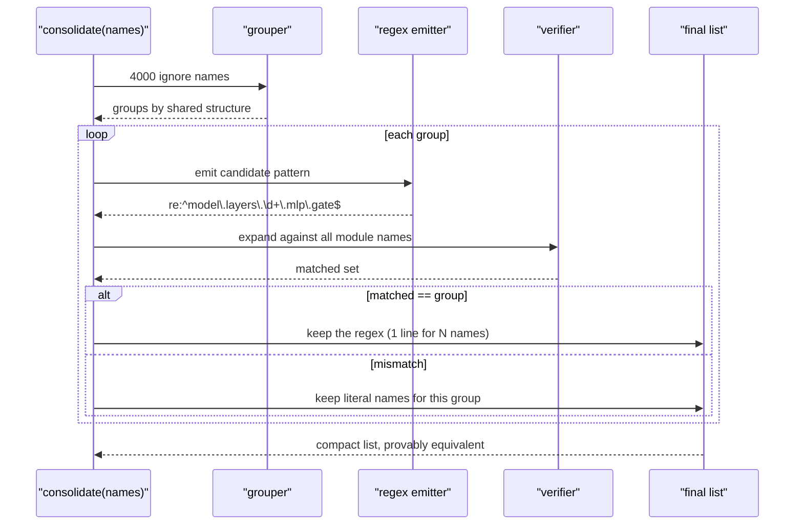

# #3468 — Plan

> Detailed explanation is in [3468-issue.md](3468-issue.md).

⚠️ **Check the assignment before anything else.** This issue is a one-line
mirror of
[compressed-tensors#1006](https://github.com/vllm-project/compressed-tensors/issues/1006),
which is **assigned to `GOavi101`**. The work, if any is available, is upstream.

**Step zero:** comment on compressed-tensors#1006 asking whether help is wanted
and on which piece. Per `CONTRIBUTING.md`, wait for a green light. Starting here
without that is the likeliest way to waste a week.

## Why a plan at all, then

Two reasons. The design has a genuine fork that is worth laying out before
anyone writes code, and **one sub-piece is separable, low-risk, and useful on
its own** — the consolidator. That is where a contributor could help without
colliding with the upstream owner.

## Approach comparison

| | A: convert then consolidate (proposed) | B: regex-to-regex mapping (alternative) |
|---|---|---|
| Where conversion happens | At save, in compressed-tensors | At load, in vLLM |
| Config contents | vLLM names | framework-neutral regexes |
| Needs regex-aware mappers | No | **Yes** — the hard part |
| Needs a vLLM change | No | Yes |
| Survives vLLM renames | **No** | Yes |
| Repos touched | 1–2 | 3 |
| Author's stance | proposed | *"Another solution is, if we can find a reliable way..."* |

A is implementable now; B is more correct and much larger. The author put A
forward while naming B, which reads as "A unless someone can make B work".

**This choice is not a contributor's to make.** It commits the project to either
baking another project's naming into saved artifacts (A) or to a cross-repo
change (B). Get it decided upstream.

## The separable piece: the consolidator

Step 4 of the proposed design — *"Consolidate lists of names into a list of
regexes which is much smaller"* — is a **pure function**:

```python
def consolidate(names: list[str]) -> list[str]:
    """Collapse concrete module names into a smaller equivalent regex list."""
```

Properties that make it a good standalone contribution:

- No framework dependency. Strings in, strings out.
- Trivially testable, CPU-only, no model, no GPU.
- Independently valuable — it would shrink today's thousands-line ignore lists
  even without the conversion pipeline.
- Does not touch the A-vs-B decision, so it is useful either way.

### The correctness bar it must meet

> A consolidated regex must match **exactly** the input names — no more, no
> fewer.

The author accepts imperfection (*"a naive approach will catch 95 % of all use
cases"*), but **a silent over-match is a wrong-quantization bug**, structurally
identical to [#3301](3301-issue.md), where an over-broad `\d+` swept up layers
belonging to a different config group. There, an expert assigned 8-bit silently
got 4-bit.

So the consolidator should be **verified, not merely plausible**:

1. Consolidate the name list into candidate regexes.
2. **Re-expand** the regexes against the full set of module names in the model.
3. Assert the result equals the input set exactly.
4. If it does not, fall back to literal names for the offending subset.

That makes "95 % of cases" a *compaction* rate rather than a *correctness* rate —
the remaining 5 % stay verbose but stay correct. Given the config drives which
weights get quantized, that trade is clearly the right one.

### Flow



### Verification sequence



### Tests

All CPU, no model needed beyond a list of names:

| Test | Asserts |
|---|---|
| `test_round_trip_equivalence` | For every input set, re-expanding the output matches it exactly. The core property. |
| `test_contiguous_indices_collapse` | `layers.0..39.mlp.gate` → one `\d+` pattern |
| `test_gap_in_indices_not_over_matched` | Layers 0–5 and 7–9 (missing 6) must **not** emit a bare `\d+` that includes 6 |
| `test_regex_metacharacters_escaped` | Names containing `.` are escaped, so `a.b` does not match `axb` |
| `test_falls_back_on_unsafe_group` | An unconsolidatable group stays literal rather than over-matching |
| `test_compaction_ratio` | A realistic 4000-name MoE ignore list shrinks by an order of magnitude |
| `test_empty_and_single` | Degenerate inputs |

`test_gap_in_indices_not_over_matched` is the one that matters. A missing index
is exactly how an ignored module silently becomes quantized, and contiguity is
the assumption a naive implementation makes without noticing.

## If you take the whole thing

Only after the upstream owner confirms. Then, in order:

1. Agree A vs B upstream, in writing on the issue.
2. Build and land the consolidator standalone, with the round-trip check.
3. Wire the conversion chain: state dict names → checkpoint (weight converter) →
   vLLM (`hf_to_vllm_mapper`).
4. Decide how `hf_to_vllm_mapper` is kept in sync. The issue says it *"will need
   to be regularly copied from vLLM repo"* — a copied file that silently drifts
   is a maintenance hazard worth naming explicitly, ideally with a CI check.
5. Apply to targets as well as ignores.
6. Verify in vLLM that regex targets really do skip conversion on the pinned
   version, not just the linked commit.

## Risks

| Risk | Note |
|---|---|
| Duplicating `GOavi101`'s work | Ask first; this is the main risk |
| Silent regex over-match | Round-trip verification + literal fallback |
| Index gaps assumed contiguous | Dedicated test |
| Copied `hf_to_vllm_mapper` drifts | CI check or a pinned-version assertion |
| vLLM renames break historic configs | Inherent to A; a maintainer decision |
| Scope creep into vLLM | Keep the consolidator independent so it lands regardless |

## Effort

- Consolidator alone: small-to-moderate, high confidence, genuinely useful.
- Full pipeline: large, cross-repo, design-blocked, and already owned.

**Recommendation:** of the seven unassigned issues, this is the one to leave
alone unless you hear back from the upstream owner. If you want to contribute
something here anyway, offer the verified consolidator as a standalone
compressed-tensors PR.
