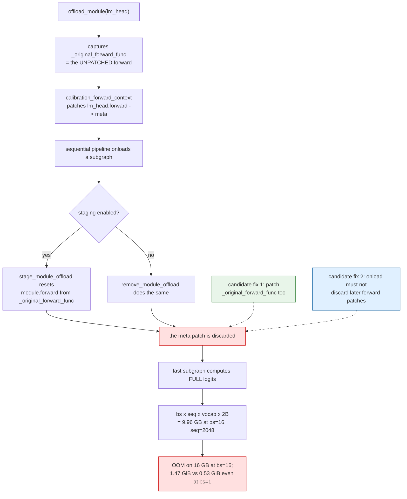
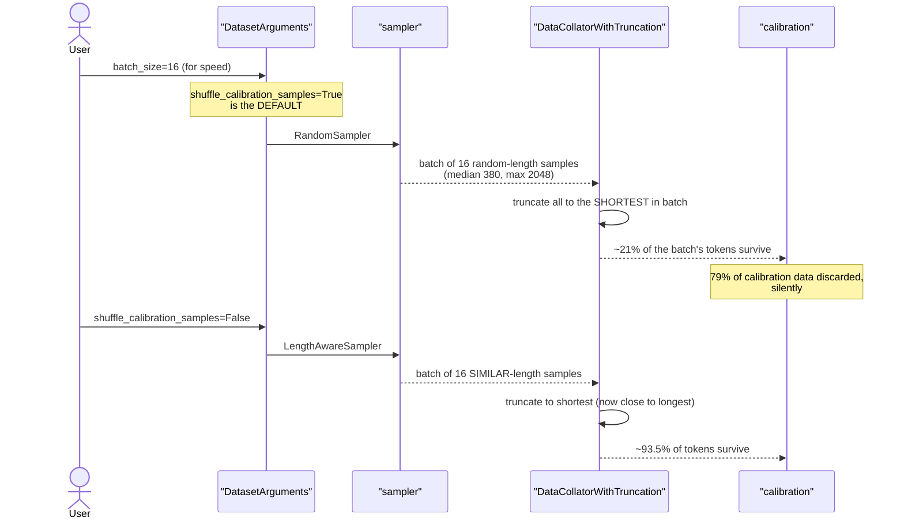

# #3479 — Automatic batch size selection and better data collators

> Issue explained in detail. The plan is in [3479-plan.md](3479-plan.md).

- **Issue:** [vllm-project/llm-compressor#3479](https://github.com/vllm-project/llm-compressor/issues/3479)
- **Labels:** `enhancement`, `good follow-up issue`, `RFC`, `perf`
- **Assignee:** none · **Open PR:** none
- **Interested contributor:** `jontb` (posted measurements 2026-11-07, not assigned)
- **Type:** RFC — the maintainer is asking for feedback and answers, not just code

## What is being asked

Two linked goals:

1. **Better batching defaults** to improve calibration throughput.
2. **`batch_size="auto"`**, using the memory statistics from
   [#3271](https://github.com/vllm-project/llm-compressor/pull/3271) (automatic
   subgraph-size selection) to pick a batch size after memory profiling.

Plus support for
[`DataCollatorWithFlattening`](https://huggingface.co/docs/transformers/main_classes/data_collator#transformers.DataCollatorWithFlattening),
and scoping where it does not work.

This is explicitly an RFC: *"Looking for feedback on this approach, answers to
the proposed questions, interest in contributing this feature."*

## The collator problem

Today's default is `DataCollatorWithTruncation`, which truncates every sample in
a batch to the **shortest** one. The larger the batch, the more tokens are
thrown away. The alternative, `DataCollatorWithPadding`, pads to the longest —
wasteful in compute, and it needs pad-token masking support across every
algorithm that calibrates on tokens.

Serving engines sidestep this with continuous batching, flattening all tokens
into one sequence. `DataCollatorWithFlattening` does the same for training-style
inputs, but the issue lists real obstacles:

- **Multimodal inputs** need a policy for non-tokenized vision tokens.
- **Ragged batching** without materializing the attention mask appears to work
  only with the transformers `flash_attention` backend, which not every model
  supports.
- **Sequences spanning batches** would need a persistent KV cache, which is out
  of scope — so over-long sequences must be truncated instead.

## The measurements that reframe the problem

`jontb` ran this on Qwen3-0.6B, GPTQ W4A16, RTX 5060 Ti 16 GB, with the examples'
own calibration data (`perfectblend` `train[:512]`, `max_seq_length=2048` →
512 samples, 257,210 tokens, median length 380).

**Share of calibration tokens surviving `DataCollatorWithTruncation`:**

| batch size | 2 | 4 | 8 | 16 | 64 |
|---|---|---|---|---|---|
| `shuffle_calibration_samples=True` (**the default**) | 59 % | 39 % | 28 % | 21 % | 10 % |
| `False` (`LengthAwareSampler`) | 99.6 % | 98.8 % | 97.1 % | 93.5 % | 77.9 % |

**This is the key finding: the loss comes mostly from the sampler, not the
collator.** At batch size 16 the default shuffled sampler keeps 21 % of tokens;
length-aware sampling keeps 93.5 %. A user who raises `batch_size` for speed
today silently discards four fifths of their calibration data.

With padding instead, sorted batches waste 2.8 % of positions at bs=8 and 22 %
at bs=64, while shuffled batches waste 66–74 % at bs≥16 — the same conclusion
from the other direction.

Hence their inference, which is the single most useful design input on the
thread:

> So `batch_size="auto"` should probably imply length-aware sampling or
> flattening.

Raising batch size without fixing sampling would make calibration *worse* while
appearing faster.

## A separable regression found along the way

While investigating, `jontb` found a bug that is **independently valuable and
much easier to fix than the RFC**:

> **`disable_lm_head` has no effect in the sequential pipeline.** When the
> pipeline onloads a subgraph, compressed-tensors resets `module.forward` from
> `_original_forward_func`. This happens in `stage_module_offload` and, with
> staging off, in `remove_module_offload`. `offload_module` captured that
> function before `calibration_forward_context` patched `lm_head.forward`, so
> the patch is lost, and the last subgraph computes full logits in both its
> calibration and its propagation pass.

The cost:

| | |
|---|---|
| **Wasted memory** | logits are `bs × seq × vocab × 2 B` = **9.96 GB** for a 16 × 2048 batch at Qwen3's 151,936 vocab |
| **Symptom** | length-sorted bs=16 OOMs in the last subgraph on 16 GB |
| **Even at bs=1** | peaks at 1.47 GiB instead of 0.53 GiB |

Evidence given: a forward hook on `lm_head` sees CUDA (not meta) outputs on
every call, and watching `lm_head.__setattr__` traces the reset to
`compressed_tensors/offload/module.py:87` (`:103` with staging off).

**Scope:** reproduces with an untied `lm_head` on a tiny random Llama, on
llmcompressor 0.15.0 + compressed-tensors 0.20.1. Returns meta on 0.14.0 +
compressed-tensors 0.19.0 — so it is a **regression between 0.14 and 0.15**,
plausibly from the subgraph onload/staging in
[#3221](https://github.com/vllm-project/llm-compressor/pull/3221), though not
bisected.

Two candidate fixes, both offered:

1. In `disable_lm_head`, also patch `lm_head._original_forward_func` with the
   meta forward. Verified: gives meta outputs on every call, and post-`oneshot`
   logits are bit-identical to unpatched runs on both models.
2. Fix it in compressed-tensors so onload does not discard forward patches
   applied after offload — *"may be cleaner; your call"*.

This regression blocks the RFC's own goal (you cannot raise batch size if the
last subgraph materializes 10 GB of logits), but it stands on its own as a
memory bug affecting every sequential run.

## Mechanism of the regression

## Token loss mechanism

## Open questions from the issue

Still unanswered, and the RFC explicitly asks for answers:

1. How should available GPU memory be split between larger batches and larger
   subgraphs?
2. Can #3271's memory estimation pick a batch size, or is runtime profiling
   needed?
3. Are there algorithms whose calibration statistics depend on sequence
   boundaries or batch composition, making flattening unsafe?
4. Where does `DataCollatorWithFlattening` actually work?
5. Does transformers allow ragged attention for mamba / non-standard attention
   layers without materializing the mask?

Question 3 is the one with a known complication: masking-aware algorithms
(AWQ today, more via [#3340](https://github.com/vllm-project/llm-compressor/issues/3340))
read `state.loss_masks` indexed per batch. Flattening changes what "a batch" is,
so the mask plumbing and flattening interact and should be designed together.
