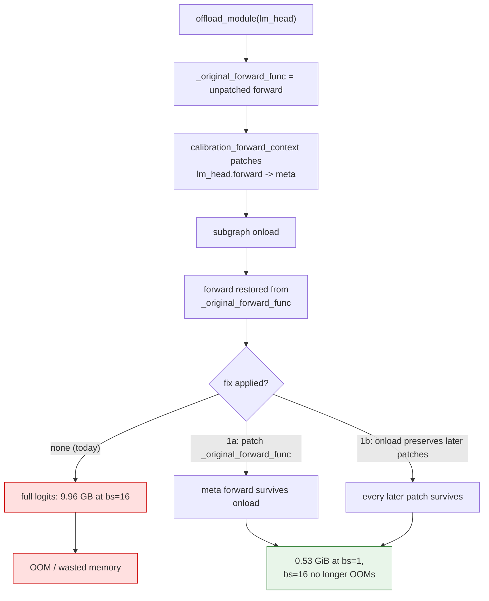
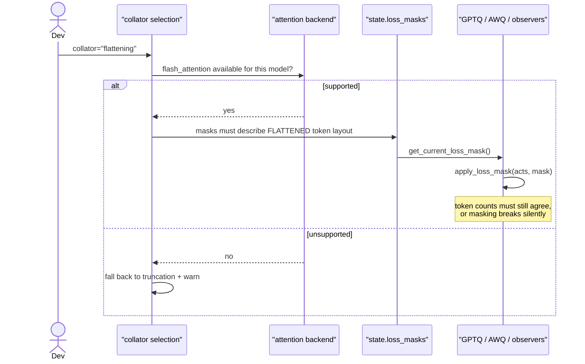

# #3479 — Plan

> Detailed explanation is in [3479-issue.md](3479-issue.md).

**Recommendation: do not attempt this as one piece of work.** It is an RFC with
five unanswered design questions, and `jontb`'s measurements have already
reshaped the problem. Split it into four PRs that each stand alone, ordered so
every one is useful even if the later ones never happen.

## Suggested decomposition

| # | PR | Depends on | Value if nothing else lands |
|---|---|---|---|
| 1 | Fix the `disable_lm_head` regression | nothing | **Large** — a 9.96 GB memory bug on every sequential run |
| 2 | Document / warn about truncation loss | nothing | Large — users stop silently discarding 79 % of tokens |
| 3 | `DataCollatorWithFlattening` support, scoped | 1, 2 | Moderate |
| 4 | `batch_size="auto"` | 1, 3 | Moderate — the RFC's headline ask |

PR 1 is a bug fix hiding in an RFC thread. It should not wait on the RFC.

## PR 1 — the `disable_lm_head` regression (start here)

A regression between 0.14 and 0.15: the sequential pipeline's subgraph onload
resets `module.forward` from `_original_forward_func`, which was captured
*before* `calibration_forward_context` patched `lm_head.forward`. The meta patch
is lost and the last subgraph materializes full logits.

### Two candidate fixes

**1a — patch `_original_forward_func` too** (in llm-compressor):

```python
# In disable_lm_head: the sequential pipeline's subgraph onload restores
# `module.forward` from `_original_forward_func`, which was captured before this
# patch was applied. Patch both so the meta forward survives an onload.
```

`jontb` verified this: meta outputs on every call, and post-`oneshot` logits
bit-identical to unpatched runs on two models.

**1b — fix it in compressed-tensors** so onload does not discard forward patches
applied after offload.

| | 1a | 1b |
|---|---|---|
| Repo | llm-compressor | compressed-tensors + version pin |
| Fixes the class | No — `lm_head` only | Yes — any later forward patch |
| Risk | Low | Medium: other code may rely on the restore |
| Verified | Yes, by the reporter | No |

The reporter deferred: *"may be cleaner; your call"*. **Ask the maintainers.**
Note that other forward patches applied inside
`calibration_forward_context` are presumably affected the same way, which
argues 1b is the real fix and 1a is the safe one.

### Flow



### Tests

| Test | Asserts |
|---|---|
| `test_lm_head_meta_after_subgraph_onload` | A forward hook on `lm_head` sees **meta** outputs on every call during sequential calibration. **Fails on `main`.** |
| `test_lm_head_meta_with_staging_disabled` | Same with staging off (the `remove_module_offload` path) |
| `test_untied_lm_head` | Reproduces with an untied head, per the report |
| `test_logits_bit_identical_after_oneshot` | Post-`oneshot` logits match an unpatched run exactly — proves the patch changes memory, not results |
| `test_peak_memory_reduced` | Peak allocation materially lower on a tiny model; guards the actual regression |

The first test is the regression guard and needs only a tiny random Llama.

## PR 2 — surface the truncation loss

The measurements show the **default** configuration silently discards most
calibration tokens as batch size rises:

| batch size | 2 | 4 | 8 | 16 | 64 |
|---|---|---|---|---|---|
| shuffled (default) | 59 % | 39 % | 28 % | 21 % | 10 % |
| length-aware | 99.6 % | 98.8 % | 97.1 % | 93.5 % | 77.9 % |

A user raising `batch_size` for throughput gets faster, worse calibration with
no indication. There is already a warning when `shuffle` and `batch_size > 1`
are combined, recommending `batch_size=1`; this would sharpen it by **reporting
the realized token-retention fraction**.

Cheap, high value, no design questions:

1. Compute kept-vs-total tokens after collation.
2. Warn when retention falls below a threshold, naming
   `shuffle_calibration_samples=False` as the remedy.
3. Document the table in the dataset/calibration guide.

This is a strong standalone PR and an easy first contribution.

## PR 3 — `DataCollatorWithFlattening`

Only after 1 and 2. The issue's own obstacles define the scope, and each needs
an answer before code:

| Obstacle | What to establish |
|---|---|
| Multimodal inputs | Exclude non-tokenized vision workflows in v1 — the issue allows this |
| Ragged attention mask | Which attention backends support it; gate on `flash_attention` availability |
| Sequences spanning batches | Out of scope — truncate instead, per the issue |
| **Mask-aware algorithms** | `state.loss_masks` is indexed **per batch**; flattening redefines a batch |

That last row is not in the issue and matters: AWQ reads
`state.loss_masks[batch_idx]`, and [#3340](https://github.com/vllm-project/llm-compressor/issues/3340)
is extending that to GPTQ, iMatrix, REAP and activation observers. Flattening
changes the token layout those masks describe. **Design the flattening and the
mask plumbing together, or flattening will silently break masking** — the
sharper form of the issue's open question 3.

### Sequence



## PR 4 — `batch_size="auto"`

The headline ask, and the most uncertain. Two blockers:

**It must imply length-aware sampling or flattening.** `jontb`'s conclusion, and
the data is unambiguous: auto-raising batch size under the default shuffled
sampler would trade calibration quality for speed without telling anyone. So
`batch_size="auto"` should either force `shuffle_calibration_samples=False` or
require a flattening collator — and say which it did.

**The memory split is unanswered.** Open question 1 — batch size versus subgraph
size — has no answer on the thread. #3271 profiles memory for subgraph
selection; whether that estimate transfers to batch size, or needs runtime
profiling, is open question 2.

Do not guess. Post a proposal on the RFC and get a maintainer's view before
implementing. A plausible shape:

1. Reuse #3271's profiling to get free memory after the largest subgraph.
2. Estimate per-sample activation cost from one profiled batch.
3. Choose the largest batch size fitting a safety margin, capped.
4. Log the chosen size, the estimate it came from, and the sampling mode it
   implied.

Step 4 matters most: an automatic choice a user cannot inspect is hard to trust
or debug.

## Answering the RFC

The highest-value contribution here may not be code at all. The issue asks for
answers, and three are now partly available from `jontb`'s work:

| Question | What can be said |
|---|---|
| 1. Memory split batch vs subgraph | Open — needs maintainer input |
| 2. Can #3271's estimates pick a batch size? | Open |
| 3. Algorithms unsafe under flattening? | **Partly answered:** mask-aware ones (AWQ now, four more via #3340) depend on per-batch mask indexing |
| 4. Where does flattening work? | Needs the backend survey in PR 3 |
| 5. Ragged attention for mamba etc.? | Open |

Posting the truncation table, the regression, and the masking interaction as an
RFC reply is cheap and moves the issue further than a speculative PR would.

## Effort

- PR 1: small, verified fix — **do this one**
- PR 2: small
- PR 3: moderate, blocked on design answers
- PR 4: large, blocked on PR 3 and two open questions

`jontb` has done the measurement work and is interested but unassigned. Comment
on the issue before starting, and coordinate — duplicating their work here would
be a waste of unusually good analysis.
